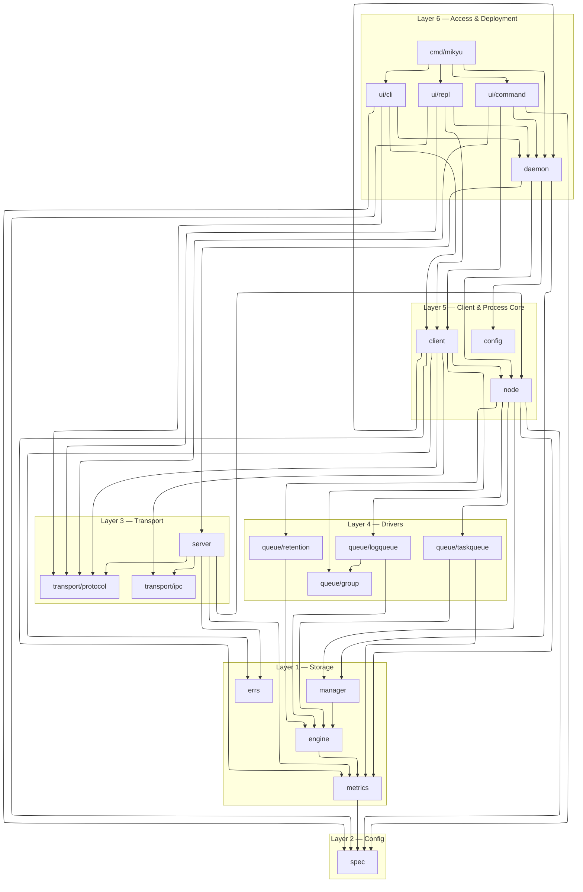
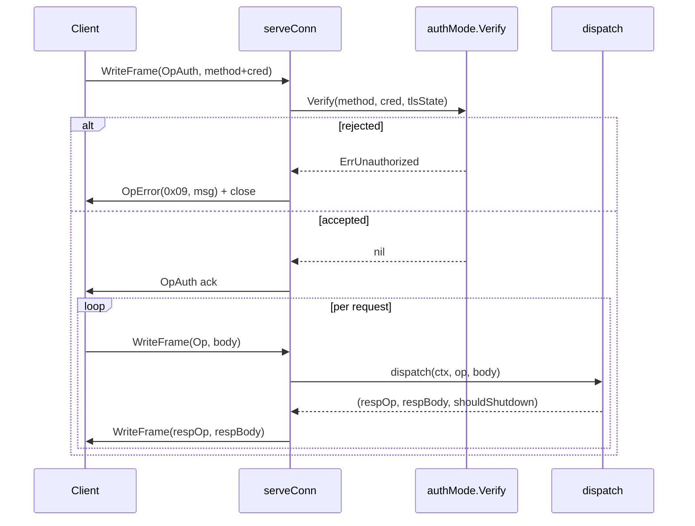
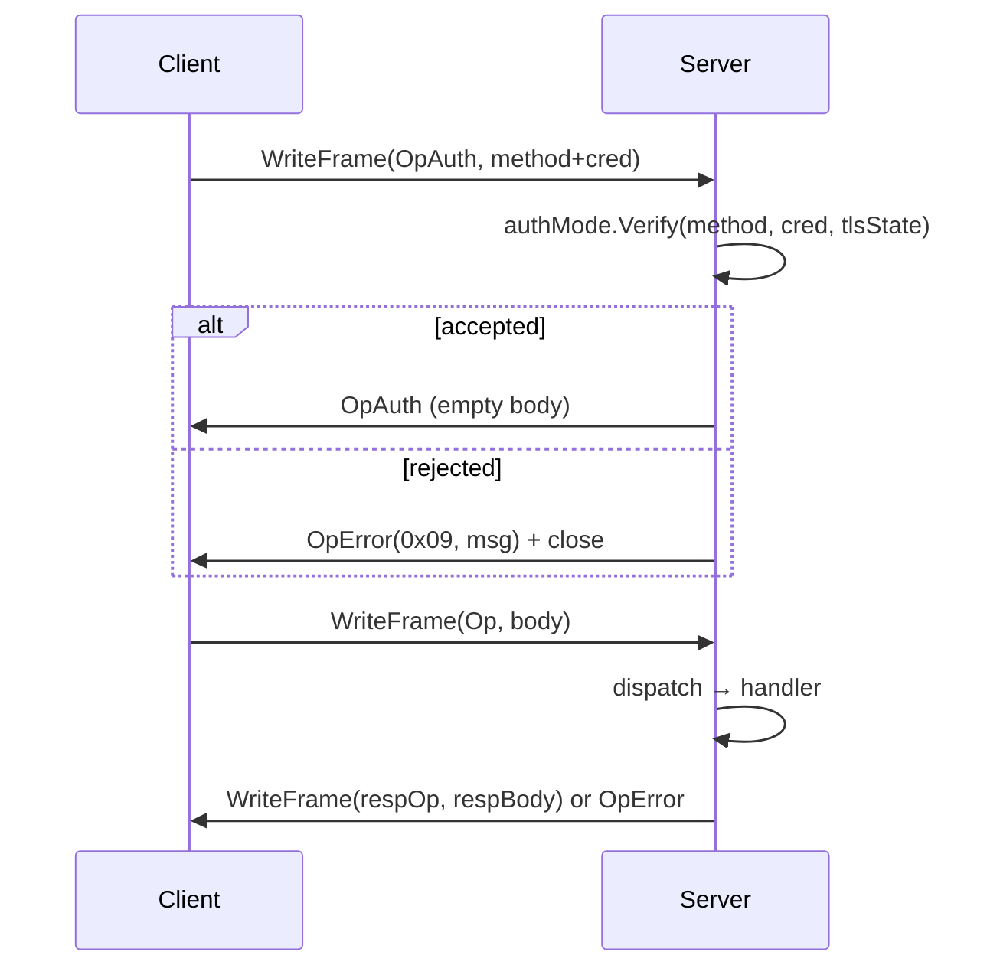

# Mikyu — Architecture & Implementation Specification

## 1. What Mikyu Is

**mikyu** is a high-performance, log-structured message queue written from scratch in Go. It presents **two structurally distinct queue kinds over one shared storage engine**:

- **Log queues** (`log/<name>`) — append-only streams with consumer-group offsets, replay, streaming, tailing, keyed compaction, per-queue retention.
- **Task queues** (`task/<name>`) — at-least-once delivery with visibility leases, exponential backoff, scheduling, stale-lease protection, a durable per-queue DLQ, an optional archive log, chunked checkpoint recovery, and per-queue in-flight/DLQ bounds.

A queue's **kind is structural**: it is the name of its parent directory under the data root. `log/events` and `task/events` are two different queues that share nothing but a filesystem tree.

### Core Guarantees

- **Durable-before-ack** by default (`durability: sync`): `Append`/`AppendBatch` block until the WAL flusher has `fsync`'d the record bytes and index entry. The returned offset is crash-safe.
- **Optional async loss window** (`durability: async`): publishes to the ring cache and `publishedOffset` immediately, flushes in the background without `fsync` per batch.
- **Zero-copy reads** on closed segments (`mmap` read-only); a `Read` on a closed segment returns a sub-slice of mapped memory with no heap allocation.
- **Byte-budgeted ring cache** (~10 ns/op tail reads) sized from `max_cache`.
- **Long-poll tailing** via `Fetch` blocking on the queue's `notify` channel.
- **Keyed compaction (log queues only)**: records carry an optional `Group`; when `compaction: keys`, `roll()` rewrites closed segments dropping superseded group versions.
- **Chunked, self-describing task checkpoints** (`recordCPStart/Chunk/Commit`); newest valid commit wins on recovery, corrupt ones skipped.
- **Archive log for tasks**: moves in-flight or dead-lettered tasks into `<queue>-archive`, a log queue created lazily.
- **Single source of truth for configuration**: `spec.Table` (`internal/spec/table.go`) holds every parameter with canonical key, path, kind, layer, scope, mutability, env name, flag name, option name, and a `Doc` string.
- **One sentinel→wire-code taxonomy**: `internal/errs/errs.go`.
- **Live telemetry under one surface**: `internal/metrics` — `Collector` over a `Registry` of atomic instruments, materializing `Snapshot`s for the wire, CLI/REPL, and the daemon's Prometheus/JSON/SSE HTTP endpoints.
- **Enforced architecture**: `.go-arch-lint.yml`; `internal/audit` gates legacy names and comment style.
- **Auth is one handshake per connection**: `OpAuth` on first frame; `none`, `none-insecure`, `token`, `mtls` modes; unauthenticated non-loopback daemon refuses to start.

### Four Roles, One Binary

| Role | Entry | Description |
|---|---|---|
| Embedded engine | `mikyu.Open(dir, opts...)` | In-process `node.Node`, no network, ref-counted per data dir. |
| Remote client | `mikyu.Dial(target, opts...)` | Pooled TCP / Unix / Named-Pipe wire client. |
| Daemon | `mikyu daemon` | Long-lived server over TCP, Unix socket, or Windows named pipe. |
| CLI / REPL | `mikyu <cmd>`, `mikyu shell` | Stateless one-shot CLI and styled interactive REPL. |

---

## 2. Architectural Principles

1. **Layer purity** — enforced by `.go-arch-lint.yml`. `spec`, `protocol`, `group` are bottoms; `metrics → spec`; `enginetest` is a test-only adapter over `engine`. `engine → metrics`. `manager → engine, metrics`. `logqueue → engine, group`. `taskqueue, retention → engine, metrics`. `node → spec, engine, manager, metrics, logqueue, taskqueue, retention`. `client → spec, engine, node, group, logqueue, taskqueue, ipc, protocol, metrics, daemon, errs`. `server → spec, engine, node, logqueue, taskqueue, ipc, protocol, metrics, errs`. `client` and `server` never import each other.
2. **One storage engine, two structural kinds.** `engine.Storage` is the only contract the drivers see. `manager.Manager` owns two `*engine.Manager` roots — `log/` and `task/`.
3. **Kind is structural.** `manager.GetOf(name, kind)` refuses to open a queue under the wrong kind (`manager.ErrWrongKind`).
4. **One configuration table.** `spec.Table` drives every surface (SDK, CLI, env, YAML, wire, storage). Each row carries a `Doc`.
5. **One observation surface.** `internal/metrics` is the only telemetry contract. No `Info`/`Stats`.
6. **One error taxonomy.** `internal/errs.Table` maps each Go sentinel to its wire code.
7. **Registry is a config artifact.** Per-queue specs live in `queues.json`. The filesystem is the source of truth for existence; missing directories purge entries, orphans are adopted.
8. **Data directory is a lock.** `node.Acquire` takes an exclusive `flock`/`LockFileEx` on `<dir>/mikyu.lock`. Two processes on the same dir fail fast with `ErrLocked`.
9. **Path escape is a compile-time concern.** File operations in `engine`, `manager`, `node` use `os.Root` scoped to the appropriate root.
10. **Refcount over teardown.** Embedded clients share one `node.Node` per absolute data directory.
11. **Errors are stable sentinels.** Wire codes map 1:1; messages are human text, never contracts.
12. **Auth is one handshake per connection.** Credentials declared once in `OpAuth`, verified once.

---

## 3. Repository Layout

```
github.com/dmunish/mikyu/
├── .go-arch-lint.yml
├── mikyu.go                    # SDK facade: Client, Open, Dial, type aliases, sentinels
├── options.go                  # Re-exported With* constructors
├── spec.go                     # Schema surface: Param, Kind, Layer, Scope, Schema, Lookup
├── typed.go                    # Typed[T] + Codec[T]
│
├── cmd/mikyu/main.go           # Single-binary entrypoint: run, exitCode
│
└── internal/
    ├── audit/                  # Source gates: TestNoLegacyNames, TestInternalCommentStyle
    ├── spec/                   # THE config schema
    │   ├── spec.go             # Spec, StorageSpec, FlushSpec, RetentionSpec, TaskSpec, Session, Builtin, Merge, Effective
    │   ├── table.go            # Table, Param, Kind, Layer, Scope, Mutability, Value, Parse, Encode/Decode
    │   ├── derive.go           # Resolve, FlushLinger, RecordOverhead
    │   ├── codec.go            # Duration, Encode/DecodeSpec(YAML), CheckSpecVersion, MaxSpecPayload
    │   ├── env.go              # ApplyEnv / ApplyEnvSession
    │   ├── errors.go           # ErrInvalidConfig, ErrImmutableField, ErrSpecTooLarge, ErrSpecTooNew
    │   ├── validate.go         # ValidateCreate/Update/Session
    │   └── enums.go            # Durability, Encryption, Compaction
    │
    ├── config/config.go        # mikyu.yaml loader, legacy-key/env rejection, bootstrap
    │
    ├── engine/                 # Storage engine
    │   ├── storage.go          # Storage interface
    │   ├── config.go           # Config, CompactionPolicy, sentinels
    │   ├── message.go          # Record
    │   ├── manager.go          # Manager, OpenManager, Create/Get/List/Delete/Collect/Close
    │   ├── queue.go            # Queue, openQueue, loadSegments, roll, Close, ApplyConfig
    │   ├── append.go           # Append, AppendBatch, AppendOption, WithGroup
    │   ├── read.go             # Read, ReadBatch, readFromSegment
    │   ├── fetch.go            # Fetch
    │   ├── offset_api.go       # LastOffset, Name, CommitOffset, Committed
    │   ├── compact.go          # MinOffset, Segments, FloorOlderThan, FloorForSize, TruncateBefore
    │   ├── wal.go              # wal, newWAL, syncLoop, flush, push/pushBatch/pushAsync, wait
    │   ├── segment.go          # segment, openSegment, enableMMap, recover, rebuild, destroy, Close
    │   ├── index.go            # rawIndexEntry, MarshalBinary, UnmarshalRawIndexEntry
    │   ├── encode.go           # encodeRecord, decodeRecord, record layout constants
    │   ├── cache.go            # ringCache, Put, Get, EvictBefore, Evict, SetMaxBytes
    │   ├── offsets.go          # OffsetStore
    │   ├── compaction.go       # buildKeyIndex, superseded, compactClosedLocked, compactSegmentLocked
    │   ├── metrics.go          # queueMetrics, walMetrics, Gauge* names, Manager.Collect
    │   ├── sync_{darwin,fdatasync,windows}.go
    │   ├── sync_dir{,_unix,_windows}.go
    │   └── encrypt_{linux,windows,other}.go
    │
    ├── metrics/                # THE telemetry model
    │   ├── instruments.go      # Counter, Gauge, Histogram, HistogramSnapshot, NewHistogram
    │   ├── registry.go         # Registry, Scope, NewRegistry, Counter/Gauge/Histogram accessors
    │   ├── snapshot.go         # Snapshot, RuntimeView, ProcessView, StorageView, QueueView, GroupView, Rates, TotalsView
    │   ├── history.go          # RingBuffer[T]
    │   ├── source.go           # Source, SourceFunc
    │   ├── collector.go        # Config, Collector, New, Start, Stop, Snapshot, History, Subscribe, build, mergeScopes, computeRates
    │   └── prometheus.go       # EncodeOptions, Encode
    │
    ├── enginetest/memstorage.go  # In-memory engine.Storage for synctest bubbles
    │
    ├── queue/
    │   ├── group/group.go      # Base: HighWater, Mark, Commit, Close, CommitFn
    │   ├── logqueue/
    │   │   ├── api.go          # Log interface
    │   │   ├── logqueue.go     # queue, New, Append/AppendBatch/Read/ReadBatch/Fetch, Group, CommitOffset
    │   │   ├── group.go        # Group interface, queueGroup
    │   │   ├── retention.go    # TruncateFloor, Truncate
    │   │   └── stream.go       # Stream, Tail (iter.Seq2), streamBatch, tailWait
    │   ├── taskqueue/
    │   │   ├── task.go         # Task, Ref, ID, EnqueueOption, NackOption, NewTaskFromWire, Resolve*
    │   │   ├── taskqueue.go    # queue, Defaults, ArchiveAppender, ArchiveLogFor, New, SetDefaults, Close, checkpointLoop
    │   │   ├── enqueue.go / dequeue.go / ack.go / nack.go / extend.go
    │   │   ├── dlq.go          # DeadLetters, AckDeadLetter
    │   │   ├── archive.go      # Archive, ArchivePrefix, encode/decodeArchiveEnvelope
    │   │   ├── lease.go        # resolveLeaseLocked, broadcastLocked, cloneTask
    │   │   ├── scheduler.go    # taskState, scheduleItem, scheduleHeap, pushScheduleLocked, pruneScheduleLocked
    │   │   ├── checkpoint.go   # checkpointLocked, loadCheckpointLocked, refreshLocked, encode/decode records
    │   │   ├── compaction.go   # TruncateFloor
    │   │   ├── metrics.go      # taskMetrics, newTaskMetrics, recordEnqueue/Dequeue/Stall
    │   │   └── id.go           # newID
    │   └── retention/coordinator.go # FloorProvider, Policy, Target, Coordinator, ReconcileAt/All, Start
    │
    ├── transport/
    │   ├── protocol/           # frames, bytes, opcodes, errors, auth, log, task
    │   └── ipc/ipc.go          # Listen, Dial, DialContext, Listener
    │
    ├── manager/                # Kind-partitioned data directory
    │   ├── kind.go             # Kind, Key, QueueInfo, ErrWrongKind
    │   └── manager.go          # Manager, Open, Get, GetOf, Create, Delete, List, Collect, Close
    │
    ├── node/                   # Process-wide shared local node
    │   ├── node.go             # Node, openNode, closeInternal, createQueue, Create*/LogQueue/TaskQueue, UpdateQueue, DescribeQueue, DeleteQueue, Truncate, ListQueues
    │   ├── kind.go             # Kind/QueueInfo aliases, ErrWrongKind alias
    │   ├── metrics.go          # MetricsConfig, AcquireOption, WithMetrics, MetricsFromSession, preregisterServerMetrics
    │   ├── pool.go             # ErrSessionDefaultsMismatch, Acquire, releaseFunc
    │   ├── registry.go         # ErrRegistryCorrupt, QueueEntry, registry, loadRegistry, saveRegistry, reconcileRegistry
    │   ├── lock.go / lock_unix.go / lock_windows.go
    │   ├── runtime_source.go / runtime_source_unix.go / runtime_source_windows.go
    │
    ├── server/                 # Wire server
    │   ├── server.go           # Server, New, WithAuth, WithTLS, WithMaxConnections, ListenAndServe, Serve, Stop, serveConn
    │   ├── dispatch.go         # dispatch
    │   ├── errors.go           # opErr, taskErr
    │   ├── auth.go             # authMode, NewAuthMode, Required, Verify
    │   ├── tls.go              # DefaultTLSConfig, generateSelfSignedCert
    │   ├── metrics.go          # serverMetrics, newServerMetrics, recordOp, opLabels
    │   ├── handlers_admin.go / handlers_log.go / handlers_minoffset.go / handlers_task.go
    │
    ├── client/                 # Embedded + remote clients
    │   ├── types.go            # QueueInfo, QueueDescription, Client interface
    │   ├── options.go          # SessionConfig, DefaultSessionConfig, Option, QueueOption, With*
    │   ├── errors.go           # ErrProtocol, ErrModeMismatch, ErrUnauthorized, decodeKnown/decodeProtocolError
    │   ├── embedded.go / embedded_queues.go
    │   ├── remote.go           # remoteClient, clientConn, NewRemote, acquire, dialConn, writeAuth, exchange
    │   ├── remote_logqueue.go  # remoteLogQueue, fetch, Stream, Tail, Group
    │   ├── remote_taskqueue.go # remoteTaskQueue, Dequeue, Enqueue, Ack, Nack, Extend, DLQ, Archive
    │   └── remote_group.go
    │
    ├── errs/errs.go            # Entry, Table, CodeFor, SentinelFor, NonWireSentinels
    │
    ├── daemon/
    │   ├── daemon.go           # ErrUsage, Run, resolveConfig, isLoopback, EnsureDaemonRunning, SendShutdownSignal
    │   ├── enum.go             # enumValue (flag.Value)
    │   ├── detach_{unix,windows}.go
    │   └── metrics_http.go     # metricsServer, startMetricsHTTP, /metrics, /api/metrics, /api/history, /api/events
    │
    └── ui/
        ├── command/            # admin.go, auth.go, client.go, flag.go, help.go, log.go, queue.go, task.go, verb.go
        ├── cli/cli.go + task.go
        ├── repl/repl.go + banner.go + confirm.go + style.go + task.go + vt_{other,windows}.go
        └── style/style.go
```

### Allowed Dependency Edges

```
spec, protocol, group, enginetest  → bottoms
errs                                        → spec, engine, manager, node, taskqueue, protocol
engine                                      → metrics
manager                                     → engine, metrics
ipc                                         → protocol
logqueue                                    → engine, group
taskqueue, retention                        → engine, metrics
node                                        → spec, engine, manager, logqueue, taskqueue, retention, metrics
client, server                              → spec, engine, node, logqueue, taskqueue, ipc, protocol, metrics, errs
config                                      → spec, manager
daemon                                      → spec, config, engine, manager, node, server, protocol, metrics
mikyu                                       → spec, client, engine, node, logqueue, taskqueue, metrics, protocol
command                                     → mikyu, client, daemon, spec
cli, repl                                   → mikyu, client, daemon, command, spec
cmd                                         → mikyu, daemon, cli, repl
```

### Layered Diagram



---

## 4. Public SDK — `mikyu` Package

**Files:** `mikyu.go`, `options.go`, `spec.go`, `typed.go`.

```go
type Client interface {
    io.Closer
    CreateLogQueue(ctx context.Context, name string, opts ...QueueOption) (LogQueue, error)
    CreateTaskQueue(ctx context.Context, name string, opts ...QueueOption) (TaskQueue, error)
    LogQueue(name string) (LogQueue, error)
    TaskQueue(name string) (TaskQueue, error)
    UpdateQueue(ctx context.Context, name string, opts ...QueueOption) error
    DescribeQueue(ctx context.Context, name string) (QueueDescription, error)
    DeleteQueue(ctx context.Context, name string) error
    ListQueues(ctx context.Context) ([]QueueInfo, error)
    Truncate(ctx context.Context, name string, minOffset uint64) (int64, error)
    Metrics(ctx context.Context) (Metrics, error)
    Schema(ctx context.Context) ([]Param, error)
    SubscribeSnapshots() (<-chan Metrics, func())
}

func Open(dir string, opts ...ClientOption) (Client, error)
func Dial(target string, opts ...ClientOption) (Client, error)
```

**Type aliases (facade):** `LogQueue = logqueue.Log`, `TaskQueue = client.TaskQueue`, `Record = engine.Record`, `Group = logqueue.Group`, `Task = taskqueue.Task`, `TaskRef = taskqueue.Ref`, `TaskID = taskqueue.ID`, `QueueKind = node.Kind`, `QueueInfo = node.QueueInfo`, `QueueDescription = client.QueueDescription`, `Metrics = metrics.Snapshot`, `Param/Kind/Layer/Scope/Session = spec.*`.

**Typed wrapper** (`typed.go`):

```go
type Codec[T any] struct {
    Marshal   func(T) ([]byte, error)
    Unmarshal func([]byte, *T) error
}
type Typed[T any] struct{ queue LogQueue; codec Codec[T] }
func NewTyped[T any](q LogQueue, codec Codec[T]) *Typed[T]
func (t *Typed[T]) Append(ctx context.Context, val T) (uint64, error)
func (t *Typed[T]) Read(ctx context.Context, offset uint64) (T, error)
```

**Schema surface** (`spec.go`):

```go
func Schema() []Param                // fresh copy of spec.Table
func Lookup(key string) (Param, bool)
func EncodeSpec(s Spec) ([]byte, error)
func EncodeSpecYAML(s Spec) ([]byte, error)
func DecodeSpec(data []byte) (Spec, error)
func DecodeSpecYAML(data []byte) (Spec, error)
func ValidateCreate(s Spec) error
func ValidateUpdate(patch Spec) error
func ValidateSession(s Session) error
func Builtin() Spec
func BuiltinSession() Session
```

---

## 5. Configuration & Schema — `internal/spec`

`spec.Table` is the canonical parameter list. Every row carries `Key`, `Path`, `Kind`, `Layer`, `Scope`, `Mutability`, `EnvName`, `FlagName`, `OptionName`, and `Doc`.

```go
type Param struct {
    Key        string     `json:"key"`
    Path       string     `json:"path"`
    Kind       Kind       `json:"kind"`
    Allowed    []string   `json:"allowed,omitempty"`
    Layer      Layer      `json:"layer"`
    Scope      Scope      `json:"scope"`
    Mutability Mutability `json:"mutability"`
    EnvName    string     `json:"env_name"`
    FlagName   string     `json:"flag_name"`
    OptionName string     `json:"option_name"`
    Doc        string     `json:"doc"`
    Apply        func(*Spec, Value)    `json:"-"`
    ApplySession func(*Session, Value) `json:"-"`
}
```

**Kinds:** `KindInt`, `KindUint32`, `KindDuration`, `KindBytes`, `KindBool`, `KindString`, `KindTime`, `KindEnum`.

**Layers:** `LayerCall`, `LayerSpec`, `LayerSession`. **Scopes:** `ScopeClient`, `ScopeServer`, `ScopeBoth`. **Mutability:** `MutMutable`, `MutCreateOnly`, `MutNotApplicable`.

**Spec types** (`spec.go`):

```go
type Spec struct {
    Storage   StorageSpec   `json:"storage,omitzero"`
    Flush     FlushSpec     `json:"flush,omitzero"`
    Retention RetentionSpec `json:"retention,omitzero"`
    Task      TaskSpec      `json:"task,omitzero"`
}
type StorageSpec struct {
    Durability, Encryption, Compaction *enum
    MaxSegment, MaxPayload, MaxCache   *int64
    MaxSegmentAge                      *Duration
}
type FlushSpec   struct{ MaxBytes *int64; MaxWait *Duration }
type RetentionSpec struct{ MaxAge *Duration; MaxBytes *int64 }
type TaskSpec    struct{ Lease *Duration; MaxAttempts, MaxInFlight, MaxDeadLetters *uint32 }
```

Every field is a pointer so `EncodeSpec` is sparse and presence-aware.

**Session types** (`spec.go`):

```go
type Session struct {
    Target, DataDir string
    MaxConnections  int
    TLS     TLSConfig
    Auth    AuthConfig
    Metrics MetricsConfig
}
type TLSConfig     struct{ Enabled bool; Cert, Key, ClientCA string }
type AuthConfig    struct{ Method, Token, TokenFile string }
type MetricsConfig struct{ Enabled bool; Interval Duration; History int; Listen string; PerQueuePrometheus, Histograms bool }
```

**Effective spec resolution** (`spec.go`): `effective = stored.Merge(session_defaults).Merge(spec.Builtin())`.

**Derived fields** (`derive.go`): `Resolve(s)` fills every nil field with the built-in default. `RecordOverhead = 36`. `FlushLinger(s) = max(0, MaxWait/8)`.

**Codec** (`codec.go`): `CurrentSpecVersion = 4`, `MaxSpecPayload = 1 MiB`. `Duration` accepts Go duration strings or int64 nanos; `EncodeSpec` omits unset fields; `DecodeSpec` uses `DisallowUnknownFields` + trailing-data rejection; `CheckSpecVersion` returns `ErrSpecTooNew`.

**Validation** (`validate.go`): positive-byte/duration/uint32 rules for storage, non-negative for retention, `max_payload ≤ max_segment − RecordOverhead`, `max_cache ≥ min(builtinMaxCache, max_segment)`. Session: `max_connections ≥ 1`, `metrics_interval > 0` when enabled, `metrics_history ≥ 1`, `metrics_listen` must parse as host:port, `auth_method ∈ {"", none, none-insecure, token, mtls}`, token mode needs token/file ≥ 16 bytes, `mtls` needs TLS.

**Built-in defaults** (`spec.go` → `Builtin()`):

| Key | Value |
|---|---|
| `storage.durability` / `encryption` / `compaction` | `sync` / `none` / `none` |
| `storage.max_segment` / `max_segment_age` / `max_payload` / `max_cache` | 64 MiB / 1h / 1 MiB / 32 MiB |
| `flush.max_bytes` / `max_wait` | 1 MiB / 10 ms |
| `retention.max_age` / `max_bytes` | `0` / `0` (unlimited) |
| `task.lease` / `max_attempts` / `max_in_flight` / `max_dead_letters` | 30 s / 5 / 100000 / 100000 |
| `server.target` / `max_connections` | `tcp://127.0.0.1:7420` / 10 |
| `server.data_dir` | *(unset in `BuiltinSession()`; `config.DefaultConfig()` supplies `./data`)* |
| `server.auth_method` / `tls_enabled` | `none` / `false` |
| `server.metrics_enabled` / `interval` / `history` / `histograms` | `true` / 1s / 300 / `true` |

**Env/flag/option naming**: `envName = "MIKYU_" + UPPER(key)`, `flagName = key` with `_→-`, `optionName = "With" + PascalCase(key)` (with `tls→TLS`, `ca→CA` initialisms).

---

## 6. Storage Engine — `internal/engine`

### `Storage` interface

```go
type Storage interface {
    Name() string
    Append(ctx, payload, ...AppendOption) (uint64, error)
    AppendBatch(ctx, payloads, ...AppendOption) ([]uint64, error)
    Read(ctx, offset) (Record, error)
    ReadBatch(ctx, start, n) ([]Record, error)
    Fetch(ctx, offset, maxCount, maxWait) ([]Record, error)
    LastOffset() uint64
    CommitOffset(ctx, group, offset) error
    Committed(ctx, group) (uint64, error)
    MaxAppendPayloadBytes() int64
    MinOffset() uint64
    Segments() []SegmentInfo
    TruncateBefore(ctx, offset) (int64, error)
    FloorOlderThan(ctx, olderThan) (uint64, error)
    FloorForSize(ctx, maxBytes) (uint64, error)
}
```

### `Record`

```go
type Record struct {
    Offset    uint64
    ID        string
    Timestamp time.Time
    Group     []byte   // compaction group; nil for unkeyed records
    Payload   []byte
}
```

### `Config`

```go
type Config struct {
    Durability       spec.Durability
    Encryption       spec.Encryption
    Compaction       spec.Compaction
    MaxSegment       int64
    MaxSegmentAge    time.Duration
    MaxPayload       int64
    MaxCache         int64
    MaxFlushBytes    int64
    MaxFlushWait     time.Duration
    FlushLinger      time.Duration
    CompactionPolicy CompactionPolicy
}
func (c Config) Async() bool            { return c.Durability == spec.DurabilityAsync }
func (c Config) KeyedCompaction() bool  { return c.Compaction == spec.CompactionKeys }
func (c Config) EncryptedStorage() bool { return c.Encryption == spec.EncryptionOS }
```

### `Manager` (per kind)

```go
type Manager struct { mu sync.RWMutex; dir string; root *os.Root; cfg Config; queues map[string]*Queue; offsets *OffsetStore; reg *metrics.Registry }
func OpenManager(dir string, cfg Config, perQueue map[string]Config, regs ...*metrics.Registry) (*Manager, error)
func (m *Manager) Create(name string, opts ...Config) (Storage, error)
func (m *Manager) Get(name string) (Storage, error)
func (m *Manager) List() []string
func (m *Manager) Delete(name string) error
func (m *Manager) Collect(_ context.Context, dst *metrics.Snapshot)
func (m *Manager) Close() error
```

Each `manager.Manager` opens one engine manager per kind root; `manager-offsets.dat` is per root so consumer groups on `log/events` and `task/events` are independent.

### `Queue`

```go
type Queue struct {
    name              string
    dir               string
    cfg               Config
    active            *segment
    segments          []*segment
    nextOffset        uint64
    minOffset         uint64
    publishedOffset   uint64
    w                 *wal
    offsets           *OffsetStore
    cache             *ringCache
    nextPreallocBytes int64
    closed            bool
    notify            chan struct{}
    keyIndex          map[string]uint64
    m                 *queueMetrics
    scope             *metrics.Scope
    mu                sync.RWMutex
}
```

`openQueue(parentDir, name, cfg, store, scopes...)` opens the queue directory through `os.Root` scoped to `parentDir`, so a hostile name cannot escape. All segment I/O uses the same mechanism.

### Append Path

`Append` delegates to `AppendBatch`. The batch path stages per-segment sub-batches so a WAL write never straddles a roll:

1. Validate `len(payload) ≤ MaxPayload`; encode with `uuid.NewV7()`; reject `recLen > MaxSegment` with `ErrRecordTooLarge`.
2. Stage into a per-segment `stagedBatch{w, seg, recs, positions, recLens, offsets, ids, totalLen, startIdx}`.
3. On roll or flush budget: commit through `commitSync` (which calls `wal.pushBatch`, unlocks, waits on `wal.wait(seq)`) or `commitAsync` (which calls `wal.pushAsync` and clones into the ring cache).
4. Final staged group committed after the loop; `broadcastLocked()` wakes parked readers.

### Read Path

1. `q.cache.Get(offset)` (byte-budget ring, O(1)).
2. `q.locateSegment(offset)` — `slices.BinarySearchFunc` over segment base offsets; `offset < minOffset` → `ErrOffsetTruncated`; `offset ≥ publishedOffset` → `ErrOffsetNotFound`.
3. `readFromSegment` — reads from `seg.mmapData` when mapped, else `seg.logFile.ReadAt`; `decodeRecord` validates CRC and length; a zeroed slot in a compactable queue returns `ErrRecordCompacted`.
4. `q.superseded(group, offset)` when compaction is on and the group has a newer offset → `ErrRecordCompacted`.

`ReadBatch` reuses the current segment between consecutive offsets and only falls back to `locateSegment` at boundaries; compacted offsets are skipped.

### Fetch

`Fetch(ctx, offset, maxCount, maxWait)`:
- `maxCount ≤ 0` → `nil, nil`.
- `offset < minOffset` → `ErrOffsetTruncated`.
- `offset < publishedOffset` → `ReadBatch`; if the window held only compacted records, advance past it; else `ErrNoData`.
- `maxWait ≤ 0` → `ErrNoData` immediately.
- otherwise parks on `ctx.Done()`, `notify`, or `timer.C`.

`broadcastLocked()` swaps `q.notify` for a fresh channel and closes the old one, waking every parked reader.

### Segment Rolling & Preallocation

`nextPreallocBytes` starts at `min(8 MiB, MaxSegment)` and adapts inside `roll()`:
- Filled in under 10 s → double, capped at `min(256 MiB, MaxSegment)`.
- Filled after 5 min → halve, floored at 8 MiB.
- Active segment truncated to written `pos` before `enableMMap`.

### Compaction

When `KeyedCompaction()` is true, `keyIndex map[string]uint64` maps each group to its newest offset; `buildKeyIndex` walks every record on open. After each `roll()`, `compactClosedLocked` rewrites each closed segment in place:

1. Walk index entries; drop records whose group has a newer offset.
2. Unmap, rewrite `.log` with kept records concatenated, zero dropped index slots.
3. `cache.Evict(evicted...)`.
4. `supersededLocked` is checked on every `Read` so a superseded record still in a mapping returns `ErrRecordCompacted`.

### WAL

```go
type wal struct {
    cfg Config; file *os.File
    mu sync.Mutex; cond *sync.Cond
    buf, swapBuf           []byte
    pending, swapPending   []pendingEntry
    pendingBytes           int64
    pushedBytes, publishedBytes int64
    asyncNext              uint64
    err                    error
    asyncChan              chan asyncEntry
    wake, configChanged    chan struct{}
    shutdown, done         chan struct{}
    stopOnce               sync.Once
    m                      *walMetrics
}
```

**Byte-based sequencing**: `push(rec, pos)` returns `(seq, wake, err)` where `seq = pushedBytes + len(rec)`. `wait(seq)` blocks until `publishedBytes ≥ seq` or `err != nil`.

**Sync path.** `push`/`pushBatch` stage bytes + pending entries under lock. `syncLoop` selects over `asyncChan`, `ticker.C` (`MaxFlushWait`), `wake`, `configChanged`, `shutdown`. `adaptiveFlush` sleeps `FlushLinger` before flushing when the batch is below `MaxFlushBytes`. `flush` swaps `buf ↔ swapBuf` and `pending ↔ swapPending`, drains the wake token under lock, calls `writeAt`, `syncData` if sync durability; broadcasts on `cond`.

**Async path.** `Queue.AppendBatch` publishes records onto `wal.asyncChan` and clones into the ring cache. `drainAndFlushAsync(first)` groups up to `MaxFlushBytes` entries, writes each record at its `pos`, writes the corresponding `.idx` entry, and advances `asyncNext` contiguously; the queue's own `publishedOffset` is bumped separately in `AppendBatch`'s `commitAsync`.

**Single writer.** `writeAt` is the only writer of the WAL segment file; `writerHook` (test hook) asserts the invariant.

**Wake-token correctness.** The `wake` channel has buffer 1 and is drained inside `flush()` under lock, preventing producer hangs when `adaptiveFlush` is mid-linger.

**Async backpressure**: `asyncChan` capacity = `MaxFlushBytes/4096` slots.

**Platform `syncData`:**
- Darwin: `unix.FcntlInt(fd, F_FULLFSYNC, 0)`, falling back to `file.Sync()`.
- Linux/BSD: `unix.Fdatasync(fd)`.
- Windows: `file.Sync()`.

### Segment

```go
type segment struct {
    baseOff uint64
    dir, logName, idxName string
    logFile, idxFile *os.File
    pos, preallocSize int64
    createdAt time.Time
    mmapData, idxMMap mmap.MMap
}
```

- `openSegment(dir, baseOff, preallocSize)` preallocates the `.log` if empty.
- `enableMMap()` maps both files read-only only if `Stat().Size() > 0` (Windows robustness).
- `recover()` tries `tryFastRecovery` (validates last index entry, copies raw entries); on failure `rebuild()` re-walks the `.log`, validates each CRC-checked record, rewrites `.idx`, truncates torn tails.
- `readIndexEntry(offset)` reads 16 bytes from `idxMMap` (closed) or `idxFile.ReadAt`.
- `lastTimestamp()` returns the newest record's timestamp (`FloorOlderThan`).
- `destroy()` unmaps, closes, unlinks both files through `os.Root`.
- `Close()` truncates the active `.log` to `pos`, unmaps, closes.

### Record Format

```
[4B Body Length][4B CRC32][2B ID Length=16][16B Raw UUID v7][8B Unix Nanos][2B Group Length][Group][Payload]
```

CRC-32/IEEE covers the body (`rec[8:]`). `decodeRecord` returns `(id string, ts time.Time, group, payload []byte, err error)`.

### Ring Cache

`ringCache` sized from `max_cache` (round up to power of two; floor 64 slots, cap 65536; average record size 256 B + 36 B overhead). `Put` evicts FIFO from `head` while `curBytes > maxBytes`. `Get` validates `msg.Offset == offset` and non-zero timestamp. `EvictBefore(minOffset)` and `Evict(offsets...)` adjust `curBytes`. `SetMaxBytes` moves the budget and evicts from head.

### Offset Store

One `manager-offsets.dat` per engine root persists `(queue:group) → uint64` as `[2B keyLen][key][8B offset]` tuples. `Commit` writes, flushes, `Sync`s, and every `compactAppendsThreshold = 5000` appends triggers `compactLocked`, which rewrites atomically via `os.Rename` from `manager-offsets.dat.tmp` and `syncDir(root)`.

### Retention Primitives

- `FloorOlderThan(ctx, olderThan)` walks **closed** segments oldest→newest; a segment qualifies only if its last record is strictly before `olderThan`. Active segment never included.
- `FloorForSize(ctx, maxBytes)` drops whole oldest closed segments while total size > `maxBytes`.
- `TruncateBefore(ctx, targetOffset)` unlinks closed segments with `nextOffset ≤ targetOffset`; stops at the first straddling segment; updates `minOffset`; calls `cache.EvictBefore`.

### Durability Sites

`SyncDirHook` fires at four sites: new segment file, offset-store compaction rename, `queues.json` rename, active-segment close-time truncation.

### Kernel Directory Encryption

| OS | Mechanism |
|---|---|
| Linux | `FS_IOC_SET_ENCRYPTION_POLICY` ioctl; `AES_256_XTS` contents, `AES_256_CTS` filenames; tolerates `ENOTTY`, `EOPNOTSUPP`, `EEXIST`. |
| Windows | `EncryptFileW` from `advapi32.dll` (NTFS EFS). |
| Other | Logs a warning and returns `nil`. |

---

## 7. Log Queue — `internal/queue/logqueue`

```go
type Log interface {
    Name() string
    Append(ctx, payload, opts ...AppendOption) (uint64, error)
    AppendBatch(ctx, payloads, opts ...AppendOption) ([]uint64, error)
    Read(ctx, offset) (engine.Record, error)
    ReadBatch(ctx, start, count) ([]engine.Record, error)
    LastOffset(ctx) (uint64, error)
    MinOffset(ctx) (uint64, error)
    Fetch(ctx, offset, maxCount, maxWait) ([]engine.Record, error)
    CommitOffset(ctx, group, offset) error
    Committed(ctx, group) (uint64, error)
    Truncate(ctx, minOffset) (int64, error)
    TruncateFloor(ctx) (uint64, bool, error)
    Stream(ctx, start) iter.Seq2[engine.Record, error]
    Tail(ctx, start) iter.Seq2[engine.Record, error]
    Group(name string) Group
}
type AppendOption func(*appendOptions)
func WithKey(k []byte) AppendOption
func ResolveAppendOptions(opts ...AppendOption) (key []byte)
```

Internally `queue{name, storage, mu sync.RWMutex, groups map[string]*queueGroup}`. `Append`/`AppendBatch` resolve the key and pass it to `engine.WithGroup`.

**Consumer group** (`group.go`):

```go
type Group interface {
    io.Closer
    Name() string
    Mark(offset uint64)
    Commit(ctx) error
    Committed(ctx) (uint64, error)
}
type queueGroup struct { group.Base; q *queue }
```

`group.Base` holds a `sync.Mutex`-guarded `HighWater uint64`, a `Closed` flag, and `CommitFn func(ctx, offset) error`. `Mark` advances to `offset+1` monotonically. `Commit` snapshots and persists. `Close` is idempotent and commits the final high water.

**Stream & Tail** (`stream.go`): `streamBatch = 1024`, `tailWait = 30s`. `Stream` uses `maxWait=0` (non-blocking drain). `Tail` blocks in `Fetch` per iteration; `ErrNoData` re-arms the wait.

**Retention** (`retention.go`): `TruncateFloor` returns `min(HighWater)` and a `constrained` flag. `Truncate(ctx, 0)` uses the driver's own floor when constrained; otherwise a no-op.

---

## 8. Task Queue — `internal/queue/taskqueue`

```go
type Queue interface {
    Name() string
    Enqueue(ctx, payload, opts ...EnqueueOption) (Task, error)
    Dequeue(ctx) (Task, error)
    TryDequeue(ctx) (Task, error)
    Ack(ctx, ref Ref) error
    Nack(ctx, ref Ref, opts ...NackOption) error
    Extend(ctx, ref Ref, timeout time.Duration) error
    DeadLetters(ctx) ([]Task, error)
    AckDeadLetter(ctx, ref Ref) error
    Archive(ctx, ref Ref) error
    SetDefaults(d Defaults)
    TruncateFloor(ctx) (uint64, bool, error)
}
func Close(q Queue) error
```

**State** (`taskqueue.go`):

```go
type queue struct {
    name string; storage engine.Storage
    mu sync.Mutex
    active            map[string]*taskState
    dlq               map[string]Task
    dlqUncheckpointed map[string]struct{}
    schedule          scheduleHeap
    sequence, scanNext uint64
    checkpointOffset  uint64
    dirty             uint64
    notify            chan struct{}
    stopCh            chan struct{}
    wg                sync.WaitGroup
    closing, closed   bool
    defaultLease  time.Duration; defaultMaxAttempts uint32
    maxInFlight, maxDeadLetters uint32
    archiveLog ArchiveLogFor
    m *taskMetrics
}
type Defaults struct { Lease time.Duration; MaxAttempts, MaxInFlight, MaxDeadLetters uint32 }
type ArchiveAppender interface{ Append(ctx, payload) (uint64, error) }
type ArchiveLogFor func(ctx, source string) (ArchiveAppender, error)
```

Lifecycle: `New` opens storage, `loadCheckpointLocked`, `scanNext = MinOffset()`, `refreshLocked` replays post-checkpoint records, starts `checkpointLoop` (5 s ticker). `Close` stops the loop, writes a final checkpoint if dirty, marks closed.

**Types** (`task.go`):

```go
type Task struct {
    ID, DeliveryID string
    Payload        []byte
    Attempts, MaxAttempts, Stalled uint32
    Lease, ScheduledAt time.Time
    Offset         uint64
    Key            []byte
}
type Ref interface{ taskRef(); taskID() string }
type ID string   // bare ID → skip strict lease check
```

Constants: `defaultLease=30s`, `defaultMaxAttempts=5`, `defaultRetryDelay=1s`, `defaultMaxRetryDelay=5min`, `defaultCheckpointInterval=5s`, `checkpointEvery=128`, `checkpointChunkBytes=64KiB`.

**Enqueue** appends `recordTask` under lock, installs a `taskState{task, nextAt: scheduledAt, lease: visibilityTimeout}`, pushes onto the schedule, sets `scanNext = offset+1`, `dirty++`, broadcasts.

**Dequeue** loops on `takeDueLocked(ctx, now)`:
1. Pop stale schedule entries.
2. If a due in-flight task is on its final attempt → dead-letter (`recordDLQ`), move to `dlq`, mark `dlqUncheckpointed`, broadcast, continue.
3. Otherwise assign a fresh `DeliveryID`, `inFlight=true`, `Attempts++`, `Lease=now+visibilityTimeout`, bump version, re-push, broadcast, return.

`TryDequeue` is a single non-blocking pass. Context cancellation returns `ctx.Err()`.

**Lease resolution** (`lease.go`):

```go
func (q *queue) resolveLeaseLocked(ref Ref) (*taskState, error)
```

- `nil` → `ErrInvalidTask`.
- Not in `active` → `ErrTaskNotFound`.
- Not `inFlight` → `ErrTaskNotInflight`.
- Visibility expired → `ErrTaskStale`.
- **Strict mode** (`ref` is `Task`): requires `Offset`, `Attempts`, non-empty `DeliveryID` to match exactly.
- **Loose mode** (`ref` is `TaskID`): skips strict comparison; visibility check still applies.

`broadcastLocked()` closes `q.notify` and allocates a fresh channel.

**Ack / Nack / Extend / DLQ / Archive:**
- **Ack** — `resolveLeaseLocked`, delete from `active`, `dirty++`, broadcast, prune schedule, `acks++`.
- **Nack** — `resolveLeaseLocked`; on `Attempts ≥ MaxAttempts` → dead-letter (with DLQ overflow drop of the oldest when `MaxDLQ` is exceeded); otherwise reset `inFlight`, clear `DeliveryID`, `nextAt = now + retryAfter`, bump version, re-push. Bumps `nacks` in both branches.
- **Extend** — extends `Lease` forward only; never increments `Attempts`.
- **DeadLetters** — returns an offset-sorted snapshot; **AckDeadLetter** verifies `Offset`/`Attempts` in strict mode, appends `recordDLQAck`, deletes, `dlq_acks++`.
- **Archive** — resolves against `active` first (strict), then `dlq`. Encodes an `archiveEnvelope`, appends to `<queue>-archive` (created lazily via `ArchiveLogFor`), removes from source. On failure, task stays put; returns `ErrArchiveFailed`.

**Scheduler** (`scheduler.go`): binary min-heap ordered by `(due, seq)`. `pushScheduleLocked` bumps `q.sequence`; `pruneScheduleLocked` rebuilds when `len(schedule) > len(active)*3 + 1024`.

**Checkpointing** (`checkpoint.go`): record kinds `recordTask=1`, `recordCPStart=2`, `recordCPChunk=3`, `recordCPCommit=4`, `recordDLQ=5`, `recordDLQAck=6`. `checkpointVersion=3`, `maxCheckpointChunks=1<<20`, `maxCheckpointBytes=512<<20`.

`checkpointLocked`:
1. `refreshLocked`.
2. Snapshot `active` (sorted by offset) + `dlq`.
3. Append `recordCPStart(coveredThrough)`.
4. Split snapshot into ≤ `min(MaxAppendPayloadBytes()-header, checkpointChunkBytes)` chunks; append `recordCPChunk(i, data)`.
5. Append `recordCPCommit(startOffset, totalChunks, coveredThrough)`.
6. Verify `commitOffset == startOffset + totalChunks + 1`; mismatch → `ErrCheckpointCorrupt`.
7. Clear `dlqUncheckpointed`, `dirty = 0`.

`loadCheckpointLocked` scans backward from `LastOffset()` for the newest valid commit; on failure tries an earlier one. `refreshLocked` walks `scanNext` forward; anything that isn't a task record kind is reported as `ErrCorruptRecord` naming the queue (this is how the task driver refuses to reinterpret a moved log directory).

**Archive envelope** (`archive.go`): `ArchivePrefix = "-archive"`. Fields: `sourceQueue(string) + key(string) + taskPayload(bytes) + attempts(u32) + stalled(u32) + deliveryID(string) + offset(u64) + archivedFrom(string) + timestamp(u64)`.

**Task metrics** (`metrics.go`): `enqueues`, `dequeues`, `acks`, `nacks`, `extends`, `dlq_acks`, `dlq_overflow`, `task_stalls`, `enqueue_duration`, `dequeue_wait`.

---

## 9. Cross-Driver Retention — `internal/queue/retention`

```go
type FloorProvider interface {
    TruncateFloor(ctx) (floor uint64, constrained bool, err error)
}
type Policy struct{ Age time.Duration; Bytes int64 }
type Target struct{ Name string; Storage engine.Storage; Driver FloorProvider; Policy Policy; mu sync.Mutex }
type Coordinator struct{ mu sync.RWMutex; targets map[string]*Target; interval time.Duration }

func NewCoordinator(interval time.Duration) *Coordinator
func (c *Coordinator) RegisterTarget(target *Target)
func (c *Coordinator) SetPolicy(name string, p Policy) (shrunk bool)
func (c *Coordinator) UnregisterTarget(name string)
func (c *Coordinator) ReconcileQueue(ctx, name) (int64, error)
func (c *Coordinator) ReconcileAt(ctx, name, requested uint64) (int64, error)
func (c *Coordinator) ReconcileAll(ctx) map[string]int64
func (c *Coordinator) Start(ctx)
```

`SetPolicy` returns `true` when a dimension that was unlimited becomes bounded, or a finite bound decreases. `ReconcileAt` computes `policyFloor` from `FloorOlderThan`/`FloorForSize`, at least `requested`, then clamps by `min(driver floors)`. Zero → no-op. Otherwise `storage.TruncateBefore(safeFloor)`. The node wires `SetPolicy` to `UpdateQueue`; a shrink triggers an out-of-band reconcile bounded by the node's retention context (5 minutes).

---

## 10. Transport — `internal/transport`

### Frames

```
+-----------------+-------------+----------------------+
| Length (uint32) | Opcode (u8) | Payload (Length-1)   |
+-----------------+-------------+----------------------+
```

`MaxFrameBytes = 256 MiB`. `WriteFrame` grabs a pooled `[]byte` (32 KiB seed), grows in-place while retaining the pointer, writes, returns to pool. `ReadFrame` validates length, allocates exactly `length-1` bytes, reads in one `io.ReadFull`. `ReadFrameInto` supports buffer reuse.

### Bytes

`Reader` provides bounds-checked `ReadU8/U16/U32/U64/Bytes`; `Buffer` provides symmetric writers. All integers big-endian.

### Opcodes

| Subsystem | Range | Ops |
|---|---|---|
| Admin | `0x0X` | Create(0x00), Delete(0x01), List(0x02), Update(0x03), Describe(0x04), Truncate(0x05), Metrics(0x07), Schema(0x08), Shutdown(0x0C) |
| Log | `0x1X` | Append(0x10), AppendBatch(0x11), Read(0x12), ReadBatch(0x13), LastOffset(0x14), MinOffset(0x15), Commit(0x16), Committed(0x17), Fetch(0x18) |
| Task | `0x2X` | Enqueue(0x20), Dequeue(0x21), Ack(0x22), Nack(0x23), Extend(0x24), Archive(0x25) |
| Dead-letter | `0x3X` | DeadLetters(0x30), DeadLetterAck(0x31) |
| Protocol | `0x7E` | Auth |
| Error | `0xFF` | Error |

Table is frozen; opcodes never reused. `ParseTarget` supports `tcp://`, `unix://`, `pipe://`, bare `host:port`.

### Error Codes

Blocked by subsystem nibble: `0x01–0x0F` admin, `0x11–0x1F` storage, `0x21–0x2F` task, `0x31–0x3F` dead-letter, `0x41–0x4F` server. `ErrCodeUnknown=0x01`, `QueueNotFound=0x02`, `QueueExists=0x03`, `InvalidConfig=0x04`, `ImmutableField=0x05`, `SpecTooNew=0x06`, `SpecTooLarge=0x07`, `Unauthorized=0x09`, `OffsetNotFound=0x11`, `OffsetTruncated=0x12`, `MessageTooLarge=0x13`, `QueueClosed=0x14`, `NoData=0x15`, `DiskFull=0x16`, `CorruptRecord=0x17`, `RecordTooLarge=0x18`, `RecordCompacted=0x19`, `TaskNotAvailable=0x21`, `TaskNotFound=0x22`, `TaskNotInflight=0x23`, `TaskStale=0x24`, `TaskInvalid=0x25`, `CheckpointCorrupt=0x26`, `QueueFull=0x27`, `DeadLetterNotFound=0x31`, `DeadLetterStale=0x32`, `ArchiveFailed=0x33`, `TooManyConnections=0x41`, `WrongKind=0x42`.

### Auth Frames

```go
const ( AuthMethodNone byte = 0; AuthMethodToken byte = 1; AuthMethodMTLS byte = 2 )
func EncodeAuth(b *Buffer, method byte, credential []byte)
func DecodeAuth(r *Reader) (byte, []byte, error)
```

`OpAuth` frame is `u8 method` + length-prefixed `credential`. First frame on every connection; server verifies and replies with an empty `OpAuth` frame, or `OpError(0x09, msg)` and closes.

### Log Wire

```go
type Record struct{ Offset uint64; ID string; Timestamp time.Time; Group, Payload []byte }
func WriteRecord / ReadRecord / WriteRecordList / ReadRecordList
func EncodeFetch(b, queue, start, maxCount, maxWait) / DecodeFetch
```

### Task Wire

```go
type Task struct{ ID, Payload, DeliveryID, Key []byte/string; Attempts, MaxAttempts, Stalled uint32; Lease, ScheduledAt time.Time; Offset uint64 }
const ( TaskRefModeTask byte = 0; TaskRefModeTaskID byte = 1
        NackModeInherit byte = 0; NackModeExplicit byte = 1 )
func EncodeTask / DecodeTask / EncodeTaskList / DecodeTaskList
func EncodeTaskDequeue / DecodeTaskDequeue
func EncodeTaskRef / DecodeTaskRef / WriteMode / ReadMode
```

`DecodeTask` rejects malformed payloads (`ErrInvalidTask`), including non-zero `Lease` without `DeliveryID` and `Attempts > MaxAttempts`. `EncodeTaskDequeue` clamps negative timeouts to 0.

### IPC

`Listen(target)` returns a `*Listener` wrapping Unix domain socket (stale file removal + `chmod 0600`) or Windows named pipe. `Listener.Close()` unlinks the Unix socket file. `DialContext` maps `pipe://` onto the `unix` network on POSIX.

---

## 11. Server — `internal/server`

```go
type Server struct {
    node *node.Node; listener net.Listener; tlsConfig *tls.Config
    maxConns int; slots chan struct{}
    mu sync.Mutex; stopCh, doneCh chan struct{}
    metrics *serverMetrics; auth *authMode
    connsMu sync.Mutex; conns map[net.Conn]struct{}
}
type ServerOption func(*Server)
func New(n *node.Node, opts ...ServerOption) *Server
func WithAuth(m *authMode) ServerOption
func WithTLS(tlsConfig *tls.Config) ServerOption
func WithMaxConnections(n int) ServerOption
func (s *Server) ListenAndServe(target string) error
func (s *Server) Serve(ln net.Listener) error
func (s *Server) Stop()
func (s *Server) Done() <-chan struct{}
```

### Connection Lifecycle



`serveConn` reads frames on a **single reader goroutine** feeding an unbuffered `reqCh`; the main goroutine dispatches each frame and writes the response. One frame of lookahead + natural backpressure; a dead reader cancels long-polling handlers via `cancel()`.

If the first frame is not `OpAuth` and the server requires auth, the connection is refused with `OpError(ErrCodeUnauthorized)`. Anonymous servers accept a non-`OpAuth` first frame for backwards compatibility.

### Handlers

- `handleCreate` reads `u8 kind, bytes(name), u16 specVersion, bytes(json)` and dispatches to `node.CreateLogQueue`/`CreateTaskQueue`.
- `handleFetch` clamps the client's wait at `maxFetchWait = 5 min`.
- `handleDequeue` caps the server-side long-poll at `maxDequeueWait = 5 min`; on context deadline with no task → `ErrCodeTaskNotAvailable`.
- `handleMinOffset` returns a bare `u64`.
- `handleSchema` returns `u16 specVersion + bytes(json []Param)`.
- `handleMetrics` returns `u16 specVersion + bytes(json Snapshot)`.

### Auth

```go
type authMode struct{ method byte; token []byte }
func NewAuthMode(sess spec.Session) (*authMode, error)
func (a *authMode) Required() bool
func (a *authMode) Verify(method byte, cred []byte, tlsState *tls.ConnectionState) error
```

| `auth_method` | Verifier | Notes |
|---|---|---|
| `""`, `none`, `none-insecure` | `AuthMethodNone` | Accepts any first frame. |
| `token` | `AuthMethodToken` | Reads `AuthTokenFile` when `AuthToken` is empty; token must be ≥ 16 bytes. |
| `mtls` | `AuthMethodMTLS` | Requires `tls_enabled` and a verified client chain. |

`Verify` uses `subtle.ConstantTimeCompare` for token mode.

### TLS

`DefaultTLSConfig(certFile, keyFile, clientCAFile)` loads a keypair or generates an ECDSA P-256 self-signed cert (`localhost`, `127.0.0.1`, `::1`, 1 year), always with `MinVersion: tls.VersionTLS13`. When `clientCAFile` is set, `ClientCAs` is populated and `ClientAuth = RequireAndVerifyClientCert`.

### Server Metrics

```go
type serverMetrics struct {
    connections *metrics.Gauge
    rejected    *metrics.Counter
    ops         map[byte]*metrics.Counter
    durations   map[byte]*metrics.Histogram
}
```

`newServerMetrics(scope)` creates one counter + one histogram per opcode in `opLabels`. `recordOp(op, start)` counts and observes every dispatched operation. The node **preregisters** every instrument before the collector ticks.

---

## 12. Node — `internal/node`

```go
type Node struct {
    mgr        *manager.Manager
    retention  *retention.Coordinator
    logQueues  map[string]logqueue.Log
    taskQueues map[string]taskqueue.Queue
    mu         sync.RWMutex

    retentionCtx    context.Context
    retentionCancel context.CancelFunc
    retentionWG     sync.WaitGroup
    reconcileWG     sync.WaitGroup
    closed          bool

    dir      string
    defaults spec.Spec
    registry *registry
    lock     *dirLock
    openedAt time.Time
    metrics  *metrics.Collector
}
```

**Lifecycle** (`openNode`):
1. `MkdirAll` the data directory.
2. Acquire the directory lock (`flock`/`LockFileEx`).
3. `loadRegistry(dir)` + `reconcileRegistry` against the filesystem.
4. Build per-queue engine configs from the effective spec, keyed by `manager.Key`.
5. `manager.Open` at the data directory.
6. `List` on-disk queues; reconcile the registry.
7. Build the metrics registry, collector, register the runtime source + the manager.
8. `preregisterServerMetrics`.
9. Start the retention loop and the collector.

`Acquire(dir, defaults, opts...)` in `pool.go` — ref-counted process pool keyed by absolute path. `ErrSessionDefaultsMismatch` for mismatched defaults; the release func is `sync.Once`-guarded.

**Queue operations:**
- **`CreateLogQueue`** — validate, refuse duplicates, create engine queue under `log/`, persist spec to `queues.json`, cache the driver, register retention target, set policy.
- **`CreateTaskQueue`** — same, under `task/`. Rejects `compaction=keys` with `spec.ErrInvalidConfig`. Wires `archiveLogFor()` and the per-queue metrics scope.
- **`UpdateQueue`** — validate, merge patch over stored, persist, apply mutable engine config, sync cached driver + retention target, push updated defaults into a live task queue, and launch a bounded immediate reconcile when the policy shrank.
- **`DescribeQueue`** — returns `{Name, Kind, Spec, Derived, Effective, Defaults}`.
- **`DeleteQueue`** — closes the task driver, drops cached handles, unregisters retention, removes the directory, updates the registry.
- **`Truncate`** — materializes the log driver, calls `retention.ReconcileAt(ctx, name, minOffset)`.
- **`LogQueue`/`TaskQueue`** — double-checked locking, cached handles, retention registered on first use.

**Archive wiring** (`archiveLogFor`): looks up `<source>-archive`; if log → wraps as `archiveAppender`; if task → `ErrWrongKind`; if absent → `CreateLogQueue` with empty spec.

**Registry** (`queues.json`):

```go
type QueueEntry struct{ Name string; Kind manager.Kind; Spec spec.Spec }
type registry  struct{ Version int; Queues map[string]QueueEntry }  // keyed by "kind/name"
```

`loadRegistry` uses `DisallowUnknownFields`; missing file → empty; corrupt → `ErrRegistryCorrupt`. `saveRegistry` writes atomically via temp + rename + `SyncDir`. `reconcileRegistry` purges missing entries, adopts orphan directories with the kind their path declares, rewrites cached kinds that disagree with the path.

**Lock** (`lock.go`): `acquireDirLock(dir)` opens `<dir>/mikyu.lock` and tries an exclusive non-blocking flock; contention → `ErrLocked`. `lock.release()` releases.

**Metrics config** (`metrics.go`):

```go
type MetricsConfig struct{ Enabled bool; Interval time.Duration; History int; Histograms bool }
type AcquireOption func(*MetricsConfig)
func WithMetrics(cfg MetricsConfig) AcquireOption
func MetricsFromSession(s spec.Session) MetricsConfig
func preregisterServerMetrics(reg *metrics.Registry)
func newRegistry(mc MetricsConfig) *metrics.Registry
func newCollector(reg *metrics.Registry, mc MetricsConfig, sources ...metrics.Source) *metrics.Collector
```

`Acquire` applies `WithMetrics` only when opening a **new** node; a second Acquire on the same dir reuses the existing collector.

**Runtime source** (`runtime_source.go`): `Collect` fills `Runtime` (goroutines, heap alloc/in-use, GC count, uptime) and `Process` from platform readers.
- Unix: `getrusage(RUSAGE_SELF)`; `Maxrss`, `Utime+Stime`.
- Windows: `GetProcessMemoryInfo` for working set; `GetProcessTimes` for kernel+user 100 ns ticks.

`cpuPercent` converts cumulative CPU into a percent against the process's own wall-clock delta; the first sample establishes the baseline and reports zero.

---

## 13. Client — `internal/client`

### Session Config

```go
type SessionConfig struct {
    Spec        spec.Spec
    Target, DataDir string
    MaxConnections  int
    TLSEnabled bool; TLSCert, TLSKey string
    AutoStart  bool
    AuthMethod, AuthToken, AuthTokenFile, TLSClientCA string
    MetricsEnabled bool; MetricsInterval time.Duration; MetricsHistory int
    MetricsListen string; MetricsPerQueuePrometheus, MetricsHistograms bool
    testFrameSent func(op byte)
}
type Option func(*SessionConfig)
type QueueOption func(*spec.Spec)
func DefaultSessionConfig() SessionConfig
func (c SessionConfig) metricsConfig() node.MetricsConfig
func (c SessionConfig) TLSConfig() (*tls.Config, error)
func applyQueueOptions(opts []QueueOption) spec.Spec
```

### Embedded Client

```go
type embeddedClient struct{ node *node.Node; release func() error }
func NewEmbedded(dir string, opts ...Option) (*embeddedClient, error)
```

Every method delegates to the node. `Metrics` returns the node snapshot. `Schema` returns a fresh copy of `spec.Table`. `SubscribeSnapshots` delegates to the collector. `Close` releases the reference. `NewEmbedded` rejects `WithTarget` with `ErrModeMismatch` and validates the resolved spec up front. `rejectCompaction` enforces compaction is a log-queue setting at the SDK boundary.

### Remote Client

```go
type remoteClient struct {
    target, network, addr string
    cfg SessionConfig; tls *tls.Config
    pool chan *clientConn; maxConns int
    connSem chan struct{}
    mu sync.Mutex; closed atomic.Bool
}
type clientConn struct{ conn net.Conn; r *bufio.Reader }
```

- **`acquire(ctx)`** — take a semaphore slot, then pop from the pool or dial fresh.
- **`dialConn`** — `ipc.DialContext` for `unix`/`pipe`; `tls.Dialer` or `net.Dialer` for `tcp` with a 5 s timeout. **Immediately after the socket is up**, it calls `authCredential()` and sends the `OpAuth` handshake via `writeAuth`.
- **`authCredential()`** — token file wins over inline token, which wins over the implicit mTLS claim (`c.tls != nil`), which wins over `none`.
- **`release(ch)`** — return to pool unless closed or full.
- **`discard(ch)`** — release the slot and close the connection. Used on cancellation or error.
- **`exchange(ctx, op, body)`** — acquire, set deadline from `ctx`, run a cancellation watcher that forces the socket deadline to a poisoned time on `ctx.Done()`, write, read, decode `OpError`. `ErrCodeTooManyConnections` always discards.

### Remote Log Queue

`remoteLogQueue`'s internal `fetch(ctx, start, maxCount, maxWait)`:
- Server budget `wait = min(maxWait, ctx deadline remaining)`.
- Call deadline `wait + pollMargin` (5 s).
- `Stream` calls `fetch(ctx, curr, 1024, 0)` (non-blocking) and returns on `ErrNoData`.
- `Tail` calls `fetch(ctx, curr, 1024, 30s)`; `ErrNoData` re-arms.
- `MinOffset` sends `OpMinOffset` with the queue name and reads the bare `u64` reply.

### Remote Task Queue

`remoteTaskQueue.Dequeue` long-polls:
- Server budget per call: `longPollTimeout = 30s`, capped by ctx.
- Client deadline: `wait + longPollMargin` (5 s).
- `ErrTaskNotAvailable` or client-side deadline → re-arm immediately.
- Parent `ctx.Done()` → return context error.

`Enqueue` sends unset zeros where the caller set no option, letting the server resolve queue defaults. `Nack` sends `NackModeInherit` when called with no options, `NackModeExplicit` with the resolved delay otherwise.

### Error Decoding

`decodeProtocolError(code, msg)` looks up the sentinel via `errs.SentinelFor`, then uses `decodeKnown` to preserve the server's detail after the sentinel's text (e.g. `ErrImmutableField: …segment_size…` still satisfies `errors.Is`). Unknown codes wrap in `ErrProtocol`.

---

## 14. Metrics — `internal/metrics`

```go
type Counter struct{ v atomic.Int64 }         // nil-safe; Add, Inc, Load
type Gauge   struct{ v atomic.Int64 }         // nil-safe; Set, Add, Load
type Histogram struct{ bounds []float64; counts []atomic.Uint64; sum, total atomic.Uint64 }
func NewHistogram(bounds []float64) *Histogram
func (h *Histogram) Observe(v float64)
func (h *Histogram) Snapshot() HistogramSnapshot

type Registry struct{ mu sync.RWMutex; cfg Config; scopes map[string]*Scope }
type Scope struct{ name string; mu sync.Mutex; counters map[string]*Counter; gauges map[string]*Gauge; histograms map[string]*Histogram }
func NewRegistry(cfg Config) *Registry
func (r *Registry) Scope(name string) *Scope
func (r *Registry) Scopes() iter.Seq[*Scope]
func (s *Scope) Counter/Gauge/Histogram(name string, ...) *...

type Snapshot struct {
    Disabled  bool
    Timestamp time.Time
    Runtime   RuntimeView
    Process   ProcessView
    Storage   StorageView
    Queues    []QueueView
    Totals    TotalsView
}
type RuntimeView struct{ Goroutines int; HeapAlloc, HeapInuse, GCCount int64; UptimeSec float64 }
type ProcessView struct{ CPUPercent float64; RSSBytes int64 }
type StorageView struct{ DataDir string; Segments, SizeBytes int64 }
type QueueView   struct{ Name, Kind string; Spec, Effective spec.Spec; Counters, Gauges map[string]int64; Histograms map[string]HistogramSnapshot; Groups []GroupView; Rates Rates }
type GroupView   struct{ Name string; Committed, HighWater, Lag uint64 }
type Rates       struct{ AppendsPerSec, ReadsPerSec, EnqueuesPerSec, DequeuesPerSec, BytesInPerSec, BytesOutPerSec float64 }
type TotalsView  struct{ Queues int; Messages uint64; Bytes int64 }

type Source interface{ Collect(ctx, dst *Snapshot) }
type SourceFunc func(context.Context, *Snapshot)

type Collector struct{ reg *Registry; cfg Config; sources []Source; latest atomic.Pointer[Snapshot]; history *RingBuffer[Snapshot]; mu sync.Mutex; subs map[int]*subscriber; nextSub int; started, stopped bool; stopOnce sync.Once; stop chan struct{}; wg sync.WaitGroup }
func New(reg *Registry, cfg Config, sources ...Source) *Collector
func (c *Collector) Start(ctx)
func (c *Collector) Stop()
func (c *Collector) Snapshot(ctx) (Snapshot, error)
func (c *Collector) History() []Snapshot
func (c *Collector) Subscribe() (<-chan Snapshot, func())

func Encode(w io.Writer, s Snapshot, opts EncodeOptions) error
type EncodeOptions struct{ PerQueue bool; TopNQueues int; Histograms bool }
```

Scopes are named for the queue they instrument (`q.name`), plus two reserved names: `"server"` for wire-server per-op counters and `"internal"` for engine queues merged without a source-supplied kind.

`build(ctx)` runs every source, `mergeScopes`, `computeRates` against the previous snapshot, sorts queues by name, and totals them. `mergeScopes` merges scope readings **into** an existing queue view so a source's gauges survive.

`Encode` emits Prometheus text 0.0.4. Global series (`mikyu_goroutines`, `mikyu_heap_alloc_bytes`, `mikyu_heap_inuse_bytes`, `mikyu_gc_count_total`, `mikyu_uptime_seconds`, `mikyu_process_cpu_percent`, `mikyu_process_rss_bytes`, `mikyu_queues`, `mikyu_messages`, `mikyu_bytes`) are always present. With `PerQueue`, each queue is rendered as labeled series (`queue="<name>"`), `TopNQueues` bounding cardinality by largest queues first.

---

## 15. Errors — `internal/errs`

```go
type Entry struct{ Sentinel error; Code byte }
var Table = []Entry{ /* sentinel→wire code 1:1 */ }
func CodeFor(err error) (byte, bool)
func SentinelFor(code byte) (error, bool)
var NonWireSentinels = map[error]string{
    node.ErrLocked:                  "process-level lock contention is not a request error",
    node.ErrSessionDefaultsMismatch: "process-level pooling conflict is not a request error",
    protocol.ErrTruncatedBody:       "codec-level truncation is rejected before dispatch",
    protocol.ErrInvalidTask:         "codec-level task decode failure is rejected before dispatch",
}
```

The taxonomy test walks every source file, extracts every `Err*` sentinel declared with `errors.New`, and requires each to be either mapped or explicitly listed in `NonWireSentinels`. `SentinelFor` inverts `CodeFor`.

---

## 16. Daemon — `internal/daemon`

```go
func Run(args []string) error
func EnsureDaemonRunning(opts SpawnOptions) error
func IsDaemonAlive(target string) bool
func SendShutdownSignal(target string, sess spec.Session) error
type SpawnOptions struct{ Target, DataDir string; TLSEnabled bool; TLSCert, TLSKey, AuthMethod, AuthTokenFile, TLSClientCA string; ExtraArgs []string }
type enumValue struct{ param spec.Param; value string; changed bool }  // flag.Value
```

`resolveConfig` parses daemon flags and layers them over the config file and env: **CLI flags > `MIKYU_*` env > `mikyu.yaml` > compiled defaults**. Only flags explicitly set on the command line override, via `fs.Visit`. `--help` written to stdout and returned as `flag.ErrHelp`; any other input mistake is written to stderr with usage text and wrapped in `ErrUsage`.

**Fail-closed defaults:** on a non-loopback `tcp://` target, `token` requires `--tls-enabled`, `mtls` requires `--tls-enabled` + `--tls-client-ca-file`, and `""`/`none` is refused (opt out with `--auth-method none-insecure`). Loopback, `unix://`, and `pipe://` are exempt. `--auth-token` is registered for `--help` but rejects on use (argv leaks via `ps`).

`Run`:
1. `resolveConfig`.
2. `logEffectiveConfig`.
3. `node.Acquire`.
4. Reconcile declared queues.
5. Optional TLS wrapper, `server.NewAuthMode`, `server.New`.
6. Optional metrics HTTP server (started before the wire server listens so a bind failure still stops `srv`).
7. `server.ListenAndServe` in a goroutine reporting through a buffered `serveErr` channel.
8. Block on `SIGINT`/`SIGTERM` or `serveErr`.

**Metrics HTTP** (`metrics_http.go`): four fixed routes.

| Route | Response |
|---|---|
| `GET /metrics` | Prometheus text 0.0.4. Per-queue series only if `--metrics-per-queue-prometheus`. Capped at `topNQueues = 50`. Histograms only if `--metrics-histograms`. |
| `GET /api/metrics` | Single JSON `metrics.Snapshot`. |
| `GET /api/history` | `?limit=N` slices the collector's tick history, newest last. |
| `GET /api/events` | Server-sent events, one `snapshot` event per collector tick. |

**Spawning** (`EnsureDaemonRunning`) probes the target; if dead, spawns a detached copy of `os.Executable()` with `daemon` and waits up to 3 s. AuthToken is deliberately not forwardable.

---

## 17. Config Loader — `internal/config`

```go
type Config struct {
    Server   ServerConfig = spec.Session
    Defaults spec.Spec
    Queues   map[string]QueueConfig
}
type QueueConfig struct{ Kind manager.Kind; Spec spec.Spec }

func Load(flagPath string) (*Config, string, error)
func DefaultConfig() Config
```

`Load` resolves the config file (flag → `mikyu.yaml` next to the executable, bootstrapping a commented template if absent), rejects legacy YAML keys and env names with a hard error naming the replacement, parses with `DisallowUnknownField`, and applies `spec.ApplyEnvSession` + `spec.ApplyEnv`.

Legacy keys rejected include: `max_segment_bytes → max_segment`, `batch_size → max_flush_bytes`, `max_interval → max_flush_wait`, `min_interval → max_flush_wait (linger is derived)`, `segment_size → max_segment`, `segment_age → max_segment_age`, `max_message_bytes → max_payload`, `fsync → durability`, `encrypted → encryption`, `max_conns → max_connections`, `max_dlq → max_dead_letters`, `default_visibility → lease`, `default_max_attempts → max_attempts`, `retention_age/bytes → max_retention_age/bytes`. Legacy env vars (`MIKYU_ENGINE_*`, `MIKYU_SERVER_*`, `MIKYU_BATCH_SIZE`, etc.) are also rejected with their replacements.

The bootstrap template (`defaultConfigYAML`) lives at the top of `config.go`.

---

## 18. User Surface — `internal/ui`

### Verb Table (`command/verb.go`)

`command.Verbs` is a `[]Verb` — the single source for `LookupVerb`, `VerbNames`, `VerbsOfKind`, `verbsInMode`, and `HasVerb`. Each `Verb` carries name, args, summary, long description, usage lines, examples, kind, modes, flag group, extra flags, aliases, and an `Intercepted` flag.

| Kind | Verbs |
|---|---|
| Log | `list`, `create`, `update`, `describe`, `delete`, `append`, `read`, `tail`, `truncate` |
| Task | `enqueue`, `dequeue`, `ack`, `nack`, `extend`, `dlq`, `dlq-ack`, `archive` |
| Admin | `metrics`, `shutdown`, `login`, `logout` |
| Session (REPL only) | `help`, `use`, `exit` |

`cli.handlers` and `repl.replHandlers` are keyed by the same names; `TestNamingLaw` asserts no retired vocabulary (`produce`, `publish`, `pop`, `stats`, `info`) leaks in.

### Shared Command Helpers (`command/`)

- **Log:** `GetTerminalWidth`, `FormatSingleLinePayload`, `ResolvePayload`, `Append`, `Read`, `Tail`, `Truncate`.
- **Queue:** `List`, `KindFromName`, `Create`, `Update`, `Describe`, `TightensRetention`, `Delete`.
- **Task:** `Enqueue`, `Dequeue`, `TaskAck/Nack/Extend/DeadLetters/AckDeadLetter/Archive`, `TaskRecord`, `Record`, `ParseTaskRef`, `FormatTaskRecord(s)`.
- **Admin:** `Metrics`, `Shutdown`.
- **Auth:** `CredentialsPath`, `LoadToken`, `SaveToken`, `DeleteToken`, `Logout`, `Login`, `LoginWithToken`.
- **Flags:** `Global`, `SessionFlags`, `ParseGlobal`, `SpecOption`, `OpenClient`, `NewFlagSet`, `QueueFlagSet`, `QueuePatchFlagSet`, `EnqueueFlagSet`, `NackFlagSet`, `ParseAnywhere`, `HasHelpFlag`.
- **Help:** `RenderOptions`, `WriteIndex`, `WriteVerb`, `collectSpecRows`, `writeFlagGroups`, `defaultString`, `humanBytes`, `formatArgsStyled`, `wrapParagraphs`.
- **Bridge:** `SpecOption(spec.Spec)` — the single bridge handing a fully-built spec to the SDK. `OpenClient(sess)` — embedded if `--dir`, otherwise ensures the daemon is running and dials.

### Credential Store (`command/auth.go`)

`os.UserConfigDir()/mikyu/credentials` holds a YAML map of `target → token`, written atomically at mode `0o600`. `LoginWithToken` verifies a token with a one-shot `Dial` + `ListQueues` before persisting.

### Help Rendering (`command/help.go`)

`WriteIndex` renders the top-level command list grouped by `VerbKind`, filtered by `Mode`. `WriteVerb` renders one verb's detail: long form, `USAGE`, `EXAMPLES`, and `FLAGS`. Flag rows come from `collectExtraRows` (presentation flags) and `collectSpecRows` (spec parameters, which read `Param.Doc`). `defaultString` uses `Param.Default()`, rendering zero durations and bytes as `unlimited`.

### CLI (`cli/cli.go`, `cli/task.go`)

`App{Stdin, Stdout, Stderr, Confirm}`. `Run(target, args)` parses global flags via `command.ParseGlobal`, looks up the verb, optionally prints per-verb help from `command.WriteVerb`, opens the client via `command.OpenClient`, and dispatches through `handlers`. Exit codes from `cmd/mikyu`: `0` success, `1` general error, `2` usage error via `daemon.ErrUsage`. `emitTask`/`emitTasks` write a card on a terminal and JSON otherwise, so `dequeue --json` feeds `ack`/`nack`/`extend`.

### REPL (`repl/repl.go`)

```go
type replSession struct {
    client  mikyu.Client
    target, dir string
    session spec.Session
    ctx     context.Context
    scanner *bufio.Scanner
    activeQueue   string
    activeKind    mikyu.QueueKind
    lastTaskQueue string
    lastTaskID    string
    done          bool
}
```

`RunREPL(target, args)` parses session flags, opens the client via `command.OpenClient`, prints the banner (`PrintBanner`), and loops on `dispatch(line)`. `dispatch` maps the first token:
- **Session commands:** `use`, `help`, `exit`/`quit`.
- **Every verb from `command.Verbs`** (via `replHandlers`).
- **Retired names** (`produce`, `publish`, `pop`, `stats`, `info`) are explicitly unreachable.

`handleUse` sets both `activeQueue` and `activeKind`. `kindOf(name)` consults `activeKind` when the name matches, otherwise lists queues. Handlers that are kind-specific reject the wrong kind up front. Task verbs resolve queue with `resolveQueue`, task with `taskRef` (falling back to `lastTaskID`), and pick the queue for mutating verbs with `queueFor`. `renderTaskCard`/`renderDeadLetterCard` produce bordered output; `formatRecord` uses terminal-width-aware payload formatting.

### Entrypoint (`cmd/mikyu/main.go`)

```go
func run(args []string) error {
    if len(args) == 0 { return repl.RunREPL(defaultTarget, nil) }
    switch args[0] {
    case "version", "--version": fmt.Printf("mikyu (spec version %d)\n", mikyu.SpecVersion); return nil
    case "daemon", "server":     return daemon.Run(args[1:])
    case "shell", "repl":        return repl.RunREPL(defaultTarget, args[1:])
    case "cli":                  return cli.RunCLI(defaultTarget, args[1:])
    default:                     return cli.RunCLI(defaultTarget, args)
    }
}
func exitCode(err error) int {
    switch {
    case err == nil:                    return 0
    case errors.Is(err, daemon.ErrUsage): return 2
    default:                            return 1
    }
}
```

---

## 19. Concurrency & Locking — At a Glance

| Structure | Lock | Protects | Notable invariants |
|---|---|---|---|
| `engine.Queue.mu` (`sync.RWMutex`) | read for `Read`/`ReadBatch`/`Fetch`; write for `AppendBatch`, `roll`, `Close`, `TruncateBefore` | `segments`, `active`, `nextOffset`, `publishedOffset`, `minOffset`, `closed`, `notify`, `keyIndex` | Writers publish, readers snapshot; `broadcastLocked` only called under the write lock. |
| `engine.wal.mu` (`sync.Mutex` + `cond`) | staged buffers, pending entries, `pushedBytes`, `publishedBytes`, `asyncNext`, `err` | `pushedBytes > publishedBytes` while a sync flush is in flight; `wait(seq)` blocks until published ≥ seq or err; the async path advances `asyncNext`. |
| `engine.OffsetStore.mu` (`sync.RWMutex`) | in-memory offsets map + append-only writer | `Commit` serialized; `Fetch` read-only; `compactLocked` under the write lock. |
| `engine.ringCache.mu` (`sync.Mutex`) | slots, byte accounting, head | Slot matches offset and has non-zero timestamp. |
| `taskqueue.queue.mu` (`sync.Mutex`) | `active`, `dlq`, `dlqUncheckpointed`, `schedule`, `scanNext`, `checkpointOffset`, `dirty`, `notify`, `closing`/`closed` | Every state mutation is inside one critical section; metric counters bumped in the same section. |
| `retention.Coordinator.mu` + `Target.mu` | targets map; each target's policy + driver | `ReconcileAt` holds the target lock while reading policy and calling driver floor. |
| `node.Node.mu` (`sync.RWMutex`) | cached drivers, closed flag | CreateQueue takes the write lock; LogQueue/TaskQueue do read-check then write-check. |
| `node.pool.poolMu` (`sync.Mutex`) | ref-counted `poolMap` | `Acquire` and `releaseFunc` are the only mutators. |
| `server.Server.mu` (`sync.Mutex`) | `listener`, `stopCh`/`doneCh` | `Stop` is idempotent. |
| `server.serveConn` | none | One reader goroutine, one dispatcher goroutine; the reader closes `reqCh` when the connection dies. |
| `client.remoteClient.connSem` (`chan struct{}`) | connection slot budget | `discard` releases the slot; `release` returns to pool or closes if full/closed. |

### Durability Sites

`syncData` is called by the WAL flusher on every batch (`durability: sync`) and by `segment.Close` when it truncates an active segment. `syncDir` is called:
1. When a new segment file is created.
2. When `OffsetStore.compactLocked` renames the temp file.
3. When `node.saveRegistry` renames `queues.json.tmp`.
4. When `segment.Close` truncates the active segment.

`engine.SyncDirHook` fires before every directory sync; the engine tests count the four sites.

---

## 20. Wire Protocol Summary



- **First frame on every connection is `OpAuth`** (auth-required servers) or any frame (anonymous servers for legacy).
- **Admin frames carrying a spec** are `bytes(name) u16 specVersion bytes(json)`. The server checks `specVersion` **before** touching JSON.
- **`OpDescribeQueue`** response: `u16 specVersion bytes(json QueueDescription)`. `QueueDescription` carries `{Name, Kind, Spec, Derived, Effective, Defaults}`.
- **`OpMetrics`** response: `u16 specVersion bytes(json Snapshot)`.
- **`OpSchema`** response: `u16 specVersion bytes(json []Param)`.
- **`OpMinOffset`** response: bare `u64`.
- **Task refs**: mode `0` = full `Task` (strict), mode `1` = bare ID (skips strict).
- **Nack**: mode `0` = inherit (server computes backoff), mode `1` = explicit with `u64` nanosecond delay.

---

## 21. Testing & Enforcement

- `go test ./...` with `goleak.VerifyTestMain` in every package that owns goroutines.
- `testing/synctest` bubbles for time-dependent behavior (WAL wake tokens, task lease expiry, metrics tickers, retention age floors).
- `enginetest.MemStorage` provides an in-memory `engine.Storage` for driver tests with a deterministic clock.
- Test hooks: `engine.SyncDirHook`, `engine.writerHook`, `config.executablePath`, `client.SessionConfig.testFrameSent`.
- `internal/audit`:
  - `TestNoLegacyNames` scans every non-test Go file for banned identifiers (with whitelisting for the SDK surface and selector/method positions).
  - `TestInternalCommentStyle` enforces at-most-one-line doc comments on internal packages and exported symbols (root `mikyu` is exempt).
- `TestParityEveryOp`, `TestParityEveryError`, `TestParityMixedKinds`, `TestSchemaOverWire` require the embedded and remote surfaces to agree field for field.
- `TestErrorTaxonomyTotal` requires every declared sentinel to be mapped or explicitly off-wire; every wire code to have a sentinel.
- `TestEverySpecParamHasDoc` (`ui/command/help_test.go`) requires every `spec.Table` row to carry a `Doc`.
- `TestSpecTagsIdentical` and `TestTableMatches{Spec,Session}Fields` require the table, the struct, and the wire/YAML codec to agree field for field.
- `cmd/mikyu/main_test.go` covers the exit-code contract (0/1/2).

---

## 22. Design Decision Log (short)

| Decision | Rationale |
|---|---|
| Kind is a directory, not a spec field | `log/events` and `task/events` are structurally distinct; the filesystem is the source of truth for existence and kind. |
| Two engine roots, one manager | The manager owns the data directory and its lock; each kind gets its own engine manager so per-kind retention, offsets, and metrics stay independent. |
| One `spec.Table` drives every surface | A new parameter is one row plus one setter and one getter; CLI/env/YAML/wire/SDK all update at once, and the `Doc` string drives help text. |
| Byte-based WAL sequencing | `pushedBytes`/`publishedBytes` rather than record count: `wait(seq)` blocks until every byte staged before `seq` is durable. |
| Ring cache is byte-budgeted | Sized from `max_cache` (not fixed 16K slots) so small queues stay lean and large ones adapt. |
| One `errs.Table` | Server never invents a code; client never guesses a sentinel. Adding an error is one row. |
| Compaction is a log-queue setting | Task records are keyed by ID; compaction would corrupt DLQ/checkpoint invariants. Rejected at client and node boundaries. |
| Archive is a log queue | Immutable history; a log queue already provides replay, retention, and zero-copy reads. |
| `Stalled` is not lease identity | Identity is `(Offset, Attempts, DeliveryID)`; `Stalled` is an observation counter. |
| `TaskRefModeTaskID` skips strict check | Stateless admin clients (CLI `ack <id>`) ack without holding the full record; visibility still applies. |
| Long-poll, not tight polling | A parked `Fetch`/`Dequeue` costs one request per window, and the server can cancel the handler when the connection dies. |
| Registry is a config artifact | `queues.json` caches specs; the filesystem is the source of truth for existence (missing dirs purge, orphans adopt). |
| Config bootstrap next to executable | Daemon must not silently read a `mikyu.yaml` from CWD; the executable's directory is stable. |
| Daemon rejects `--auth-token` | A token on argv leaks via `ps`; use `--auth-token-file`. |
| Fail-closed on non-loopback | Silent anonymous default would be a security regression; operator must explicitly opt out. |
| Reserved opcode slots frozen | Schema-versioned system cannot rely on opcode reuse. |