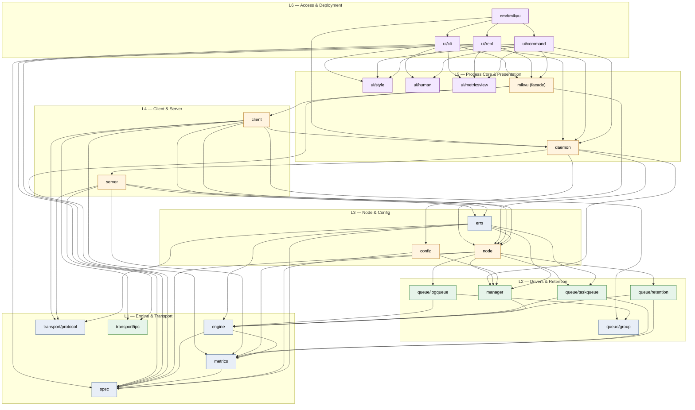

# Mikyu — Architecture & Implementation Specification

Mikyu is a high-performance, log-structured message queue written from scratch in Go. It presents **two structurally distinct queue kinds over one shared storage engine**:

- **Log queues** (`log/<name>`) — append-only streams with consumer-group offsets, replay, streaming, tailing, keyed compaction, per-queue retention.
- **Task queues** (`task/<name>`) — at-least-once delivery with visibility leases, exponential backoff, scheduling, stale-lease protection, a durable per-queue DLQ, an optional archive log, chunked checkpoint recovery, and per-queue in-flight/DLQ bounds.

A queue's **kind is structural**: it is the name of its parent directory under the data root. `log/events` and `task/events` are two different queues that share nothing but a filesystem tree.

---

## 1. Architectural Principles

1. **Layer purity** — enforced by `.go-arch-lint.yml`. `spec`, `protocol`, `group`, `enginetest`, `style`, `human` are bottoms.
2. **One storage engine, two structural kinds.** `engine.Storage` is the only contract drivers see. `manager.Manager` owns two `*engine.Manager` roots — `log/` and `task/`.
3. **Kind is structural.** `manager.GetOf(name, kind)` refuses a queue under the wrong kind (`manager.ErrWrongKind`).
4. **One configuration table.** `spec.Table` drives every surface (SDK, CLI, env, YAML, wire, storage). Each row carries a `Doc`.
5. **One observation surface.** `internal/metrics` is the only telemetry contract. No `Info`/`Stats`.
6. **One error taxonomy.** `internal/errs.Table` maps each Go sentinel to its wire code.
7. **Registry is a config artifact.** Per-queue specs live in `queues.json`. The filesystem is the source of truth for existence; missing directories purge entries, orphans are adopted.
8. **Data directory is a lock.** `node.Acquire` takes an exclusive `flock`/`LockFileEx` on `<dir>/mikyu.lock`. Two processes on the same dir fail fast with `ErrLocked`.
9. **Path escape is a compile-time concern.** File ops in `engine`, `manager`, `node` use `os.Root`.
10. **Refcount over teardown.** Embedded clients share one `node.Node` per absolute data dir.
11. **Errors are stable sentinels.** Wire codes map 1:1; messages are human text, never contracts.
12. **Auth is one handshake per connection.** Credentials declared once in `OpAuth`, verified once.

### Guarantees

- **Durable-before-ack** by default (`durability: sync`): `Append`/`AppendBatch` block until the WAL flusher has `fsync`'d bytes and index.
- **Optional async loss window** (`durability: async`): publishes to ring cache + `publishedOffset` immediately, flushes in background.
- **Zero-copy reads** on closed segments (`mmap` read-only).
- **Byte-budgeted ring cache** sized from `max_cache`.
- **Long-poll tailing** via `Fetch` on `notify` channel.
- **Keyed compaction (log only)**: records carry an optional `Group`; when `compaction: keys`, `roll()` rewrites closed segments dropping superseded group versions.
- **Chunked, self-describing task checkpoints** (`recordCPStart/Chunk/Commit`); newest valid commit wins on recovery.

### Four Roles, One Binary

| Role | Entry | Notes |
|---|---|---|
| Embedded engine | `mikyu.Open(dir, opts...)` | In-process `node.Node`, no network, ref-counted per data dir. |
| Remote client | `mikyu.Dial(target, opts...)` | Pooled TCP / Unix / Named-Pipe wire client. |
| Daemon | `mikyu daemon` | Long-lived server over TCP, Unix socket, or Windows named pipe. |
| CLI / REPL | `mikyu <cmd>`, `mikyu shell` | Stateless one-shot CLI and styled interactive REPL. |

---

## 2. Repository Layout & Dependency Graph

```
github.com/dmunish/mikyu/
├── .go-arch-lint.yml
├── mikyu.go / options.go / spec.go / typed.go   # Public SDK facade
├── cmd/mikyu/main.go                            # Entry: run, exitCode
└── internal/
    ├── audit/                   # Source gates: TestNoLegacyNames, TestInternalCommentStyle
    ├── spec/                    # THE config schema (spec, table, derive, codec, env, validate, enums, errors)
    ├── config/config.go         # mikyu.yaml loader, legacy-key/env rejection, bootstrap
    ├── engine/                  # Storage engine (storage, manager, queue, append, read, fetch,
    │                            # wal, segment, compaction, cache, offsets, metrics, sync_*, encrypt_*)
    ├── enginetest/memstorage.go # In-memory engine.Storage for synctest bubbles
    ├── metrics/                 # THE telemetry model (instruments, registry, snapshot, state,
    │                            # history, collector, prometheus, lock, source)
    ├── queue/
    │   ├── group/group.go       # Base: HighWater, Mark, Commit, Close, CommitFn
    │   ├── logqueue/            # api, logqueue, group, retention, stream
    │   ├── taskqueue/           # task, taskqueue, enqueue, dequeue, ack, nack, extend,
    │   │                        # dlq, archive, lease, scheduler, checkpoint, compaction,
    │   │                        # metrics, id
    │   └── retention/coordinator.go
    ├── transport/
    │   ├── protocol/            # frames, bytes, opcodes, errors, auth, log, task
    │   └── ipc/ipc.go           # Unix socket + Windows named pipe
    ├── manager/                 # Kind-partitioned data directory
    ├── node/                    # Process-wide shared node (node, catalog, kind, pool,
    │                            # registry, lock_*, metrics, runtime_source_*)
    ├── errs/errs.go             # Sentinel↔wire-code taxonomy
    ├── server/                  # Wire server (server, dispatch, errors, auth, tls, handlers_*, metrics)
    ├── client/                  # Embedded + remote clients
    ├── daemon/                  # daemon, enum, detach_*, metrics_http
    └── ui/
        ├── style/               # Theme, Palette, components (TitledBox, Gauge, ...)
        ├── human/               # Bytes/Count/Duration/Percent/Rate formatters
        ├── metricsview/         # summary, detail, queuecard, health, spec, specdiff
        ├── command/             # admin, auth, client, flag, help, log, queue, task, verb,
        │                        # metrics, metrics_watch
        ├── cli/                 # cli.go, task.go, metrics.go
        └── repl/                # repl, banner, confirm, style, task, metrics, vt_*
```

### Allowed Dependency Edges

```
bottoms:          spec, protocol, group, enginetest, style, human
metrics        →  spec
engine         →  spec, metrics
manager        →  engine, metrics
ipc            →  protocol
logqueue       →  engine, group
taskqueue      →  engine, metrics
retention      →  engine, metrics
errs           →  spec, engine, manager, node, logqueue, taskqueue, protocol
node           →  spec, engine, manager, logqueue, taskqueue, retention, metrics
config         →  spec, manager
client, server →  spec, engine, node, logqueue, taskqueue, ipc, protocol, metrics, errs
                 (client also → group, daemon;  client and server never import each other)
daemon         →  spec, config, engine, manager, node, server, protocol, metrics
mikyu          →  spec, client, engine, node, logqueue, taskqueue, metrics, protocol
metricsview    →  metrics, human, style, spec
command        →  mikyu, client, daemon, spec, style, human, metricsview
cli, repl      →  mikyu, client, daemon, command, spec, style, metricsview
cmd            →  mikyu, daemon, cli, repl
```

### Architecture Diagram



---

## 3. Public SDK — `mikyu` Package

```go
type Client interface {
    io.Closer
    CreateLogQueue(ctx context.Context, name string, opts ...QueueOption) (LogQueue, error)
    CreateTaskQueue(ctx context.Context, name string, opts ...QueueOption) (TaskQueue, error)
    LogQueue(name string) (LogQueue, error)
    TaskQueue(name string) (TaskQueue, error)
    UpdateQueue(ctx context.Context, name string, opts ...QueueOption) error
    DescribeQueue(ctx context.Context, name string) (QueueDescription, error)
    DeleteQueue(ctx context.Context, name string) error
    ListQueues(ctx context.Context) ([]QueueInfo, error)
    Truncate(ctx context.Context, name string, minOffset uint64) (int64, error)
    Metrics(ctx context.Context) (Metrics, error)
    Schema(ctx context.Context) ([]Param, error)
    SubscribeSnapshots() (<-chan Metrics, func())
}
func Open(dir string, opts ...ClientOption) (Client, error)
func Dial(target string, opts ...ClientOption) (Client, error)
const SpecVersion = spec.CurrentSpecVersion   // 5
```

**Type aliases** (`mikyu.go`): `LogQueue = logqueue.Log`, `TaskQueue = client.TaskQueue`, `Record = engine.Record`, `Group = logqueue.Group`, `Task = taskqueue.Task`, `TaskRef = taskqueue.Ref`, `TaskID = taskqueue.ID`, `QueueKind = node.Kind`, `QueueInfo = node.QueueInfo`, `QueueDescription = client.QueueDescription`, `Metrics = metrics.Snapshot`, `Param/Kind/Layer/Scope/Session = spec.*`.

**Typed wrapper** (`typed.go`):
```go
type Codec[T any] struct { Marshal func(T) ([]byte, error); Unmarshal func([]byte, *T) error }
type Typed[T any] struct { queue LogQueue; codec Codec[T] }
func NewTyped[T any](q LogQueue, codec Codec[T]) *Typed[T]
func (t *Typed[T]) Append(ctx context.Context, val T) (uint64, error)
func (t *Typed[T]) Read(ctx context.Context, offset uint64) (T, error)
```

**Schema surface** (`spec.go`): `Schema() []Param`, `Lookup(key) (Param, bool)`, `EncodeSpec`, `EncodeSpecYAML`, `DecodeSpec`, `DecodeSpecYAML`, `ValidateCreate`, `ValidateUpdate`, `ValidateSession`, `Builtin()`, `BuiltinSession()`.

**Options** (`options.go`): every `With*` constructor re-exports `client.With*` / `taskqueue.With*` / `logqueue.With*`. Notable ones not derived from `spec.Table`: `WithSessionSpec`, `WithAutoStart`, `WithKey` (task), `WithRecordKey` (log), `WithTaskLease`, `WithTaskMaxAttempts`.

---

## 4. Configuration & Schema — `internal/spec`

`spec.Table` is the canonical parameter list (`internal/spec/table.go`).

```go
type Param struct {
    Key        string     `json:"key"`
    Path       string     `json:"path"`
    Kind       Kind       `json:"kind"`
    Allowed    []string   `json:"allowed,omitempty"`
    Layer      Layer      `json:"layer"`
    Scope      Scope      `json:"scope"`
    Mutability Mutability `json:"mutability"`
    EnvName    string     `json:"env_name"`
    FlagName   string     `json:"flag_name"`
    OptionName string     `json:"option_name"`
    Doc        string     `json:"doc"`
    Apply        func(*Spec, Value)    `json:"-"`
    ApplySession func(*Session, Value) `json:"-"`
}
```

**Kinds:** `KindInt, KindUint32, KindDuration, KindBytes, KindBool, KindString, KindTime, KindEnum`.
**Layers:** `LayerCall, LayerSpec, LayerSession`. **Scopes:** `ScopeClient, ScopeServer, ScopeBoth`. **Mutability:** `MutMutable, MutCreateOnly, MutNotApplicable`.

**Spec types** (sparse, pointer fields):
```go
type Spec struct {
    Storage   StorageSpec   `json:"storage,omitzero"`
    Flush     FlushSpec     `json:"flush,omitzero"`
    Retention RetentionSpec `json:"retention,omitzero"`
    Task      TaskSpec      `json:"task,omitzero"`
}
type StorageSpec struct {
    Durability, Encryption, Compaction *enum
    MaxSegment, MaxPayload, MaxCache *int64
    MaxSegmentAge *Duration
}
type FlushSpec     struct { MaxBytes *int64; MaxWait *Duration }
type RetentionSpec struct { MaxAge *Duration; MaxBytes *int64 }
type TaskSpec      struct { Lease *Duration; MaxAttempts, MaxInFlight, MaxDeadLetters *uint32 }
```

**Session type** (server-scoped, no `json`):
```go
type Session struct {
    Target, DataDir string
    MaxConnections  int
    TLS     TLSConfig
    Auth    AuthConfig
    Metrics MetricsConfig
}
type TLSConfig     struct { Enabled bool; Cert, Key, ClientCA string }
type AuthConfig    struct { Method, Token, TokenFile string }
type MetricsConfig struct {
    Enabled bool; Interval Duration; History int; Listen string
    PerQueuePrometheus, Histograms bool
}
```

**Effective spec:** `effective = stored.Merge(session).Merge(spec.Builtin())` then `Resolve` fills every nil field.

**Codec:** `CurrentSpecVersion = 5`, `MaxSpecPayload = 1<<20`. `Duration` accepts Go duration strings or int64 nanos. `DecodeSpec` uses `DisallowUnknownFields` + trailing-data rejection. `CheckSpecVersion(version) error` returns `ErrSpecTooNew`.

**Built-in defaults** (`spec.go → Builtin()`):

| Key | Value |
|---|---|
| `durability` / `encryption` / `compaction` | `sync` / `none` / `none` |
| `max_segment` / `max_segment_age` / `max_payload` / `max_cache` | 64 MiB / 1 h / 1 MiB / 32 MiB |
| `max_flush_bytes` / `max_flush_wait` | 1 MiB / 10 ms |
| `max_retention_age` / `max_retention_bytes` | 0 / 0 (unlimited) |
| `lease` / `max_attempts` / `max_in_flight` / `max_dead_letters` | 30 s / 5 / 100 000 / 100 000 |
| `target` / `max_connections` | `tcp://127.0.0.1:7420` / 10 |
| `auth_method` / `tls_enabled` | `none` / `false` |
| `metrics_enabled` / `interval` / `history` / `histograms` | `true` / 1 s / 300 / `true` |

**Naming rule:** `EnvName = "MIKYU_" + UPPER(key)`, `FlagName = key` with `_→-`, `OptionName = "With" + PascalCase(key)` (with `tls→TLS`, `ca→CA` initialisms).

**Validation** (`validate.go`): positive-byte/duration/uint32 rules; non-negative for retention; `max_payload ≤ max_segment − RecordOverhead (36)`; `max_cache ≥ min(builtinMaxCache, max_segment)`. Session: `max_connections ≥ 1`, `metrics_interval > 0` when enabled, `metrics_history ≥ 1`, `metrics_listen` host:port, `auth_method ∈ {"", none, none-insecure, token, mtls}`, token mode needs ≥16-byte token/file, `mtls` needs TLS.

**Derived:** `RecordOverhead = 36`; `FlushLinger(s) = max(0, MaxWait/8)`.

---

## 5. Storage Engine — `internal/engine`

### `Storage` interface

```go
type Storage interface {
    Name() string
    Append(ctx, payload, ...AppendOption) (uint64, error)
    AppendBatch(ctx, payloads, ...AppendOption) ([]uint64, error)
    Read(ctx, offset) (Record, error)
    ReadBatch(ctx, start, n) ([]Record, error)
    Fetch(ctx, offset, maxCount, maxWait) ([]Record, error)
    LastOffset() uint64
    CommitOffset(ctx, group, offset) error
    Committed(ctx, group) (uint64, error)
    MaxAppendPayloadBytes() int64
    MinOffset() uint64
    Segments() []SegmentInfo
    TruncateBefore(ctx, offset) (int64, error)
    FloorOlderThan(ctx, olderThan) (uint64, error)
    FloorForSize(ctx, maxBytes) (uint64, error)
}
```

### `Record` / `Config`

```go
type Record struct { Offset uint64; ID string; Timestamp time.Time; Group, Payload []byte }

type Config struct {
    Durability       spec.Durability
    Encryption       spec.Encryption
    Compaction       spec.Compaction
    MaxSegment       int64
    MaxSegmentAge    time.Duration
    MaxPayload       int64
    MaxCache         int64
    MaxFlushBytes    int64
    MaxFlushWait     time.Duration
    FlushLinger      time.Duration
    CompactionPolicy CompactionPolicy
}
func (c Config) Async() bool            { return c.Durability == spec.DurabilityAsync }
func (c Config) KeyedCompaction() bool  { return c.Compaction == spec.CompactionKeys }
func (c Config) EncryptedStorage() bool { return c.Encryption == spec.EncryptionOS }
```

### Sentinels

`ErrQueueExists, ErrQueueNotFound, ErrOffsetNotFound, ErrMessageTooLarge, ErrRecordTooLarge, ErrOffsetTruncated, ErrQueueClosed, ErrNoData, ErrRecordCompacted, ErrDiskFull, ErrCorruptRecord`.

### `Manager` (per kind)

```go
type Manager struct {
    mu      sync.RWMutex
    dir     string
    root    *os.Root
    cfg     Config
    queues  map[string]*Queue
    offsets *OffsetStore
    reg     *metrics.Registry
}
func OpenManager(dir string, cfg Config, perQueue map[string]Config, regs ...*metrics.Registry) (*Manager, error)
func (m *Manager) Create(name string, opts ...Config) (Storage, error)
func (m *Manager) Get(name string) (Storage, error)
func (m *Manager) List() []string
func (m *Manager) Delete(name string) error
func (m *Manager) Collect(ctx, dst *metrics.Snapshot)
func (m *Manager) Close() error
```

`manager-offsets.dat` is per root, so consumer groups on `log/events` and `task/events` are independent.

### `Queue`

```go
type Queue struct {
    name              string
    dir               string
    cfg               Config
    active            *segment
    segments          []*segment
    nextOffset        uint64
    minOffset         uint64
    publishedOffset   uint64
    w                 *wal
    offsets           *OffsetStore
    cache             *ringCache
    nextPreallocBytes int64
    closed            bool
    notify            chan struct{}
    keyIndex          map[string]uint64
    m                 *queueMetrics
    scope             *metrics.Scope
    mu                sync.RWMutex
}
```

`openQueue(parentDir, name, cfg, store, scopes...)` opens the queue directory through `os.Root` scoped to `parentDir`, so a hostile name cannot escape.

### Append Path

`Append` delegates to `AppendBatch`. The batch stages per-segment sub-batches so a WAL write never straddles a roll:

1. Validate `len(payload) ≤ MaxPayload`; encode with `uuid.NewV7()`; reject `recLen > MaxSegment` with `ErrRecordTooLarge`.
2. Stage into a per-segment `stagedBatch{w, seg, recs, positions, recLens, offsets, ids, totalLen, startIdx}`.
3. On roll or flush budget: commit through `commitSync` (calls `wal.pushBatch`, unlocks, waits on `wal.wait(seq)`) or `commitAsync` (calls `wal.pushAsync`, clones into ring cache).
4. Final staged group committed after the loop; `broadcastLocked()` wakes parked readers.

### Read Path

1. `q.cache.Get(offset)` — byte-budget ring, O(1).
2. `q.locateSegment(offset)` — `slices.BinarySearchFunc`; `offset < minOffset` → `ErrOffsetTruncated`; `offset ≥ publishedOffset` → `ErrOffsetNotFound`.
3. `readFromSegment` — reads from `seg.mmapData` when mapped, else `seg.logFile.ReadAt`; `decodeRecord` validates CRC and length. A zeroed slot in a compactable queue returns `ErrRecordCompacted`.
4. `q.superseded(group, offset)` when compaction is on → `ErrRecordCompacted`.

`ReadBatch` reuses the current segment between consecutive offsets; compacted offsets are skipped.

### Fetch

```go
func (q *Queue) Fetch(ctx, offset uint64, maxCount int, maxWait time.Duration) ([]Record, error)
```
- `maxCount ≤ 0` → `nil, nil`; `offset < minOffset` → `ErrOffsetTruncated`.
- `offset < publishedOffset` → `ReadBatch`; if window held only compacted records, advance past it; else `ErrNoData`.
- `maxWait ≤ 0` → `ErrNoData` immediately.
- Otherwise parks on `ctx.Done()`, `notify`, or `timer.C`. `broadcastLocked()` swaps `q.notify` and closes the old one.

### Segment Rolling & Preallocation

`nextPreallocBytes` starts at `min(8 MiB, MaxSegment)` and adapts inside `roll()`:
- Filled in under 10 s → double, capped at `min(256 MiB, MaxSegment)`.
- Filled after 5 min → halve, floored at 8 MiB.
- Active segment truncated to written `pos` before `enableMMap`.

### Compaction (log only)

When `KeyedCompaction()` is true, `keyIndex map[string]uint64` maps group → newest offset; `buildKeyIndex` walks every record on open. After each `roll()`, `compactClosedLocked` rewrites each closed segment in place:

1. Walk index entries; drop records whose group has a newer offset (corrupt records are **kept** — dropping could remove the newest).
2. Unmap, rewrite `.log` with kept records concatenated, zero dropped index slots.
3. `cache.Evict(evicted...)`.
4. `supersededLocked` checked on every `Read` so a superseded record still in a mapping returns `ErrRecordCompacted`.

Key index warn limit is `keyIndexWarnLimit = 1_000_000`; over the limit logs a warning and the `key_index` gauge reports the live size.

### WAL

```go
type wal struct {
    cfg Config; file *os.File
    mu sync.Mutex; cond *sync.Cond
    buf, swapBuf             []byte
    pending, swapPending     []pendingEntry
    pendingBytes, pushedBytes, publishedBytes int64
    asyncNext                uint64
    err                      error
    asyncChan                chan asyncEntry
    wake, configChanged      chan struct{}
    shutdown, done           chan struct{}
    stopOnce                 sync.Once
    m                        *walMetrics
}
```

**Byte-based sequencing**: `push(rec, pos) (seq, wake, err)` returns `seq = pushedBytes + len(rec)`; `wait(seq)` blocks until `publishedBytes ≥ seq` or `err != nil`.

**Sync path.** `push`/`pushBatch` stage bytes + pending entries under lock. `syncLoop` selects over `asyncChan`, `ticker.C` (`MaxFlushWait`), `wake`, `configChanged`, `shutdown`. `adaptiveFlush` sleeps `FlushLinger` before flushing when the batch is below `MaxFlushBytes`. `flush` swaps buffers, drains the wake token under lock, calls `writeAt`, `syncData` if sync durability, and broadcasts on `cond`.

**Async path.** `AppendBatch` publishes records onto `wal.asyncChan` and clones into the ring cache. `drainAndFlushAsync(first)` groups up to `MaxFlushBytes` entries, writes each at its `pos`, writes the `.idx` entry, and advances `asyncNext` contiguously; `publishedOffset` is bumped separately in `commitAsync`.

**Single writer.** `writeAt` is the only writer of the WAL segment file; `writerHook` (test) asserts the invariant.

**Wake-token correctness.** `wake` has buffer 1 and is drained inside `flush()` under lock, preventing producer hangs when `adaptiveFlush` is mid-linger.

**Async backpressure**: `asyncChan` capacity = `MaxFlushBytes/4096` slots.

**Platform `syncData`:** Darwin uses `F_FULLFSYNC`; Linux/BSD use `Fdatasync`; Windows uses `File.Sync()`.

### Segment

```go
type segment struct {
    baseOff uint64
    dir, logName, idxName string
    logFile, idxFile *os.File
    pos, preallocSize int64
    createdAt time.Time
    mmapData, idxMMap mmap.MMap
}
```

- `openSegment(dir, baseOff, preallocSize)` preallocates the `.log` if empty.
- `enableMMap()` maps both files read-only only if `Stat().Size() > 0`.
- `recover()` tries `tryFastRecovery` (validates last index entry); on failure `rebuild()` re-walks the `.log`, validates CRC, rewrites `.idx`, truncates torn tails.
- `readIndexEntry(offset)` reads 16 bytes from `idxMMap` (closed) or `idxFile.ReadAt`.
- `lastTimestamp()` returns the newest record's timestamp (`FloorOlderThan`).
- `destroy()` unmaps, closes, unlinks through `os.Root`.

### Record Format

```
[4B Body Length][4B CRC32][2B ID Length=16][16B Raw UUID v7][8B Unix Nanos][2B Group Length][Group][Payload]
```

CRC-32/IEEE covers the body (`rec[8:]`).

### Ring Cache

`ringCache` sized from `max_cache` (round up to power of two; floor 64 slots, cap 65536; avg 256 B + 36 B overhead). `Put` evicts FIFO from `head` while `curBytes > maxBytes`. `Get` validates `msg.Offset == offset` and non-zero timestamp. `EvictBefore(minOffset)` and `Evict(offsets...)` adjust `curBytes`. `SetMaxBytes` moves the budget and evicts from head.

### Offset Store

One `manager-offsets.dat` per engine root persists `(queue:group) → uint64` as `[2B keyLen][key][8B offset]`. `Commit` writes, flushes, `Sync`s; every `compactAppendsThreshold = 5000` appends triggers `compactLocked`, which rewrites atomically via `os.Rename` from `manager-offsets.dat.tmp` and `syncDir(root)`.

### Retention Primitives

- `FloorOlderThan(ctx, olderThan)` walks **closed** segments oldest→newest; a segment qualifies only if its last record is strictly before `olderThan`. Active segment never included.
- `FloorForSize(ctx, maxBytes)` drops whole oldest closed segments while total size > `maxBytes`.
- `TruncateBefore(ctx, targetOffset)` unlinks closed segments with `nextOffset ≤ targetOffset`; stops at the first straddling segment; updates `minOffset`; calls `cache.EvictBefore`.

### Durability Sites

`SyncDirHook` fires at four sites: new segment file, offset-store compaction rename, `queues.json` rename, active-segment close-time truncation.

### Kernel Directory Encryption

| OS | Mechanism |
|---|---|
| Linux | `FS_IOC_SET_ENCRYPTION_POLICY` ioctl; `AES_256_XTS` contents, `AES_256_CTS` filenames; tolerates `ENOTTY`, `EOPNOTSUPP`, `EEXIST`. |
| Windows | `EncryptFileW` from `advapi32.dll` (NTFS EFS). |
| Other | Logs a warning and returns `nil`. |

---

## 6. Log Queue — `internal/queue/logqueue`

```go
type Log interface {
    Name() string
    Append(ctx, payload, opts ...AppendOption) (uint64, error)
    AppendBatch(ctx, payloads, opts ...AppendOption) ([]uint64, error)
    Read(ctx, offset) (engine.Record, error)
    ReadBatch(ctx, start, count) ([]engine.Record, error)
    LastOffset(ctx) (uint64, error)
    MinOffset(ctx) (uint64, error)
    Fetch(ctx, offset, maxCount, maxWait) ([]engine.Record, error)
    CommitOffset(ctx, group, offset) error
    Committed(ctx, group) (uint64, error)
    Truncate(ctx, minOffset) (int64, error)
    TruncateFloor(ctx) (uint64, bool, error)
    Stream(ctx, start) iter.Seq2[engine.Record, error]
    Tail(ctx, start) iter.Seq2[engine.Record, error]
    Group(name string) Group
}
type AppendOption func(*appendOptions)
func WithKey(k []byte) AppendOption
func ResolveAppendOptions(opts ...AppendOption) (key []byte)
```

Internal `queue{name string, storage engine.Storage, mu sync.RWMutex, groups map[string]*queueGroup}`.

**Consumer group** (`group.go`):
```go
type Group interface { io.Closer; Name() string; Mark(offset uint64); Commit(ctx) error; Committed(ctx) (uint64, error) }
type queueGroup struct { group.Base; q *queue }
```
`group.Base` holds a `sync.Mutex`-guarded `HighWater uint64`, a `Closed` flag, and `CommitFn func(ctx, offset) error`. `Mark` advances to `offset+1` monotonically. `Close` is idempotent and commits the final high water.

**Stream & Tail** (`stream.go`): `streamBatch = 1024`, `tailWait = 30s`. `Stream` uses `maxWait=0` (non-blocking drain). `Tail` blocks in `Fetch` per iteration; `ErrNoData` re-arms.

**Retention** (`retention.go`): `TruncateFloor` returns `min(HighWater)` and a `constrained` flag. `Truncate(ctx, 0)` uses the driver's own floor when constrained; else no-op.

---

## 7. Task Queue — `internal/queue/taskqueue`

```go
type Queue interface {
    Name() string
    Enqueue(ctx, payload, opts ...EnqueueOption) (Task, error)
    Dequeue(ctx) (Task, error)
    TryDequeue(ctx) (Task, error)
    Ack(ctx, ref Ref) error
    Nack(ctx, ref Ref, opts ...NackOption) error
    Extend(ctx, ref Ref, timeout time.Duration) error
    DeadLetters(ctx) ([]Task, error)
    AckDeadLetter(ctx, ref Ref) error
    Archive(ctx, ref Ref) error
    SetDefaults(d Defaults)
    TruncateFloor(ctx) (uint64, bool, error)
}
func Close(q Queue) error
```

**State** (`taskqueue.go`):

```go
type queue struct {
    name string; storage engine.Storage
    mu sync.Mutex
    active            map[string]*taskState
    inFlightCount     int64
    dlq               map[string]Task
    dlqUncheckpointed map[string]struct{}
    schedule          scheduleHeap
    sequence, scanNext uint64
    checkpointOffset, checkpointCovered uint64
    dirty             uint64
    notify            chan struct{}
    closing, closed   bool
    defaultLease       time.Duration
    defaultMaxAttempts uint32
    maxInFlight, maxDeadLetters uint32
    archiveLog ArchiveLogFor
    m *taskMetrics
}
type Defaults struct { Lease time.Duration; MaxAttempts, MaxInFlight, MaxDeadLetters uint32 }
type ArchiveAppender interface{ Append(ctx, payload) (uint64, error) }
type ArchiveLogFor func(ctx, source string) (ArchiveAppender, error)
```

Lifecycle: `New` opens storage, `loadCheckpointLocked`, `scanNext = MinOffset()`, `refreshLocked` replays post-checkpoint records. `Close` stops any checkpoint work, writes a final checkpoint if dirty, marks closed. The node's `catalog.go` sweeps dirty task queues every `checkpointSweepInterval = 5s` via `taskqueue.Checkpoint`.

**Types** (`task.go`):
```go
type Task struct {
    ID, DeliveryID string
    Payload        []byte
    Attempts, MaxAttempts, Stalled uint32
    Lease, ScheduledAt time.Time
    Offset uint64
    Key    []byte
}
type Ref interface { taskRef(); taskID() string }
type ID string
```
Constants: `defaultLease=30s`, `defaultMaxAttempts=5`, `defaultRetryDelay=1s`, `defaultMaxRetryDelay=5min`, `checkpointEvery=128`, `checkpointChunkBytes=64KiB`.

**Enqueue** appends `recordTask`, installs a `taskState{task, nextAt: scheduledAt, lease: visibilityTimeout}`, pushes onto schedule, sets `scanNext = offset+1`, `dirty++`, broadcasts.

**Dequeue** loops on `takeDueLocked(ctx, now)`: pop stale entries, dead-letter a final-attempt in-flight task, else assign a fresh `DeliveryID`, `Attempts++`, `Lease=now+lease`, bump version, re-push, broadcast, return. `TryDequeue` is one non-blocking pass.

**Lease resolution** (`lease.go`):
```go
func (q *queue) resolveLeaseLocked(ref Ref) (*taskState, error)
```
- `nil` → `ErrInvalidTask`; not in `active` → `ErrTaskNotFound`; not `inFlight` → `ErrTaskNotInflight`; visibility expired → `ErrTaskStale`.
- **Strict mode** (`ref` is `Task`): requires `Offset`, `Attempts`, non-empty `DeliveryID` to match exactly.
- **Loose mode** (`ref` is `TaskID`): skips strict comparison; visibility still applies.

`broadcastLocked()` closes `q.notify` and allocates a fresh channel.

**Ack / Nack / Extend / DLQ / Archive:**
- **Ack** — `resolveLeaseLocked`, delete from `active`, `dirty++`, broadcast, prune, `acks++`.
- **Nack** — `resolveLeaseLocked`; on `Attempts ≥ MaxAttempts` → dead-letter (with DLQ overflow drop of the oldest when `MaxDLQ` exceeded); else reset `inFlight`, clear `DeliveryID`, `nextAt = now + retryAfter`, bump version, re-push.
- **Extend** — extends `Lease` forward only; never increments `Attempts`.
- **DeadLetters** — offset-sorted snapshot; **AckDeadLetter** verifies `Offset`/`Attempts` in strict mode, appends `recordDLQAck`, deletes, `dlq_acks++`.
- **Archive** — resolves against `active` first (strict), then `dlq`. Encodes an `archiveEnvelope`, appends to `<queue>-archive` (created lazily via `ArchiveLogFor`), removes from source. On failure task stays put; returns `ErrArchiveFailed`.

**Scheduler** (`scheduler.go`): binary min-heap ordered by `(due, seq)`. `pushScheduleLocked` bumps `q.sequence`; `pruneScheduleLocked` rebuilds when `len(schedule) > len(active)*3 + 1024`.

**Checkpointing** (`checkpoint.go`): record kinds `recordTask=1`, `recordCPStart=2`, `recordCPChunk=3`, `recordCPCommit=4`, `recordDLQ=5`, `recordDLQAck=6`. `checkpointVersion=3`, `maxCheckpointChunks=1<<20`, `maxCheckpointBytes=512<<20`.

`checkpointLocked`:
1. `refreshLocked`; snapshot `active` (offset-sorted) + `dlq`.
2. Append `recordCPStart(coveredThrough)`.
3. Split snapshot into ≤ `min(MaxAppendPayloadBytes()-header, checkpointChunkBytes)` chunks; append `recordCPChunk(i, data)`.
4. Append `recordCPCommit(startOffset, totalChunks, coveredThrough)`.
5. Verify `commitOffset == startOffset + totalChunks + 1`; mismatch → `ErrCheckpointCorrupt`.
6. Clear `dlqUncheckpointed`, `dirty = 0`.

`loadCheckpointLocked` scans backward from `LastOffset()` for the newest valid commit; on failure tries an earlier one. `refreshLocked` walks `scanNext` forward; anything that isn't a task record kind is reported as `ErrCorruptRecord` naming the queue (this is how the task driver refuses to reinterpret a moved log directory).

**Archive envelope** (`archive.go`): `ArchivePrefix = "-archive"`. Fields: `sourceQueue(string) + key(string) + taskPayload(bytes) + attempts(u32) + stalled(u32) + deliveryID(string) + offset(u64) + archivedFrom(string) + timestamp(u64)`.

**Task metrics** (`metrics.go`): `enqueues, dequeues, acks, nacks, extends, dlq_acks, dlq_overflow, task_stalls, dequeue_park_events, queue_full_events, retry_budget_drops, enqueue_duration, dequeue_wait, in_flight_enqueue, parked_dequeue, active, in_flight, scheduled, dead_letters, uncheckpointed, schedule_heap, checkpoint_lsn, dirty, checkpoint_lag`. `publishLocked()` mirrors `viewLocked()` into the scope.

---

## 8. Cross-Driver Retention — `internal/queue/retention`

```go
type FloorProvider interface {
    TruncateFloor(ctx) (floor uint64, constrained bool, err error)
}
type Policy struct { Age time.Duration; Bytes int64 }
type Target struct {
    Name string; Storage engine.Storage; Driver FloorProvider
    Policy Policy; mu sync.Mutex
}
type Coordinator struct {
    mu       *metrics.RWLockObserver
    targets  map[string]*Target
    interval time.Duration
}
func NewCoordinator(interval time.Duration) *Coordinator
func (c *Coordinator) RegisterTarget(target *Target)
func (c *Coordinator) SetPolicy(name string, p Policy) (shrunk bool)
func (c *Coordinator) UnregisterTarget(name string)
func (c *Coordinator) ReconcileQueue(ctx, name) (int64, error)
func (c *Coordinator) ReconcileAt(ctx, name, requested uint64) (int64, error)
func (c *Coordinator) ReconcileAll(ctx) map[string]int64
func (c *Coordinator) Start(ctx)
```

`SetPolicy` returns `true` when a dimension that was unlimited becomes bounded, or a finite bound decreases. `ReconcileAt` computes `policyFloor` from `FloorOlderThan`/`FloorForSize`, at least `requested`, then clamps by `min(driver floors)`. Zero → no-op. Otherwise `storage.TruncateBefore(safeFloor)`. The node wires `SetPolicy` to `UpdateQueue`; a shrink triggers an out-of-band reconcile bounded by the node's retention context (5 minutes).

---

## 9. Transport — `internal/transport`

### Frames

```
+-----------------+-------------+----------------------+
| Length (uint32) | Opcode (u8) | Payload (Length-1)   |
+-----------------+-------------+----------------------+
```
`MaxFrameBytes = 256 MiB`. `WriteFrame` grabs a pooled `[]byte` (32 KiB seed), grows in-place while retaining the pointer, writes, returns to pool. `ReadFrame` validates length, allocates exactly `length-1` bytes, reads in one `io.ReadFull`. `ReadFrameInto` supports buffer reuse.

### Bytes

`Reader` provides bounds-checked `ReadU8/U16/U32/U64/Bytes`; `Buffer` provides symmetric writers. All integers big-endian.

### Opcodes

| Subsystem | Range | Ops |
|---|---|---|
| Admin | `0x0X` | Create(0x00), Delete(0x01), List(0x02), Update(0x03), Describe(0x04), Truncate(0x05), Metrics(0x07), Schema(0x08), Shutdown(0x0C) |
| Log | `0x1X` | Append(0x10), AppendBatch(0x11), Read(0x12), ReadBatch(0x13), LastOffset(0x14), MinOffset(0x15), Commit(0x16), Committed(0x17), Fetch(0x18) |
| Task | `0x2X` | Enqueue(0x20), Dequeue(0x21), Ack(0x22), Nack(0x23), Extend(0x24), Archive(0x25) |
| Dead-letter | `0x3X` | DeadLetters(0x30), DeadLetterAck(0x31) |
| Protocol | `0x7E` | Auth |
| Error | `0xFF` | Error |

`ParseTarget` supports `tcp://`, `unix://`, `pipe://`, bare `host:port`.

### Error Codes

Blocked by subsystem nibble: `0x01–0x0F` admin, `0x11–0x1F` storage, `0x21–0x2F` task, `0x31–0x3F` dead-letter, `0x41–0x4F` server. Includes `ErrCodeUnknown=0x01`, `QueueNotFound=0x02`, `QueueExists=0x03`, `InvalidConfig=0x04`, `ImmutableField=0x05`, `SpecTooNew=0x06`, `SpecTooLarge=0x07`, `Unauthorized=0x09`, `OffsetNotFound=0x11`, `OffsetTruncated=0x12`, `MessageTooLarge=0x13`, `QueueClosed=0x14`, `NoData=0x15`, `DiskFull=0x16`, `CorruptRecord=0x17`, `RecordTooLarge=0x18`, `RecordCompacted=0x19`, `TaskNotAvailable=0x21`, `TaskNotFound=0x22`, `TaskNotInflight=0x23`, `TaskStale=0x24`, `TaskInvalid=0x25`, `CheckpointCorrupt=0x26`, `QueueFull=0x27`, `DeadLetterNotFound=0x31`, `DeadLetterStale=0x32`, `ArchiveFailed=0x33`, `TooManyConnections=0x41`, `WrongKind=0x42`.

### Auth Frames

```go
const ( AuthMethodNone byte = 0; AuthMethodToken byte = 1; AuthMethodMTLS byte = 2 )
func EncodeAuth(b *Buffer, method byte, credential []byte)
func DecodeAuth(r *Reader) (byte, []byte, error)
```

`OpAuth` frame is `u8 method` + length-prefixed `credential`. First frame on every connection; server verifies and replies with an empty `OpAuth` frame, or `OpError(0x09, msg)` and closes.

### Log Wire

```go
type Record struct{ Offset uint64; ID string; Timestamp time.Time; Group, Payload []byte }
func WriteRecord / ReadRecord / WriteRecordList / ReadRecordList
func EncodeFetch(b, queue, start, maxCount, maxWait) / DecodeFetch
```

### Task Wire

```go
type Task struct{ ID, Payload, DeliveryID, Key; Attempts, MaxAttempts, Stalled uint32; Lease, ScheduledAt time.Time; Offset uint64 }
const ( TaskRefModeTask byte = 0; TaskRefModeTaskID byte = 1
        NackModeInherit byte = 0; NackModeExplicit byte = 1 )
func EncodeTask / DecodeTask / EncodeTaskList / DecodeTaskList
func EncodeTaskDequeue / DecodeTaskDequeue
func EncodeTaskRef / DecodeTaskRef / WriteMode / ReadMode
```

`DecodeTask` rejects malformed payloads (`ErrInvalidTask`), including non-zero `Lease` without `DeliveryID` and `Attempts > MaxAttempts`. `EncodeTaskDequeue` clamps negative timeouts to 0.

### IPC

`Listen(target)` returns a `*Listener` wrapping Unix domain socket (stale file removal + `chmod 0600`) or Windows named pipe. `Listener.Close()` unlinks the Unix socket file. `DialContext` maps `pipe://` onto the `unix` network on POSIX.

---

## 10. Server — `internal/server`

```go
type Server struct {
    node *node.Node; listener net.Listener; tlsConfig *tls.Config
    maxConns int; slots chan struct{}
    mu sync.Mutex; stopCh, doneCh chan struct{}
    metrics *serverMetrics; auth *authMode
    connsMu sync.Mutex; conns map[net.Conn]struct{}
}
type ServerOption func(*Server)
func New(n *node.Node, opts ...ServerOption) *Server
func WithAuth(m *authMode) ServerOption
func WithTLS(tlsConfig *tls.Config) ServerOption
func WithMaxConnections(n int) ServerOption
func (s *Server) ListenAndServe(target string) error
func (s *Server) Serve(ln net.Listener) error
func (s *Server) Stop()
func (s *Server) Done() <-chan struct{}
```

### Connection Lifecycle

`serveConn` reads frames on a **single reader goroutine** feeding an unbuffered `reqCh`; the main goroutine dispatches each frame and writes the response. One frame of lookahead + natural backpressure; a dead reader cancels long-polling handlers via `cancel()`.

If the first frame is not `OpAuth` and the server requires auth, the connection is refused with `OpError(ErrCodeUnauthorized)`. Anonymous servers accept a non-`OpAuth` first frame for backwards compatibility.

Over-limit connections are answered with `OpError(ErrCodeTooManyConnections)` after waiting up to `rejectGrace = 1s` for the first frame, then closed.

### Handlers

- `handleCreate` reads `u8 kind, bytes(name), u16 specVersion, bytes(json)` and dispatches to `node.CreateLogQueue`/`CreateTaskQueue`.
- `handleFetch` clamps the client's wait at `maxFetchWait = 5 min`.
- `handleDequeue` caps the server-side long-poll at `maxDequeueWait = 5 min`; on context deadline with no task → `ErrCodeTaskNotAvailable`.
- `handleMinOffset` returns a bare `u64`.
- `handleSchema` returns `u16 specVersion + bytes(json []Param)`.
- `handleMetrics` returns `u16 specVersion + bytes(json Snapshot)`.

### Auth

```go
type authMode struct{ method byte; token []byte }
func NewAuthMode(sess spec.Session) (*authMode, error)
func (a *authMode) Required() bool
func (a *authMode) Verify(method byte, cred []byte, tlsState *tls.ConnectionState) error
```

| `auth_method` | Verifier | Notes |
|---|---|---|
| `""`, `none`, `none-insecure` | `AuthMethodNone` | Accepts any first frame. |
| `token` | `AuthMethodToken` | Reads `AuthTokenFile` when `AuthToken` is empty; token must be ≥ 16 bytes. |
| `mtls` | `AuthMethodMTLS` | Requires `tls_enabled` and a verified client chain. |

`Verify` uses `subtle.ConstantTimeCompare` for token mode.

### TLS

`DefaultTLSConfig(certFile, keyFile, clientCAFile)` loads a keypair or generates an ECDSA P-256 self-signed cert (`localhost`, `127.0.0.1`, `::1`, 1 year), always with `MinVersion: tls.VersionTLS13`. When `clientCAFile` is set, `ClientCAs` is populated and `ClientAuth = RequireAndVerifyClientCert`.

### Server Metrics

```go
type serverMetrics struct {
    connections *metrics.Gauge
    rejected    *metrics.Counter
    ops         map[byte]*metrics.Counter
    durations   map[byte]*metrics.Histogram
}
```

`newServerMetrics(scope)` creates one counter + one histogram per opcode in `opLabels`. `recordOp(op, start)` counts and observes every dispatched operation. The node **preregisters** every instrument via `preregisterServerMetrics(reg)` before the collector ticks.

---

## 11. Node — `internal/node`

```go
type Node struct {
    mgr         *manager.Manager
    retention   *retention.Coordinator
    logCatalog  map[string]*logEntry
    taskCatalog map[string]*taskEntry
    installWG   sync.WaitGroup
    mu          *metrics.RWLockObserver

    retentionCtx    context.Context
    retentionCancel context.CancelFunc
    retentionWG     sync.WaitGroup
    reconcileWG     sync.WaitGroup
    closed          bool

    dir      string
    defaults spec.Spec
    registry *registry
    lock     *dirLock
    openedAt time.Time
    metrics  *metrics.Collector
}
```

**Catalog** (`catalog.go`): `logEntry{ready chan struct{}; q logqueue.Log; err error}` and `taskEntry{ready chan struct{}; q taskqueue.Queue; err error}`. Install builds the driver **outside** `n.mu` and `close(e.ready)` when done. `logEntryFor`/`taskEntryFor` wait on `ready`. Faults are recorded via `recordFault(name, err)`, incrementing `queue_faults` and logging — one bad queue does not fail the node.

**Lifecycle** (`openNode`):
1. `MkdirAll` the data directory; acquire the directory lock (`flock`/`LockFileEx`).
2. `loadRegistry(dir)` + `reconcileRegistry` against the filesystem.
3. Build per-queue engine configs from the effective spec, keyed by `manager.Key`.
4. `manager.Open`.
5. `List` on-disk queues; reconcile the registry.
6. Build metrics registry, collector, register runtime source + manager + `configSource{n}`.
7. `preregisterServerMetrics`.
8. `installAll(infos)` — one driver per queue.
9. Start retention loop, checkpoint maintenance loop, collector.

`Acquire(dir, defaults, opts...)` in `pool.go` — ref-counted process pool keyed by absolute path. `ErrSessionDefaultsMismatch` for mismatched defaults; release is `sync.Once`-guarded.

**Queue operations:**
- **`CreateLogQueue`** — validate, refuse duplicates, create engine queue under `log/`, persist spec to `queues.json`, cache the driver, register retention target, set policy.
- **`CreateTaskQueue`** — same, under `task/`. Rejects `compaction=keys` with `spec.ErrInvalidConfig`. Wires `archiveLogFor()` and the per-queue metrics scope.
- **`UpdateQueue`** — validate, merge patch over stored, persist, apply mutable engine config, sync cached driver + retention target, push updated defaults into a live task queue, and launch a bounded immediate reconcile when the policy shrank.
- **`DescribeQueue`** — returns `{Name, Kind, Spec, Derived, Effective, Defaults}`.
- **`DeleteQueue`** — closes the task driver, drops cached handles, unregisters retention, removes the directory, updates the registry.
- **`Truncate`** — materializes the log driver, calls `retention.ReconcileAt(ctx, name, minOffset)`.

**Archive wiring** (`archiveLogFor`): looks up `<source>-archive`; if log → wraps as `archiveAppender`; if task → `ErrWrongKind`; if absent → `CreateLogQueue` with empty spec.

**Registry** (`queues.json`):
```go
type QueueEntry struct { Name string; Kind manager.Kind; Spec spec.Spec }
type registry    struct { Version int; Queues map[string]QueueEntry } // keyed "kind/name"
```
`loadRegistry` uses `DisallowUnknownFields`; missing file → empty; corrupt → `ErrRegistryCorrupt`. `saveRegistry` writes atomically via temp + rename + `SyncDir`. `reconcileRegistry` purges missing entries, adopts orphan directories with the kind their path declares, rewrites cached kinds that disagree with the path.

**Lock** (`lock.go`): `acquireDirLock(dir)` opens `<dir>/mikyu.lock` and tries an exclusive non-blocking flock; contention → `ErrLocked`.

**Metrics config** (`metrics.go`):
```go
type MetricsConfig struct { Enabled bool; Interval time.Duration; History int; Histograms bool }
type AcquireOption func(*MetricsConfig)
func WithMetrics(cfg MetricsConfig) AcquireOption
func MetricsFromSession(s spec.Session) MetricsConfig
func preregisterServerMetrics(reg *metrics.Registry)
func newRegistry(mc MetricsConfig) *metrics.Registry
func newCollector(reg *metrics.Registry, mc MetricsConfig, sources ...metrics.Source) *metrics.Collector
```
`Acquire` applies `WithMetrics` only when opening a **new** node; a second `Acquire` on the same dir reuses the existing collector.

**Runtime source** (`runtime_source.go`): filters the runtime metric names actually available in this Go build; reads scheduler/GC/memory stats each tick. `cpuPercent` converts cumulative CPU into a percent against wall-clock delta; the first sample establishes the baseline and reports zero. Platform readers:
- Unix: `getrusage(RUSAGE_SELF)`; `Maxrss` is 1 KiB on Linux/BSD and bytes on Darwin.
- Linux: `/proc/self/stat`, `/proc/self/status`, `/proc/self/fd`, cached 5 s.
- Darwin: `/dev/fd` cached 5 s.
- Windows: `GetProcessMemoryInfo`, `GetProcessTimes`, `GetProcessHandleCount`, toolhelp thread snapshot cached 5 s.

---

## 12. Client — `internal/client`

### Session Config

```go
type SessionConfig struct {
    Spec        spec.Spec
    Target, DataDir string
    MaxConnections  int
    TLSEnabled bool; TLSCert, TLSKey string
    AutoStart  bool
    AuthMethod, AuthToken, AuthTokenFile, TLSClientCA string
    MetricsEnabled bool; MetricsInterval time.Duration; MetricsHistory int
    MetricsListen string; MetricsPerQueuePrometheus, MetricsHistograms bool
    testFrameSent func(op byte)
}
type Option func(*SessionConfig)
type QueueOption func(*spec.Spec)
func DefaultSessionConfig() SessionConfig
func (c SessionConfig) metricsConfig() node.MetricsConfig
func (c SessionConfig) TLSConfig() (*tls.Config, error)
func applyQueueOptions(opts []QueueOption) spec.Spec
```

### Embedded Client

```go
type embeddedClient struct{ node *node.Node; release func() error }
func NewEmbedded(dir string, opts ...Option) (*embeddedClient, error)
```
Every method delegates to the node. `Metrics` returns the node snapshot. `Schema` returns a fresh copy of `spec.Table`. `SubscribeSnapshots` delegates to the collector. `NewEmbedded` rejects `WithTarget` with `ErrModeMismatch`, validates resolved spec up front, and `rejectCompaction` enforces compaction is a log-queue setting at the SDK boundary.

### Remote Client

```go
type remoteClient struct {
    target, network, addr string
    cfg SessionConfig; tls *tls.Config
    pool chan *clientConn; maxConns int
    connSem chan struct{}
    mu sync.Mutex; closed atomic.Bool
}
type clientConn struct{ conn net.Conn; r *bufio.Reader }
```

- **`acquire(ctx)`** — take a semaphore slot, then pop from the pool or dial fresh.
- **`dialConn`** — `ipc.DialContext` for `unix`/`pipe`; `tls.Dialer` or `net.Dialer` for `tcp` with a 5 s timeout. Immediately after the socket is up, calls `authCredential()` and sends the `OpAuth` handshake via `writeAuth`.
- **`authCredential()`** — token file wins over inline token, then implicit mTLS (`c.tls != nil`), then `none`.
- **`release(ch)`** — return to pool unless closed or full.
- **`discard(ch)`** — release the slot and close the connection; used on cancellation or error.
- **`exchange(ctx, op, body)`** — acquire, set deadline from `ctx`, run a cancellation watcher that forces the socket deadline to a poisoned time on `ctx.Done()`, write, read, decode `OpError`. `ErrCodeTooManyConnections` always discards.

### Remote Log Queue

`remoteLogQueue`'s internal `fetch(ctx, start, maxCount, maxWait)`:
- Server budget `wait = min(maxWait, ctx deadline remaining)`.
- Call deadline `wait + pollMargin` (5 s).
- `Stream` calls `fetch(ctx, curr, 1024, 0)` (non-blocking) and returns on `ErrNoData`.
- `Tail` calls `fetch(ctx, curr, 1024, 30s)`; `ErrNoData` re-arms.
- `MinOffset` sends `OpMinOffset` with the queue name and reads the bare `u64` reply.

### Remote Task Queue

`remoteTaskQueue.Dequeue` long-polls:
- Server budget per call: `longPollTimeout = 30s`, capped by ctx.
- Client deadline: `wait + longPollMargin` (5 s).
- `ErrTaskNotAvailable` or client-side deadline → re-arm immediately.
- Parent `ctx.Done()` → return context error.

`Enqueue` sends unset zeros where the caller set no option, letting the server resolve queue defaults. `Nack` sends `NackModeInherit` when called with no options, `NackModeExplicit` with the resolved delay otherwise.

### Error Decoding

`decodeProtocolError(code, msg)` looks up the sentinel via `errs.SentinelFor`, then uses `decodeKnown` to preserve the server's detail after the sentinel's text (e.g. `ErrImmutableField: …max_segment…` still satisfies `errors.Is`). Unknown codes wrap in `ErrProtocol`.

---

## 13. Metrics — `internal/metrics`

### Instruments

```go
type Counter struct{ v atomic.Int64 }         // nil-safe; Add, Inc, Load
type Gauge   struct{ v atomic.Int64 }         // nil-safe; Set, Add, Load
type Histogram struct{ bounds []float64; counts []atomic.Uint64; sum, total atomic.Uint64 }
func NewHistogram(bounds []float64) *Histogram
func (h *Histogram) Observe(v float64)
func (h *Histogram) Snapshot() HistogramSnapshot
```

`HistogramSnapshot` has `Bounds, Counts, Sum, Total` and `Percentile(p)`, `Max()`. `viewOf(s)` derives a `HistogramView` with `P50/P90/P95/P99/P999/Max`.

### Registry and Scopes

```go
type Scope struct{ name string; mu sync.Mutex; counters, gauges, histograms map[string]*... }
type Registry struct{ mu sync.RWMutex; cfg Config; scopes map[string]*Scope }
func NewRegistry(cfg Config) *Registry
func (r *Registry) Scope(name string) *Scope
func (r *Registry) Scopes() iter.Seq[*Scope]
func (s *Scope) Counter/Gauge/Histogram(name string, ...) *...
```

Scopes are named for the queue they instrument (`q.name`), plus two reserved names: `"server"` for wire-server per-op counters and `"internal"` for engine queues merged without a source-supplied kind.

### Lock Observers (`lock.go`)

```go
type LockViewSource interface { Name() string; LockViews() []LockView }
type LockObserver   struct { name string; mu sync.Mutex; waits atomic.Int64; maxBits atomic.Uint64; hist *Histogram }
type RWLockObserver struct { /* write + read halves */ }
func NewLockObserver(name string, bounds []float64) *LockObserver
func NewRWLockObserver(name string, bounds []float64) *RWLockObserver
func RegisterLockObserver(src LockViewSource)
func SnapshotLockObservers() []LockView
```

`Lock()` uses `TryLock` on the fast path; only contended acquisitions are timed (`chargeWait`). `RWLockObserver` charges write contention and read contention separately (`name` and `name + ".read"`). `node.Node` registers `node.mu`, `engine.OffsetStore` registers `engine.offsets`, `retention.Coordinator` registers `retention.coordinator`.

### Snapshot

```go
type Snapshot struct {
    Disabled  bool      `json:"disabled,omitempty"`
    Timestamp time.Time `json:"timestamp"`
    Build     BuildView
    Runtime   RuntimeView
    Process   ProcessView
    GC        GCView
    Scheduler SchedulerView
    Locks     LocksView
    Session   spec.Spec `json:"session,omitzero"`
    Storage   StorageView
    Queues    []QueueView
    Totals    TotalsView
}
type BuildView struct{ SpecVersion uint16; GoVersion, OS, Arch string }
type RuntimeView struct {
    Goroutines, GOMAXPROCS int
    GoroutineStates GoroutineStates
    Heap            HeapView
    Stack, Metadata MemoryClassView
    UptimeSec       float64
}
type HeapView struct{ Alloc, Sys, Inuse, Idle, Released, Objects, TotalAlloc, TotalFree int64 }
type ProcessView struct {
    CPUPercent, CPUSecondsUser, CPUSecondsSys float64
    RSSBytes, VSZBytes, Threads, OpenFDs      int64
}
type GCView struct {
    Cycles int64; PauseTotalMs float64; NextGCBytes, MemLimitBytes int64
    Pause PauseView
}
type SchedulerView struct{ Latency LatencyView }
type LocksView   struct{ GlobalWaitSec float64; Observers []LockView }
type StorageView struct {
    DataDir string
    Queues int; Segments, SizeBytes, CacheBytes, CacheLimit, CacheHits, CacheMisses int64
    CommittedBytes, FlushedBytes, PendingBytes, OffsetStoreBytes int64
}
type QueueView struct {
    Name, Kind string
    Spec, Derived, Effective spec.Spec
    Counters   map[string]int64
    Gauges     map[string]int64
    Rates      Rates
    Histograms map[string]HistogramView
    Producers    ProducerView
    Consumers    ConsumerView
    Backpressure BackpressureView
    Tasks        TaskView
    Groups       []GroupView
}
type Rates        struct{ AppendsPerSec, ReadsPerSec, EnqueuesPerSec, DequeuesPerSec, BytesInPerSec, BytesOutPerSec float64 }
type TotalsView   struct{ Queues int; Messages uint64; Bytes int64 }
```

`Snapshot` methods: `IterQueues() iter.Seq[QueueView]`, `Queue(name) (QueueView, bool)`, `ResolveQueue(name)`, `ResolveQueues() iter.Seq[QueueView]`.

### Health (`state.go`)

```go
type Health int
const ( HealthOK Health = iota; HealthWarn; HealthCritical )
func (h Health) String() string                          // "healthy"|"degraded"|"critical"
func (q QueueView) IsLog/IsTask/IsInternal() bool
func (q QueueView) Messages/SizeBytes/Segments/LastOffset/MinOffset() int64
func (q QueueView) EffectiveSpec(session spec.Spec) spec.Spec
func (q QueueView) MaxInFlight/MaxDeadLetters/MaxAttempts() int64
func (q QueueView) Lease() time.Duration
func (q QueueView) LagRatio/MaxLag() float64/uint64
func GroupHealth(g GroupView) Health
func QueueHealth(q QueueView) Health
func NodeHealth(s Snapshot) Health
```

Queue signals: WAL channel/byte fill (≥0.5/0.9), queue-full events, retry-budget drops, blocked producers, task dead letters, task in-flight ratio (≥0.8/0.95), log group lag ratio (>0.1/>0.5). Node signals: cache fill (≥0.95), GC pause P99 (>10 ms/>50 ms), CPU percent (>80/>95). A non-finite reading reads as absent.

### Collector

```go
type Config struct { Interval time.Duration; History int; Histograms bool; Disabled bool }
type Collector struct { /* ... latest, history, subs, stop ... */ }
func New(reg *Registry, cfg Config, sources ...Source) *Collector
func (c *Collector) Start(ctx)
func (c *Collector) Stop()
func (c *Collector) Snapshot(ctx) (Snapshot, error)
func (c *Collector) History() []Snapshot
func (c *Collector) Subscribe() (<-chan Snapshot, func())
```

`build(ctx)` runs every source, `mergeScopes`, `computeRates` against the previous snapshot, sorts queues by name, and totals them. `mergeGauges` routes task-scope gauges into `QueueView.Tasks` so the snapshot carries one representation of each value. Subscribers with a full buffer are dropped (`slog.Debug` once).

### Prometheus

```go
type EncodeOptions struct { PerQueue bool; TopNQueues int; Histograms bool }
func Encode(w io.Writer, s Snapshot, opts EncodeOptions) error
```

Emits Prometheus text 0.0.4. Global series (`mikyu_build_info`, `mikyu_runtime_*`, `mikyu_process_*`, `mikyu_gc_*`, `mikyu_scheduler_latency_seconds`, `mikyu_lock_*`, `mikyu_storage_*`, `mikyu_totals_*`) are always present. With `PerQueue`, each queue is rendered as labeled series (`queue="<name>"`), `TopNQueues` bounding cardinality by largest queues first. `mikyu_queue_info` carries effective config as labels; `mikyu_queue_faults_total` reports only faulted queues.

---

## 14. Errors — `internal/errs`

```go
type Entry struct { Sentinel error; Code byte }
var Table = []Entry{ /* sentinel↔wire code 1:1 */ }
func CodeFor(err error) (byte, bool)
func SentinelFor(code byte) (error, bool)
var NonWireSentinels = map[error]string{
    node.ErrLocked:                  "process-level lock contention is not a request error",
    node.ErrSessionDefaultsMismatch: "process-level pooling conflict is not a request error",
    protocol.ErrTruncatedBody:       "codec-level truncation is rejected before dispatch",
    protocol.ErrInvalidTask:         "codec-level task decode failure is rejected before dispatch",
}
```

The taxonomy test walks every source file, extracts every `Err*` sentinel declared with `errors.New`, and requires each to be either mapped or listed in `NonWireSentinels`. `SentinelFor` inverts `CodeFor`.

---

## 15. Daemon — `internal/daemon`

```go
func Run(args []string) error
func EnsureDaemonRunning(opts SpawnOptions) error
func IsDaemonAlive(target string) bool
func SendShutdownSignal(target string, sess spec.Session) error
type SpawnOptions struct { Target, DataDir string; TLSEnabled bool; TLSCert, TLSKey, AuthMethod, AuthTokenFile, TLSClientCA string; ExtraArgs []string }
type enumValue struct { param spec.Param; value string; changed bool }   // flag.Value
```

`resolveConfig` parses daemon flags and layers them over the config file and env: **CLI flags > `MIKYU_*` env > `mikyu.yaml` > compiled defaults**. Only flags explicitly set on the command line override, via `fs.Visit`. `--help` written to stdout and returned as `flag.ErrHelp`; any other input mistake written to stderr with usage text and wrapped in `ErrUsage`.

**Fail-closed defaults:** on a non-loopback `tcp://` target, `token` requires `--tls-enabled`, `mtls` requires `--tls-enabled` + `--tls-client-ca-file`, and `""`/`none` is refused (opt out with `--auth-method none-insecure`). Loopback, `unix://`, `pipe://` are exempt. `--auth-token` is registered for `--help` but rejects on use (argv leaks via `ps`).

`Run`:
1. `resolveConfig`.
2. `logEffectiveConfig`.
3. `node.Acquire` with `node.WithMetrics(node.MetricsFromSession(cfg.Server))`.
4. Reconcile declared queues.
5. Optional TLS wrapper, `server.NewAuthMode`, `server.New`.
6. Optional metrics HTTP server (started before the wire server listens so a bind failure still stops `srv`).
7. `server.ListenAndServe` in a goroutine reporting through a buffered `serveErr` channel.
8. Block on `SIGINT`/`SIGTERM` or `serveErr`.

**Metrics HTTP** (`metrics_http.go`): four fixed routes.

| Route | Response |
|---|---|
| `GET /metrics` | Prometheus text 0.0.4. Per-queue series only if `--metrics-per-queue-prometheus`. Capped at `topNQueues = 50`. Histograms only if `--metrics-histograms`. |
| `GET /api/metrics` | Single JSON `metrics.Snapshot`. |
| `GET /api/history` | `?limit=N` slices the collector's tick history, newest last. |
| `GET /api/events` | Server-sent events, one `snapshot` event per collector tick. |

**Spawning** (`EnsureDaemonRunning`) probes the target; if dead, spawns a detached copy of `os.Executable()` with `daemon` and waits up to 3 s. AuthToken is deliberately not forwardable.

---

## 16. Config Loader — `internal/config`

```go
type Config struct {
    Server   ServerConfig = spec.Session
    Defaults spec.Spec
    Queues   map[string]QueueConfig
}
type QueueConfig struct{ Kind manager.Kind; Spec spec.Spec }
func Load(flagPath string) (*Config, string, error)
func DefaultConfig() Config
```

`Load` resolves the config file (flag → `mikyu.yaml` next to the executable, bootstrapping a commented template if absent), rejects legacy YAML keys and env names with a hard error naming the replacement, parses with `DisallowUnknownField`, and applies `spec.ApplyEnvSession` + `spec.ApplyEnv`.

Legacy keys rejected include `max_segment_bytes → max_segment`, `batch_size → max_flush_bytes`, `max_interval → max_flush_wait`, `min_interval → max_flush_wait (linger is derived)`, `segment_size → max_segment`, `segment_age → max_segment_age`, `max_message_bytes → max_payload`, `fsync → durability`, `encrypted → encryption`, `max_conns → max_connections`, `max_dlq → max_dead_letters`, `default_visibility → lease`, `default_max_attempts → max_attempts`, `retention_age/bytes → max_retention_*`.

The `legacyKeyPattern` matches at key position, so keys that *contain* a legacy name (e.g. `max_segment_age` contains `segment_age`) never trip.

---

## 17. User Surface — `internal/ui`

### Presentation Layers

- `internal/ui/style` — `Theme{Plain, Accent, Accent2, Label, Text, Ok, Warn, Danger}`, `Palette{Primary, Danger, Success, Error, Warning, Muted, Subtle, Bright, Gradient}`, `Default` palette, `NewTheme(dark)`, `PlainTheme()`, `HealthGlyph(level)`, and layout primitives: `TitledBox`, `GradientHeader`, `StatBand`, `KVSection`, `DataTable`, `Gauge`, `Footer`.
- `internal/ui/human` — `Formatter{Raw bool}` with `Bytes, Count, Duration, Percent, Rate`. Zero value is the human form.
- `internal/ui/metricsview` — `Summary(w, snap, theme, formatter, width)`, `Detail(w, snap, selected, theme, formatter, width)`, `ErrUnknownQueue`, `HealthColor`, plus `queuecard.go` and `spec.go` for the layer-diff render.

### Verb Table (`command/verb.go`)

`command.Verbs` is a `[]Verb` — the single source for `LookupVerb`, `VerbNames`, `VerbsOfKind`, `verbsInMode`, and `HasVerb`. Each `Verb` carries name, args, summary, long description, usage lines, examples, kind, modes, flag group, extra flags, aliases, and an `Intercepted` flag.

| Kind | Verbs |
|---|---|
| Log | `list`, `create`, `update`, `describe`, `delete`, `append`, `read`, `tail`, `truncate` |
| Task | `enqueue`, `dequeue`, `ack`, `nack`, `extend`, `dlq`, `dlq-ack`, `archive` |
| Admin | `metrics`, `shutdown`, `login`, `logout` |
| Session (REPL only) | `help`, `use`, `exit` |

`cli.handlers` and `repl.replHandlers` are keyed by the same names; `TestNamingLaw` asserts no retired vocabulary (`produce`, `publish`, `pop`, `stats`, `info`) leaks in.

### Shared Command Helpers (`command/`)

- **Log:** `GetTerminalWidth`, `FormatSingleLinePayload`, `ResolvePayload`, `Append`, `Read`, `Tail`, `Truncate`.
- **Queue:** `List`, `KindFromName`, `Create`, `Update`, `Describe`, `TightensRetention`, `Delete`.
- **Task:** `Enqueue`, `Dequeue`, `TaskAck/Nack/Extend/DeadLetters/AckDeadLetter/Archive`, `Record`, `ParseTaskRef`, `FormatTaskRecord(s)`.
- **Admin:** `Metrics`, `Shutdown`.
- **Auth:** `CredentialsPath`, `LoadToken`, `SaveToken`, `DeleteToken`, `Logout`, `Login`, `LoginWithToken`.
- **Flags:** `Global`, `SessionFlags`, `ParseGlobal`, `SpecOption`, `OpenClient`, `NewFlagSet`, `QueueFlagSet`, `QueuePatchFlagSet`, `EnqueueFlagSet`, `NackFlagSet`, `ParseAnywhere`, `HasHelpFlag`.
- **Help:** `RenderOptions`, `WriteIndex`, `WriteVerb`, `collectSpecRows`, `writeFlagGroups`, `defaultString`, `humanBytes`, `formatArgsStyled`, `wrapParagraphs`.
- **Metrics:** `MetricsOptions`, `MetricsFlagSet`, `RunMetrics`, `presentation`, `renderFrame`, `watchMetrics`, `watchInterval`, `watchModeFor`.

`command.SpecOption(spec.Spec)` is the single bridge handing a fully-built spec to the SDK. `command.OpenClient(sess)` returns an embedded client if `--dir`, otherwise ensures the daemon is running and dials.

### Credential Store (`command/auth.go`)

`os.UserConfigDir()/mikyu/credentials` holds a YAML map of `target → token`, written atomically at mode `0o600`. `LoginWithToken` verifies a token with a one-shot `Dial` + `ListQueues` before persisting.

### CLI (`cli/cli.go`, `cli/task.go`, `cli/metrics.go`)

`App{Stdin, Stdout, Stderr, Confirm}`. `Run(target, args)` parses global flags via `command.ParseGlobal`, looks up the verb, optionally prints per-verb help from `command.WriteVerb`, opens the client via `command.OpenClient`, and dispatches through `handlers`. Exit codes from `cmd/mikyu`: `0` success, `1` general error, `2` usage error via `daemon.ErrUsage`. `emitTask`/`emitTasks` write a card on a terminal and JSON otherwise, so `dequeue --json` feeds `ack`/`nack`/`extend`.

### REPL (`repl/repl.go`)

```go
type replSession struct {
    client  mikyu.Client
    target, dir string
    session spec.Session
    ctx     context.Context
    scanner *bufio.Scanner
    activeQueue   string
    activeKind    mikyu.QueueKind
    lastTaskQueue string
    lastTaskID    string
    done          bool
}
```

`RunREPL(target, args)` parses session flags, opens the client via `command.OpenClient`, prints the banner (`PrintBanner`), and loops on `dispatch(line)`. `dispatch` maps the first token:
- **Session commands:** `use`, `help`, `exit`/`quit`.
- **Every verb from `command.Verbs`** (via `replHandlers`).
- **Retired names** (`produce`, `publish`, `pop`, `stats`, `info`) are explicitly unreachable.

`handleUse` sets `activeQueue` and `activeKind`. `kindOf(name)` consults `activeKind` when the name matches, else lists queues. Handlers that are kind-specific reject the wrong kind up front. `renderTaskCard`/`renderDeadLetterCard` produce bordered output; `formatRecord` uses terminal-width-aware payload formatting.

### Entrypoint (`cmd/mikyu/main.go`)

```go
func run(args []string) error {
    if len(args) == 0 { return repl.RunREPL(defaultTarget, nil) }
    switch args[0] {
    case "version", "--version": fmt.Printf("mikyu (spec version %d)\n", mikyu.SpecVersion); return nil
    case "daemon", "server":     return daemon.Run(args[1:])
    case "shell", "repl":        return repl.RunREPL(defaultTarget, args[1:])
    case "cli":                  return cli.RunCLI(defaultTarget, args[1:])
    default:                     return cli.RunCLI(defaultTarget, args)
    }
}
func exitCode(err error) int { 0/1/2 }
```

---

## 18. Concurrency & Locking — At a Glance

| Structure | Lock | Protects | Notes |
|---|---|---|---|
| `engine.Queue.mu` (RWMutex) | read for `Read`/`ReadBatch`/`Fetch`; write for `AppendBatch`, `roll`, `Close`, `TruncateBefore` | `segments`, `active`, offsets, `closed`, `notify`, `keyIndex` | `broadcastLocked` only under write lock. |
| `engine.wal.mu` (Mutex + cond) | staged buffers, pending entries, `pushedBytes`, `publishedBytes`, `asyncNext`, `err` | `pushedBytes > publishedBytes` while a flush is in flight; `wait(seq)` blocks until `publishedBytes ≥ seq` or `err`; async path advances `asyncNext`. |
| `engine.OffsetStore.mu` (RWMutex) | in-memory offsets + append-only writer | `Commit` serialized; `compactLocked` under write lock. |
| `engine.ringCache.mu` (Mutex) | slots, byte accounting, head | Slot matches offset and has non-zero timestamp. |
| `logqueue.queue.mu` (RWMutex) | `groups` map | Group creation under write lock; reads under read lock. |
| `taskqueue.queue.mu` (Mutex) | `active`, `dlq`, `dlqUncheckpointed`, `schedule`, `scanNext`, `checkpointOffset`, `dirty`, `notify`, `closing`/`closed` | Every state mutation in one critical section; metric counters bumped inside it. |
| `retention.Coordinator.mu` (`metrics.RWLockObserver`) + `Target.mu` | targets map; each target's policy + driver | `ReconcileAt` holds target lock while reading policy and calling driver floor. |
| `node.Node.mu` (`metrics.RWLockObserver`) | catalog maps, `closed` | CreateQueue takes write lock; lookups take read lock; install builds drivers outside the lock. |
| `node.pool.poolMu` (Mutex) | ref-counted `poolMap` | `Acquire` and `releaseFunc` are the only mutators. |
| `server.Server.mu` (Mutex) | `listener`, `stopCh`/`doneCh` | `Stop` idempotent. |
| `server.serveConn` | none | One reader goroutine, one dispatcher goroutine; reader closes `reqCh` when the connection dies. |
| `client.remoteClient.connSem` (`chan struct{}`) | connection slot budget | `discard` releases the slot; `release` returns to pool or closes. |

### Durability Sites

`syncData` called by the WAL flusher on every batch (`durability: sync`) and by `segment.Close` when truncating an active segment. `syncDir` called:
1. When a new segment file is created.
2. When `OffsetStore.compactLocked` renames the temp file.
3. When `node.saveRegistry` renames `queues.json.tmp`.
4. When `segment.Close` truncates the active segment.

`engine.SyncDirHook` fires before every directory sync; engine tests count the four sites.

---

## 19. Testing & Enforcement

- `go test ./...` with `goleak.VerifyTestMain` in every package that owns goroutines.
- `testing/synctest` bubbles for time-dependent behavior (WAL wake tokens, task lease expiry, metrics tickers, retention age floors).
- `enginetest.MemStorage` provides an in-memory `engine.Storage` for driver tests with a deterministic clock.
- Test hooks: `engine.SyncDirHook`, `engine.writerHook`, `config.executablePath`, `client.SessionConfig.testFrameSent`, `daemon.daemonHelperEnv`.
- `internal/audit`:
  - `TestNoLegacyNames` scans every non-test Go file for banned identifiers (with whitelisting for the SDK surface and selector/method positions).
  - `TestInternalCommentStyle` enforces at-most-one-line doc comments on internal packages and exported symbols (root `mikyu` is exempt).
- `TestParityEveryOp`, `TestParityEveryError`, `TestParityMixedKinds`, `TestSchemaOverWire` require embedded and remote surfaces to agree field for field.
- `TestErrorTaxonomyTotal` requires every declared sentinel to be mapped or explicitly off-wire; every wire code to have a sentinel.
- `TestEverySpecParamHasDoc` (`ui/command/help_test.go`) requires every `spec.Table` row to carry a `Doc`.
- `TestSpecTagsIdentical` and `TestTableMatches{Spec,Session}Fields` require the table, struct, and wire/YAML codec to agree field for field.
- `TestPrometheusCoversSnapshot` requires every `Snapshot` leaf to be exported or explicitly skipped with a reason.
- `cmd/mikyu/main_test.go` covers the exit-code contract (0/1/2).

---

## 20. Design Decision Log (short)

| Decision | Rationale |
|---|---|
| Kind is a directory, not a spec field | `log/events` and `task/events` are structurally distinct; the filesystem is the source of truth. |
| Two engine roots, one manager | Per-kind retention, offsets, and metrics stay independent. |
| One `spec.Table` drives every surface | A new parameter is one row plus one setter and one getter; CLI/env/YAML/wire/SDK all update at once. |
| Byte-based WAL sequencing | `pushedBytes`/`publishedBytes` rather than record count. |
| Ring cache is byte-budgeted | Sized from `max_cache`; small queues stay lean, large ones adapt. |
| One `errs.Table` | Server never invents a code; client never guesses a sentinel. |
| Compaction is a log-queue setting | Task records are keyed by ID; compaction would corrupt DLQ/checkpoint invariants. Rejected at client and node boundaries. |
| Archive is a log queue | Immutable history; a log queue already provides replay, retention, zero-copy reads. |
| `Stalled` is not lease identity | Identity is `(Offset, Attempts, DeliveryID)`. |
| `TaskRefModeTaskID` skips strict check | Stateless admin clients (CLI `ack <id>`) ack without holding the full record; visibility still applies. |
| Long-poll, not tight polling | A parked `Fetch`/`Dequeue` costs one request per window; server can cancel the handler when the connection dies. |
| Registry is a config artifact | `queues.json` caches specs; filesystem is the source of truth. |
| Config bootstrap next to executable | Daemon must not silently read a `mikyu.yaml` from CWD. |
| Daemon rejects `--auth-token` | Token on argv leaks via `ps`. |
| Fail-closed on non-loopback | Silent anonymous default would be a security regression. |
| Reserved opcode slots frozen | Schema-versioned system cannot rely on opcode reuse. |
| Locks observed via `metrics.RWLockObserver` | Contention is real telemetry; the fast path only pays `TryLock`. |