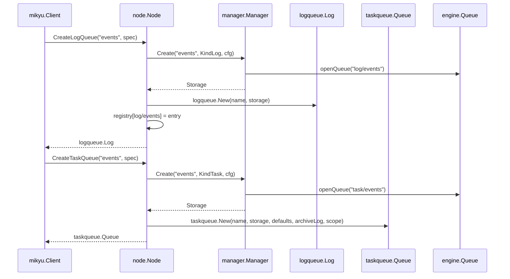
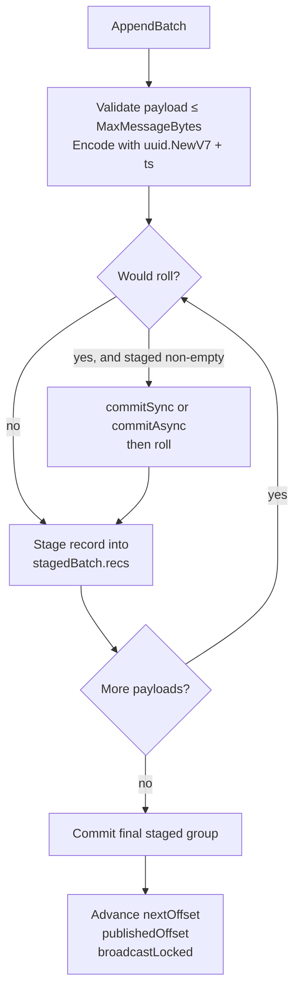
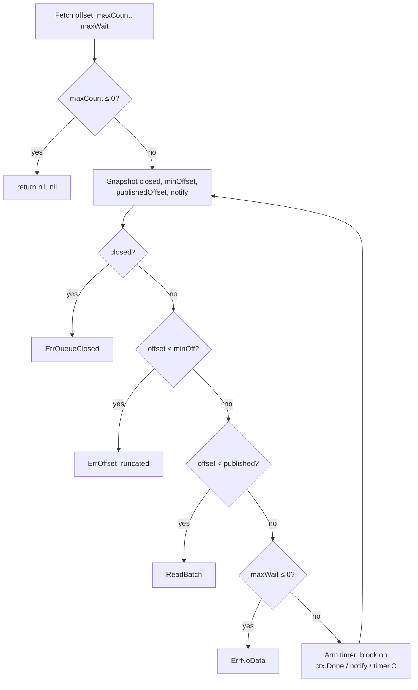
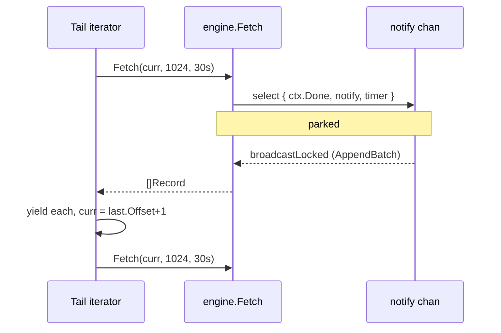
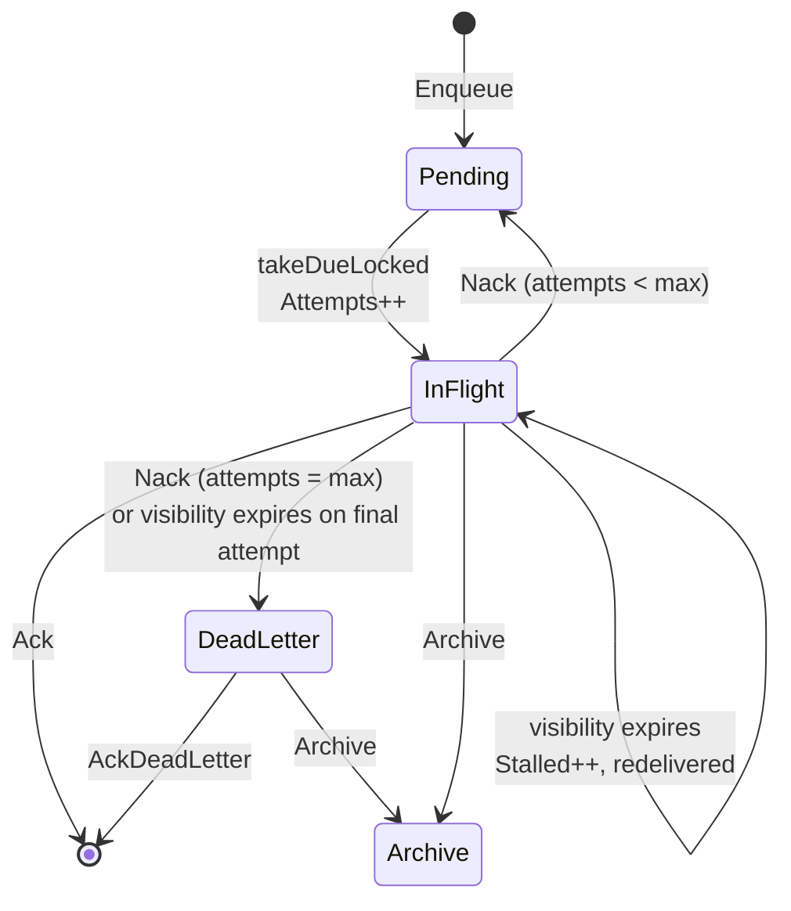
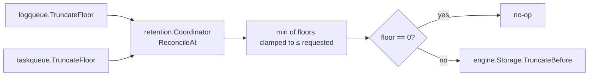
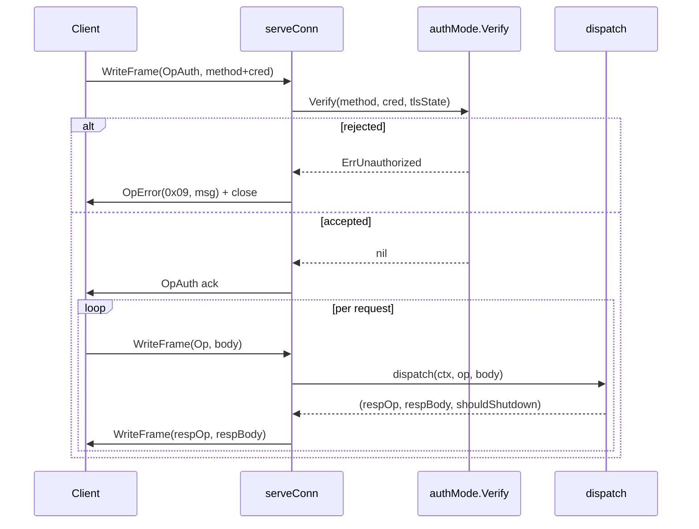
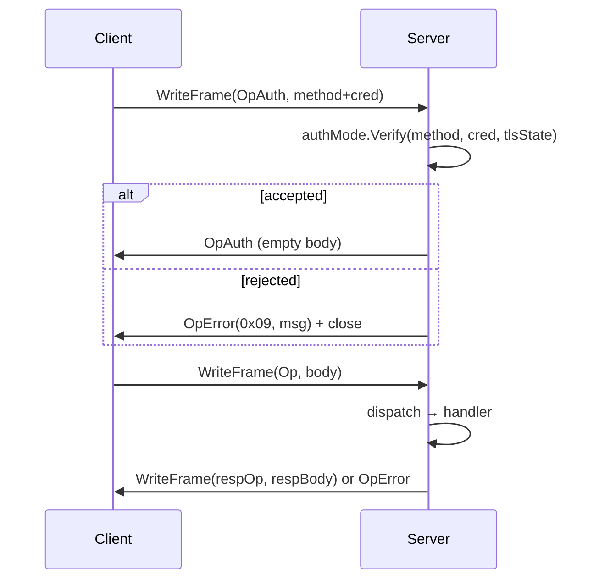

# Mikyu — Architecture & Implementation Specification

## Project Overview

**mikyu** is a high‑performance, log‑structured message queue written from scratch in Go. It presents **two structurally distinct queue kinds over one shared storage engine**:

- **Log queues** — append‑only streams with consumer‑group offset tracking, replay, continuous tail, truncation, keyed compaction, and per‑queue retention. Used for event logs, CDC pipelines, and replayable streams.
- **Task queues** — at‑least‑once delivery with visibility leases, exponential backoff, scheduling, stale‑lease protection, a durable per‑queue dead‑letter queue, an optional archive log, chunked checkpoint‑based crash recovery, and per‑queue in‑flight / DLQ bounds. Used for work pools and job processing.

Both kinds sit on the same `engine.Storage` interface, but they are **not** the same directory: a queue's kind is structural, and its parent directory under the data root is its kind. `log/events` and `task/events` are two different queues that share nothing but a filesystem tree.

The project ships as a **single binary** with four roles:

| Role | Entry | Description |
|---|---|---|
| Embedded engine | `mikyu.Open(dir, opts...)` | In‑process `node.Node`, no network, ref‑counted per data directory. |
| Remote client | `mikyu.Dial(target, opts...)` | Pooled TCP / Unix / Named‑Pipe wire client. |
| Daemon | `mikyu daemon` | Long‑lived server process over TCP, Unix socket, or Windows named pipe. |
| CLI / REPL | `mikyu <cmd>`, `mikyu shell` | Stateless one‑shot CLI and a styled interactive REPL. |

### Core Guarantees

- **Durable‑before‑ack (default, `Fsync: true`).** `Append`/`AppendBatch` block until the WAL flusher has `syncData`'d the record bytes and index entry. The returned offset is crash‑safe.
- **Optional crash‑loss window (`Fsync: false`).** The record is published to the ring cache and `publishedOffset` immediately; the flusher writes via `WriteAt` without `syncData`. Trades a small crash window for much lower latency. Bytes still land in the OS page cache.
- **Zero‑copy reads.** Closed segments are `mmap`'d read‑only. `Read` on a closed segment returns a sub‑slice of mapped memory with no heap allocation.
- **Ring cache.** The last 16,384 messages are cached in a lock‑protected ring for ~100 ns/op tail reads.
- **Long‑poll tailing.** `Fetch` blocks on the queue's `notify` channel for up to its `maxWait`, waking on every `AppendBatch` broadcast. `Stream` uses `maxWait=0` for a non‑blocking drain; `Tail` re‑arms a 30 s window per iteration.
- **Keyed compaction (log queues only).** Records carry an optional `Group` byte slice. When `Compaction` is enabled, `roll()` rewrites closed segments, dropping any record whose `Group` has a newer offset in the in‑memory key index. Readers see `ErrRecordCompacted`.
- **Chunked, self‑describing task checkpoints.** Task state is snapshotted into `recordCPStart` / `recordCPChunk` / `recordCPCommit` records; the newest valid commit wins on recovery, and corrupt or incomplete checkpoints are skipped in favor of earlier ones.
- **Archive log for tasks.** `Archive(ctx, ref)` moves an in‑flight or dead‑lettered task into a `<queue>-archive` log queue, preserving the original payload, key, attempts, and stalled count.
- **Single source of truth for configuration.** Every queue and session parameter lives in `spec.Table` with a canonical key, path, kind, layer, scope, mutability, env name, flag name, and option name. Every other surface (SDK, CLI, env, YAML, wire, storage) is driven from that one table, and the table itself is published: `mikyu.Schema()` locally, `OpSchema` over the wire.
- **One sentinel‑to‑wire‑code taxonomy.** `internal/errs` is the single mapping between Go sentinels and wire codes; both the server and the remote client route through it.
- **Live telemetry under one surface.** `internal/metrics` is the single observation point: a pull‑based `Collector` over a `Registry` of atomic instruments, materializing `Snapshot`s for the wire (`OpMetrics`), the CLI/REPL (`metrics`), and the daemon's Prometheus/JSON/SSE HTTP endpoints.
- **Enforced architecture.** `.go-arch-lint.yml` defines the package‑level dependency graph; `internal/audit` gates legacy names and comment style. CI fails on a violation.
- **Authentication is a handshake, not a per‑op concern.** The first frame on every connection is `OpAuth`; the server verifies it once, then dispatches. `none`, `token`, and `mtls` are the only supported modes, and an unauthenticated non‑loopback daemon refuses to start.

---

## Architectural Principles

1. **Layer purity.** `spec`, `metrics`, `errs`, and `protocol` are bottoms. `engine` imports only `metrics`. `manager` imports `engine` and `metrics`. `node` imports `spec`, `engine`, `manager`, `logqueue`, `taskqueue`, `retention`, `metrics`. `client` and `server` never import each other. `ui/*` reaches the world only through `mikyu`, `client`, `command`, `daemon`, `spec`. This graph is enforced by `.go-arch-lint.yml`.

2. **One storage engine, two structural kinds.** `engine.Storage` is the only contract the drivers see. `manager.Manager` owns two `*engine.Manager` roots — `log/` and `task/` — and dispatches by directory path. `logqueue` and `taskqueue` implement different semantics over the same engine bytes.

3. **Kind is structural.** A queue's kind is the name of its parent directory under the data root: `log/<name>` or `task/<name>`. `manager.GetOf(name, kind)` refuses to open a queue under the wrong kind, and `manager.ErrWrongKind` names the mismatch. This is why a single data directory can host `log/events` and `task/events` without collision.

4. **One configuration table.** `spec.Table` is the canonical parameter list. Every other surface is generated from it, and the table itself is published — `mikyu.Schema()` locally, `OpSchema` over the wire.

5. **One observation surface.** `internal/metrics` is the only telemetry contract. Every instrument flows through a `metrics.Scope`; every snapshot comes from a `metrics.Collector`. `Info` and `Stats` do not exist.

6. **One error taxonomy.** `internal/errs.Table` maps each Go sentinel to its wire code. `errs.CodeFor` and `errs.SentinelFor` are the only translators; the server wraps every error through `taskErr`, the remote client decodes every `OpError` through `decodeProtocolError`.

7. **The registry is a config artifact.** Per‑queue specs live in `queues.json`. The filesystem is the source of truth for existence; missing directories purge entries, orphan directories are adopted.

8. **The data directory is a lock.** `node.Acquire` takes an exclusive `flock` on `<dir>/mikyu.lock`. Two processes on the same dir fail fast with `ErrLocked`.

9. **Path escape is a compile‑time concern.** Every file operation in `engine`, `manager`, and `node` uses `os.Root` scoped to the appropriate root.

10. **Refcount over teardown.** Embedded clients share one `node.Node` per absolute data directory. `Close` decrements; the last one releases the manager, drivers, lock, collector, and retention loop.

11. **Errors are stable sentinels.** Wire codes map 1:1 to Go sentinels. Messages are human text, never contracts.

12. **Auth is one handshake per connection.** Credentials are declared once in `OpAuth` and verified once in `authMode.Verify`; the rest of the protocol is credential‑free. The verifier lives in `internal/server/auth.go`, not in `dispatch.go`.

---

## Layered Architecture

```mermaid
flowchart TB
    subgraph L6["Layer 6 — Access & Deployment"]
        CLI[internal/ui/cli]
        REPL[internal/ui/repl]
        CMD[internal/ui/command]
        DAEMON[internal/daemon]
        BIN[cmd/mikyu]
    end

    subgraph L5["Layer 5 — Client & Process Core"]
        CLIENT[internal/client<br/>embedded | remote]
        NODE[internal/node<br/>registry · pool · collector]
        CONFIG[internal/config<br/>yaml + env]
    end

    subgraph L4["Layer 4 — Drivers"]
        LOGQ[internal/queue/logqueue]
        TASKQ[internal/queue/taskqueue]
        GROUP[internal/queue/group]
        RET[internal/queue/retention]
    end

    subgraph L3["Layer 3 — Transport"]
        PROTO[internal/transport/protocol]
        IPC[internal/transport/ipc]
        SERVER[internal/server<br/>dispatch + auth]
    end

    subgraph L2["Layer 2 — Configuration & Schema"]
        SPEC[internal/spec<br/>Spec · Session · Table · codec]
    end

    subgraph L1["Layer 1 — Storage"]
        MGR[internal/manager<br/>log/ + task/ roots]
        ENG[internal/engine<br/>segments · WAL · ring cache]
        METRICS[internal/metrics]
        ERRS[internal/errs]
    end

    BIN --> CLI & REPL & DAEMON & CMD
    CLI & REPL & CMD --> CLIENT & DAEMON & SPEC & PROTO
    DAEMON --> CONFIG & SERVER & NODE & MGR
    CLIENT --> NODE & PROTO & IPC & ERRS & METRICS
    SERVER --> NODE & PROTO & IPC & ERRS & METRICS
    NODE --> MGR & LOGQ & TASKQ & RET & METRICS & SPEC
    MGR --> ENG
    LOGQ --> ENG & GROUP
    TASKQ --> ENG & METRICS
    RET --> ENG
    ENG --> METRICS
    SPEC --> ERRS
    PROTO --> ERRS
```

### The two structural kinds

A single data directory owns two engine roots. The top‑level `manager.Manager` is a thin coordinator: it partitions create/get/list/delete by kind and delegates to the right engine manager. It is the *only* place the kind string ("log" / "task") is turned into a directory path.

```go
// internal/manager/kind.go
type Kind uint8
const (
    KindLog  Kind = 1
    KindTask Kind = 2
)
func (k Kind) String() string { /* "log" | "task" | "unknown" */ }
func (k Kind) Valid() bool    { return k == KindLog || k == KindTask }

type Key struct { Name string; Kind Kind }
func (k Key) Label() string   { return k.Kind.String() + "/" + k.Name }

type QueueInfo struct {
    Name string `json:"name"`
    Kind Kind   `json:"kind"`
}
```

```go
// internal/manager/manager.go
type Manager struct {
    dir  string
    log  *engine.Manager
    task *engine.Manager
}

func Open(dir string, defaultCfg engine.Config,
          perQueue map[Key]engine.Config, regs ...*metrics.Registry) (*Manager, error)

func (m *Manager) Dir() string
func (m *Manager) Get(name string) (engine.Storage, Kind, error)
func (m *Manager) GetOf(name string, kind Kind) (engine.Storage, error)
func (m *Manager) Create(ctx context.Context, name string, kind Kind, cfg engine.Config) (engine.Storage, error)
func (m *Manager) Delete(ctx context.Context, name string) error
func (m *Manager) List(ctx context.Context) ([]QueueInfo, error)
func (m *Manager) Collect(ctx context.Context, dst *metrics.Snapshot)
func (m *Manager) Close() error
```

`Get` checks `log/` first, then `task/`, so `log/events` wins when both exist. `GetOf` inverts the precedence: it opens under the requested kind and returns `ErrWrongKind` when the directory belongs to the other kind. `Close` shuts the task root first (final checkpoints) and then the log root.

### Cross‑kind request flow



---

## Public SDK Surface — `mikyu`

The root package is the SDK facade. It re‑exports the engine's `Record`, the driver interfaces, the option constructors, the parameter table, and the sentinels.

### Client

```go
type Client interface {
    io.Closer

    CreateLogQueue(ctx context.Context, name string, opts ...QueueOption) (LogQueue, error)
    CreateTaskQueue(ctx context.Context, name string, opts ...QueueOption) (TaskQueue, error)

    LogQueue(name string) (LogQueue, error)
    TaskQueue(name string) (TaskQueue, error)

    UpdateQueue(ctx context.Context, name string, opts ...QueueOption) error
    DescribeQueue(ctx context.Context, name string) (QueueDescription, error)
    DeleteQueue(ctx context.Context, name string) error
    ListQueues(ctx context.Context) ([]QueueInfo, error)
    Truncate(ctx context.Context, name string, minOffset uint64) (int64, error)

    Metrics(ctx context.Context) (Metrics, error)
    Schema(ctx context.Context) ([]Param, error)
    SubscribeSnapshots() (<-chan Metrics, func())
}

func Open(dir string, opts ...ClientOption) (Client, error)
func Dial(target string, opts ...ClientOption) (Client, error)
```

### Driver interfaces

```go
type LogQueue = logqueue.Log
type TaskQueue = client.TaskQueue   // == taskqueue.Queue

type Record  = engine.Record
type Group   = logqueue.Group
type Task    = taskqueue.Task
type TaskRef = taskqueue.Ref
type TaskID  = taskqueue.ID
```

```go
// internal/queue/logqueue/api.go
type Log interface {
    Name() string
    Append(ctx context.Context, payload []byte, opts ...AppendOption) (uint64, error)
    AppendBatch(ctx context.Context, payloads [][]byte, opts ...AppendOption) ([]uint64, error)
    Read(ctx context.Context, offset uint64) (engine.Record, error)
    ReadBatch(ctx context.Context, startOffset uint64, count int) ([]engine.Record, error)
    LastOffset(ctx context.Context) (uint64, error)
    MinOffset(ctx context.Context) (uint64, error)
    Fetch(ctx context.Context, offset uint64, maxCount int, maxWait time.Duration) ([]engine.Record, error)
    CommitOffset(ctx context.Context, group string, offset uint64) error
    Committed(ctx context.Context, group string) (uint64, error)
    Truncate(ctx context.Context, minOffset uint64) (int64, error)
    TruncateFloor(ctx context.Context) (uint64, bool, error)
    Stream(ctx context.Context, startOffset uint64) iter.Seq2[engine.Record, error]
    Tail(ctx context.Context, startOffset uint64) iter.Seq2[engine.Record, error]
    Group(name string) Group
}
```

```go
// internal/queue/taskqueue/task.go
type Queue interface {
    Name() string
    Enqueue(ctx context.Context, payload []byte, opts ...EnqueueOption) (Task, error)
    Dequeue(ctx context.Context) (Task, error)
    TryDequeue(ctx context.Context) (Task, error)
    Ack(ctx context.Context, ref Ref) error
    Nack(ctx context.Context, ref Ref, opts ...NackOption) error
    Extend(ctx context.Context, ref Ref, timeout time.Duration) error
    DeadLetters(ctx context.Context) ([]Task, error)
    AckDeadLetter(ctx context.Context, ref Ref) error
    Archive(ctx context.Context, ref Ref) error
    SetDefaults(d Defaults)
    TruncateFloor(ctx context.Context) (uint64, bool, error)
}
```

### Typed wrapper

```go
// mikyu/typed.go
type Codec[T any] struct {
    Marshal   func(T) ([]byte, error)
    Unmarshal func([]byte, *T) error
}

type Typed[T any] struct { queue LogQueue; codec Codec[T] }
func NewTyped[T any](q LogQueue, codec Codec[T]) *Typed[T]
func (t *Typed[T]) Append(ctx context.Context, val T) (uint64, error)
func (t *Typed[T]) Read(ctx context.Context, offset uint64) (T, error)
```

### Published schema

```go
type Param      = spec.Param
type Kind       = spec.Kind
type Layer      = spec.Layer
type Scope      = spec.Scope
type Session    = spec.Session

func Schema() []Param                                 // fresh copy of spec.Table
func Lookup(key string) (Param, bool)
func EncodeSpec(s Spec) ([]byte, error)               // JSON
func EncodeSpecYAML(s Spec) ([]byte, error)
func DecodeSpec(data []byte) (Spec, error)
func DecodeSpecYAML(data []byte) (Spec, error)
func ValidateCreate(s Spec) error
func ValidateUpdate(patch Spec) error
func ValidateSession(s Session) error
func Builtin() Spec
func BuiltinSession() Session
```

### Option constructors

Every `With*` in `options.go` is a thin wrapper over the same method on the client package, which in turn writes a single field of `spec.Spec` or `spec.Session`:

```go
// Session options
WithSessionSpec, WithTarget, WithDataDir, WithMaxConns,
WithTLSEnabled, WithTLSCertFile, WithTLSKeyFile, WithAutoStart,
WithAuthMethod, WithAuthToken, WithAuthTokenFile, WithTLSClientCaFile,
WithMetricsEnabled, WithMetricsInterval, WithMetricsHistory,
WithMetricsListen, WithMetricsPerQueuePrometheus, WithMetricsHistograms

// Queue options (one per spec-layer parameter)
WithBatchSize, WithMaxInterval, WithMinInterval,
WithSegmentSize, WithMaxMessageBytes, WithSegmentAge,
WithEncrypted, WithFsync, WithCompaction,
WithRetentionAge, WithRetentionBytes,
WithDefaultVisibility, WithDefaultMaxAttempts,
WithMaxInFlight, WithMaxDLQ

// Call options
WithVisibility, WithMaxAttempts, WithScheduledAt, WithRetryAfter,
WithKey, WithRecordKey
```

---

## Configuration & Schema — `internal/spec`

`spec.Table` is the canonical parameter list. Every parameter is one row.

```go
type Param struct {
    Key        string     `json:"key"`
    Path       string     `json:"path"`
    Kind       Kind       `json:"kind"`
    Layer      Layer      `json:"layer"`
    Scope      Scope      `json:"scope"`
    Mutability Mutability `json:"mutability"`
    EnvName    string     `json:"env_name"`
    FlagName   string     `json:"flag_name"`
    OptionName string     `json:"option_name"`
    Apply        func(*Spec, Value)    `json:"-"`
    ApplySession func(*Session, Value) `json:"-"`
}
```

### Layers

| Layer | Where it can be set | Persistence |
|---|---|---|
| `LayerCall` | Per call (`WithVisibility`, `WithRetryAfter`, `WithMaxAttempts`, `WithScheduledAt`) | Never persisted. Not a `Spec` field. No env var. |
| `LayerSpec` | Per queue (`CreateQueue`/`UpdateQueue` options, `defaults:` block in YAML, `MIKYU_*` env) | `queues.json` and wire JSON. Has `Spec` fields. |
| `LayerSession` | Per process / session (`--dir`, `--target`, `MIKYU_TARGET`, `--metrics-listen`, `--auth-method`, etc.) | `mikyu.yaml` `server:` block, or env. Never reaches the wire queue spec. |

### Scope

Session parameters additionally carry a scope: `ScopeClient`, `ScopeServer`, or `ScopeBoth`. The CLI's global flag set is `spec.ParamsInScope(LayerSession, ScopeClient, ScopeBoth)`; the daemon's flag set is the full session list.

### Effective spec resolution

```
effective = stored.Spec.Merge(session_defaults).Merge(spec.Builtin())
```

`DescribeQueue` returns **all three spec layers**: the stored spec, the effective spec, and the session defaults it inherits. Live storage stats no longer live on `DescribeQueue`; they are observed through `Metrics`.

### Built‑ins

`Builtin()` is total: every `LayerSpec` field is set. `BuiltinSession()` is likewise total for `LayerSession`. The important ones:

| Key | Value |
|---|---|
| `engine.batch_size` | `256` |
| `engine.max_interval` | `10ms` |
| `engine.min_interval` | `30µs` |
| `engine.segment_size` | `64 MiB` |
| `engine.segment_age` | `1h` |
| `engine.max_message_bytes` | `1 MiB` |
| `engine.encrypted` | `false` |
| `engine.fsync` | `true` |
| `engine.compaction` | `false` |
| `retention.age` / `retention.bytes` | `0` (unlimited) |
| `task.default_visibility` | `30s` |
| `task.default_max_attempts` | `5` |
| `task.max_in_flight` | `100000` |
| `task.max_dlq` | `100000` |
| `server.target` | `tcp://127.0.0.1:7420` |
| `server.data_dir` | `./data` |
| `server.max_conns` | `10` |
| `server.auth_method` | `none` |
| `server.metrics_enabled` | `true` |
| `server.metrics_interval` | `1s` |
| `server.metrics_history` | `300` |
| `server.metrics_listen` | `""` |

### Sparse encoding

All `Spec` fields are pointers. `EncodeSpec` omits unset fields (`{"engine":{"fsync":true}}`), and `DecodeSpec` uses `DisallowUnknownFields` + `MaxSpecPayload = 1 MiB` + trailing‑data rejection. Same schema for JSON (wire) and YAML (config), enforced by `TestSpecTagsIdentical`.

### Session validation

`spec.ValidateSession` is the only place session‑level invariants are checked:

- `max_conns` must be ≥ 1.
- `metrics_interval` must be positive when metrics are enabled; `metrics_history` ≥ 1.
- `metrics_listen`, when set, must be a `host:port`.
- `auth_method` must be `""`, `none`, `none-insecure`, `token`, or `mtls`.
- `token` mode requires `auth_token` or `auth_token_file`; a token shorter than 16 bytes is rejected.
- `mtls` requires `tls_enabled`.

`node.Acquire` and `config.Load` both call it, so a session that fails validation never reaches the wire server.

---

## Storage Engine — `internal/engine`

### `Storage` interface

```go
type Storage interface {
    Name() string
    Append(ctx context.Context, payload []byte, opts ...AppendOption) (uint64, error)
    AppendBatch(ctx context.Context, payloads [][]byte, opts ...AppendOption) ([]uint64, error)
    Read(ctx context.Context, offset uint64) (Record, error)
    ReadBatch(ctx context.Context, start uint64, n int) ([]Record, error)
    Fetch(ctx context.Context, offset uint64, maxCount int, maxWait time.Duration) ([]Record, error)
    LastOffset() uint64
    CommitOffset(ctx context.Context, group string, offset uint64) error
    Committed(ctx context.Context, group string) (uint64, error)
    MaxAppendPayloadBytes() int64
    MinOffset() uint64
    Segments() []SegmentInfo
    TruncateBefore(ctx context.Context, offset uint64) (int64, error)
    FloorOlderThan(ctx context.Context, olderThan time.Time) (uint64, error)
    FloorForSize(ctx context.Context, maxBytes int64) (uint64, error)
}
```

`Fetch` is the streaming primitive both `logqueue.Stream` and `logqueue.Tail` build on; it is the only read method that blocks.

### `Record`

```go
type Record struct {
    Offset    uint64
    ID        string
    Timestamp time.Time
    Group     []byte   // keyed compaction group; nil for unkeyed records
    Payload   []byte
}
```

`Group` is the log driver's compaction key. It is written into the record's body by `encodeRecord`, and read back by `decodeRecord`. An empty `Group` means the record is unkeyed and never compacted.

### `Config`

```go
type Config struct {
    BatchSize        int
    MaxInterval      time.Duration
    MinInterval      time.Duration
    SegmentSize      int64
    MaxMessageBytes  int64
    SegmentAge       time.Duration
    Encrypted        bool
    Fsync            bool
    Compaction       bool
    CompactionPolicy CompactionPolicy
}

type CompactionPolicy struct {
    ExtractGroup func(payload []byte) []byte
}
```

`withDefaults()` fills zeros. `ApplyConfig` merges the mutable fields into a live queue and calls `wal.UpdateConfig`. Create‑only fields (`SegmentSize`, `MaxMessageBytes`, `Encrypted`, `Fsync`, `Compaction`) are silently ignored on the live path.

### `Manager` (per kind)

```go
type Manager struct {
    mu      sync.RWMutex
    dir     string
    root    *os.Root
    cfg     Config
    queues  map[string]*Queue
    offsets *OffsetStore
    reg     *metrics.Registry
}

func OpenManager(dir string, cfg Config, perQueue map[string]Config,
                 regs ...*metrics.Registry) (*Manager, error)
func (m *Manager) Create(name string, opts ...Config) (Storage, error)
func (m *Manager) Get(name string) (Storage, error)
func (m *Manager) List() []string
func (m *Manager) Delete(name string) error
func (m *Manager) Collect(_ context.Context, dst *metrics.Snapshot)
func (m *Manager) Close() error
```

Each `manager.Manager` opens one engine manager per kind root. The offsets file (`manager-offsets.dat`) is per root, so consumer groups on `log/events` and `task/events` are stored in different files.

### `Queue`

```go
type Queue struct {
    name              string
    dir               string
    cfg               Config
    active            *segment
    segments          []*segment
    nextOffset        uint64
    minOffset         uint64
    publishedOffset   uint64
    w                 *wal
    offsets           *OffsetStore
    cache             *ringCache
    nextPreallocBytes int64
    closed            bool
    notify            chan struct{}
    keyIndex          map[string]uint64
    m                 *queueMetrics
    scope             *metrics.Scope
    mu                sync.RWMutex
}
```

`openQueue` creates the queue directory **through `os.Root` scoped to the parent**, so a hostile name cannot escape the data dir. All file I/O in `segment` uses the same mechanism.

#### Append & AppendBatch

`Append` delegates to `AppendBatch`. The batch path stages per‑segment sub‑batches so a WAL write never straddles a roll:



1. Validate `len(payload) <= MaxMessageBytes`; encode with `uuid.NewV7()` and a shared timestamp; reject records larger than `SegmentSize` with `ErrRecordTooLarge`.
2. Stage into a `stagedBatch{w, seg, recs, positions, recLens, offsets, ids, totalLen, startIdx}`.
3. On roll (size or age), commit the staged group through either:
   - **`commitSync`** (`Fsync: true`): `wal.pushBatch` publishes sequence numbers; the caller unlocks and waits on `wal.wait(seq)` (or delivers the wake token), then `roll()`s and starts a new group.
   - **`commitAsync`** (`Fsync: false`): clone payloads into the ring cache, publish records on `wal.asyncChan`, advance `publishedOffset`, then `roll()`.
4. Final staged group is committed after the loop.

#### Read & ReadBatch

`Read`:

1. `q.cache.Get(offset)` — hit returns the shallow message.
2. `q.locateSegment(offset)` — `slices.BinarySearchFunc` over `q.segments` base offsets (O(log S)). Handles `offset < minOffset` (`ErrOffsetTruncated`), `offset ≥ publishedOffset` (`ErrOffsetNotFound`).
3. `q.readFromSegment(seg, offset)` — reads from `seg.mmapData` when mapped, else `seg.logFile.ReadAt`; `decodeRecord` validates CRC and length.
4. `q.superseded(msg.Group, offset)` — when compaction is on and the record's group has a newer offset, return `ErrRecordCompacted`.

`ReadBatch` walks offsets in order, reusing the current segment pointer between consecutive offsets and short‑circuiting to `locateSegment` only on boundary crossings. Compacted offsets are skipped.

#### Fetch



`notify` is broadcast by `broadcastLocked()` — called by both the sync and async `AppendBatch` paths after `publishedOffset` advances — so a parked reader wakes the instant a new record is visible.

#### Segment rolling & preallocation

`nextPreallocBytes` starts at `min(8 MiB, SegmentSize)` and adapts inside `roll()`:

- Segment filled in under 10 s → double, capped at `min(256 MiB, SegmentSize)`.
- Segment filled after 5 m → halve, floored at the 8 MiB min.
- The active segment is truncated to its written `pos` before `enableMMap`.

#### Compaction

When `Config.Compaction` is true, the queue keeps an in‑memory `keyIndex map[string]uint64` mapping each group to its newest offset. `buildKeyIndex` walks every record on open. After every `roll()`, `compactClosedLocked` rewrites each closed segment in place:

1. Walk the segment's index entries; for each record, decode the group and check `keyIndex[group] != off`. If true, the record is superseded and dropped.
2. Unmap the segment; rewrite the `.log` file with only the kept records concatenated; zero the index slots of dropped records.
3. `cache.Evict(evicted...)` so stale ring slots disappear.
4. `supersededLocked` is checked on every `Read` and `ReadBatch` so a superseded record that hasn't physically rolled yet still returns `ErrRecordCompacted`.

`CompactionPolicy.ExtractGroup` lets a caller override how the group is derived (by default it uses the record's `Group` field).

#### Close & ApplyConfig

`Close` stops the WAL, closes every segment, marks `closed`, and broadcasts. `ApplyConfig` updates `BatchSize`, `MaxInterval`, `MinInterval`, `SegmentAge` on the live queue and pushes the flusher config via `wal.UpdateConfig`.

### WAL

```go
type wal struct {
    cfg  Config
    file *os.File

    mu          sync.Mutex
    cond        *sync.Cond
    buf         []byte
    pending     []pendingEntry
    swapBuf     []byte
    swapPending []pendingEntry
    pushed      int64
    published   int64
    err         error

    asyncChan     chan asyncEntry
    wake          chan struct{}
    configChanged chan struct{}
    shutdown      chan struct{}
    done          chan struct{}
    stopOnce      sync.Once

    m *walMetrics
}
```

**Sync path.** `push`/`pushBatch` stage bytes + pending entries into `buf`/`pending` under lock; the flusher (`syncLoop`) selects over `asyncChan`, `ticker.C` (`MaxInterval`), `wake`, `configChanged`, `shutdown`. `adaptiveFlush` sleeps `MinInterval` before calling `flush()` when the current batch is below `BatchSize`. `flush` swaps `buf ↔ swapBuf` and `pending ↔ swapPending`, drains the wake token under lock, calls `file.WriteAt`, and (if `Fsync`) `syncData`; then broadcasts on `cond` and reclaims the swap buffers. Producers `wait(seq)` on `cond`.

**Async path.** `Queue.AppendBatch` writes records onto `wal.asyncChan` and clones into the ring cache. `drainAndFlushAsync(first)` groups up to `BatchSize` entries, writes each record at its recorded `pos`, writes the corresponding `.idx` entry, and advances `published` contiguously.

**Single writer.** `writeAt` is the only writer of the WAL segment file; `flush` and `drainAndFlushAsync` call it. `writerHook` (test hook) records the goroutine ID to assert the invariant.

**Wake‑token correctness.** The `wake` channel has buffer 1 and is drained inside `flush()` under lock, preventing producer hangs when `adaptiveFlush` is mid‑linger.

**Platform `syncData`:**

| OS | Call |
|---|---|
| Darwin | `unix.FcntlInt(fd, unix.F_FULLFSYNC, 0)` (drive cache) |
| Linux/BSD | `unix.Fdatasync(fd)` |
| Windows | `file.Sync()` |

### Segment

```go
type segment struct {
    baseOff      uint64
    dir          string
    logName      string
    idxName      string
    logFile      *os.File
    idxFile      *os.File
    pos          int64
    preallocSize int64
    createdAt    time.Time
    mmapData     mmap.MMap
    idxMMap      mmap.MMap
}
```

- `openSegment(dir, baseOff, preallocSize)` preallocates the `.log` file if empty.
- `enableMMap()` maps both files read‑only **only if `Stat().Size() > 0`** (Windows robustness).
- `recover()` tries `tryFastRecovery` (validates last index entry, copies raw entries); on failure, `rebuild()` re‑walks the `.log` file, validates each CRC‑checked record, rewrites `.idx`, truncates torn tails.
- `readIndexEntry(offset)` reads 16 bytes from `idxMMap` (closed) or `idxFile.ReadAt`.
- `lastTimestamp()` returns the timestamp of the newest record (used by `FloorOlderThan`).
- `destroy()` unmaps, closes, and unlinks both files through an `os.Root`.
- `Close()` truncates the active `.log` to `pos`, unmaps, closes.

### Record format

```
[4B Body Length][4B CRC32][2B ID Length (=16)][16B Raw UUID v7][8B Unix Nanoseconds][2B Group Length][Group][Payload]
```

CRC‑32/IEEE covers the body (`rec[8:]`). `decodeRecord` returns `(id string, ts time.Time, group, payload []byte, err error)`.

### Ring cache

`slots [16384]Record`, indexed by `offset & (capacity-1)` under `sync.RWMutex`. `EvictBefore(minOffset)` zeros slots below the new floor. `Evict(offsets...)` removes specific slots when compaction drops them out of order. `Get(offset)` validates `msg.Offset == offset` and non‑zero timestamp to defend against stale slots.

### Offset store

One `manager-offsets.dat` file per engine root persists `(queue:group) → uint64` as `[2B keyLen][key][8B offset]` tuples. `recover()` streams valid records and stops on torn tails. `Commit` writes, flushes, `Sync`s, and every `compactAppendsThreshold = 5000` appends triggers `compactLocked`, which rewrites the file atomically via `os.Rename` from `manager-offsets.dat.tmp`. `syncDir` after the rename makes the new file durable.

### Retention primitives — `compact.go`

- `MinOffset()`, `Segments()` return snapshots.
- `FloorOlderThan(ctx, olderThan)` walks **closed** segments oldest → newest; a segment qualifies only if its last record is strictly before `olderThan`. The active segment is never included.
- `FloorForSize(ctx, maxBytes)` drops whole oldest closed segments while total size exceeds `maxBytes`.
- `TruncateBefore(ctx, targetOffset)` unlinks closed segments with `nextOffset <= targetOffset`; stops at the first straddling segment; updates `minOffset`; calls `cache.EvictBefore`.

### Durability sites

The `syncDir` hook fires at four places:

1. A newly created segment file.
2. Offset‑store compaction's rename.
3. `queues.json`'s rename.
4. An active segment's close‑time truncation.

`engine.SyncDirHook` is set by tests to count them.

### Kernel directory encryption

| OS | Mechanism |
|---|---|
| Linux | `SYS_IOCTL` with `FS_IOC_SET_ENCRYPTION_POLICY`; `AES_256_XTS` contents, `AES_256_CTS` filenames. Tolerates `ENOTTY`, `EOPNOTSUPP`, `EEXIST`. |
| Windows | `EncryptFileW` from `advapi32.dll` (NTFS EFS). |
| Other (macOS/BSD) | Logs a warning and returns `nil`. |

---

## Log Queue Driver — `internal/queue/logqueue`

### State

```go
type queue struct {
    name    string
    storage engine.Storage
    mu      sync.RWMutex
    groups  map[string]*queueGroup
}
```

A log queue wraps a single `engine.Storage` and caches one `*queueGroup` per consumer group name.

### Append options

```go
type AppendOption func(*appendOptions)
type appendOptions struct{ key []byte }

func WithKey(k []byte) AppendOption
func ResolveAppendOptions(opts ...AppendOption) (key []byte)
```

`Append` and `AppendBatch` resolve the key and pass it to `engine.WithGroup`, which becomes the record's `Group` field.

### Consumer group

```go
type Group interface {
    io.Closer
    Name() string
    Mark(offset uint64)
    Commit(ctx context.Context) error
    Committed(ctx context.Context) (uint64, error)
}

type queueGroup struct {
    group.Base
    q *queue
}
```

`group.Base` holds a `sync.Mutex`‑guarded `HighWater uint64`, a `Closed` flag, and a `CommitFn func(ctx, offset) error`. `Mark(offset)` advances `HighWater` to `offset+1` (monotonic). `Commit` snapshots the high water and calls `CommitFn`. `Close` is idempotent and commits the final high water.

### Stream and Tail

```go
const (
    streamBatch = 1024
    tailWait    = 30 * time.Second
)
```

- **`Stream(ctx, startOffset)`** drains every existing record and returns on `ErrNoData`. It passes `maxWait=0`, which turns `Fetch` into a strictly non‑blocking drain.
- **`Tail(ctx, startOffset)`** yields existing records, then blocks in `Fetch` for up to `tailWait` per iteration; `ErrNoData` simply re‑arms the wait, so an idle tail costs one long‑poll per 30 s window.



### Retention

```go
func (q *queue) TruncateFloor(ctx context.Context) (uint64, bool, error)
func (q *queue) Truncate(ctx context.Context, minOffset uint64) (int64, error)
```

`TruncateFloor` returns `min(HighWater across all groups)` and a `constrained` flag. No groups → `(0, false)`. When `Truncate(0)` is called with no explicit offset, the driver substitutes its own floor if constrained; otherwise the call is a no‑op.

---

## Task Queue Driver — `internal/queue/taskqueue`

### State

```go
type queue struct {
    name    string
    storage engine.Storage

    mu                sync.Mutex
    active            map[string]*taskState
    dlq               map[string]Task
    dlqUncheckpointed map[string]struct{}
    schedule          scheduleHeap
    sequence          uint64
    scanNext          uint64

    checkpointOffset uint64
    dirty            uint64
    notify           chan struct{}
    stopCh           chan struct{}
    wg               sync.WaitGroup
    closing, closed  bool

    defaultVisibility  time.Duration
    defaultMaxAttempts uint32
    maxInFlight        uint32
    maxDLQ             uint32

    archiveLog ArchiveLogFor
    m          *taskMetrics
}
```

Lifecycle: `New` opens the storage, calls `loadCheckpointLocked`, sets `scanNext = MinOffset()` if zero, calls `refreshLocked` to replay post‑checkpoint records, and starts `checkpointLoop` (5 s ticker). `Close` stops the loop, writes a final checkpoint if dirty, marks closed.

### Types

```go
type Task struct {
    ID          string
    Payload     []byte
    Attempts    uint32
    MaxAttempts uint32
    Visibility  time.Time
    ScheduledAt time.Time
    DeliveryID  string
    Offset      uint64
    Key         []byte
    Stalled     uint32
}

type Ref interface { taskRef(); taskID() string }
type ID string       // bare ID → skip strict lease check
// Task also implements Ref → strict check on Offset+Attempts+DeliveryID
```

`Stalled` counts how many times a lease has been reclaimed after its visibility expired. It is preserved across redelivery and checkpoint restart, and it is deliberately **not** part of the lease identity check.

### Defaults and options

```go
const (
    defaultVisibilityTimeout  = 30 * time.Second
    defaultMaxAttempts        = 5
    defaultRetryDelay         = time.Second
    defaultMaxRetryDelay      = 5 * time.Minute
    defaultCheckpointInterval = 5 * time.Second
    checkpointEvery           = 128
    checkpointChunkBytes      = 64 * 1024
)

type Defaults struct {
    Visibility  time.Duration
    MaxAttempts uint32
    MaxInFlight uint32
    MaxDLQ      uint32
}

type EnqueueOption func(*enqueueOptions)
func WithVisibility(d time.Duration) EnqueueOption
func WithMaxAttempts(n uint32) EnqueueOption
func WithScheduledAt(t time.Time) EnqueueOption
func WithKey(k []byte) EnqueueOption
func ResolveWireEnqueueOptions(opts ...EnqueueOption) (visibility, maxAttempts, scheduledAt)
func ResolveEnqueueOptions(opts ...EnqueueOption) (visibility, maxAttempts, scheduledAt, key)

type NackOption func(*nackOptions)
func WithRetryAfter(d time.Duration) NackOption
func ResolveNackOptions(task Task, opts ...NackOption) time.Duration
```

`ResolveNackOptions` computes exponential backoff `defaultRetryDelay * 2^(Attempts-1)` capped at `defaultMaxRetryDelay`. `ResolveWireEnqueueOptions` returns unset zeros so a remote client sends "inherit" rather than pre‑resolving built‑ins.

### Enqueue

`Enqueue` acquires the lock once to check the `MaxInFlight` bound and to resolve options, then again to append the record. It:

1. Generates a 32‑char hex ID from `crypto/rand`.
2. Appends `encodeTaskRecord(id, maxAttempts, visibilityTimeout, scheduledAt, payload, key, stalled=0)`.
3. Installs a `taskState{task, nextAt: scheduledAt, visibilityTimeout}`.
4. Pushes onto the schedule, sets `scanNext = offset + 1`, increments `dirty`, broadcasts.
5. Observes `enqueue_duration`.

### Dequeue

```go
func (q *queue) TryDequeue(ctx context.Context) (Task, error)   // one pass
func (q *queue) Dequeue(ctx context.Context) (Task, error)      // blocks
```

`Dequeue` loops on `takeDueLocked(ctx, now)`:

1. Pop stale entries (version mismatch or missing from `active`).
2. If the due task is in‑flight on its **final** attempt → dead‑letter: append `recordDLQ`, move to `dlq`, mark `dlqUncheckpointed`, broadcast, continue.
3. Otherwise assign a fresh `DeliveryID`, set `inFlight=true`, `Attempts++`, `Visibility = now + visibilityTimeout`, bump version, re‑push onto schedule, broadcast, return.



`Dequeue` parks on `notify` or a timer until `waitUntil`. Context cancellation returns `ctx.Err()`. Successful takes observe `dequeue_wait` with the time between the due moment and the actual delivery.

### Lease resolution

```go
func (q *queue) resolveLeaseLocked(ref Ref) (*taskState, error)
```

The single source of truth for lease validity:

- `nil` → `ErrInvalidTask`.
- Not in `active` → `ErrTaskNotFound`.
- Not `inFlight` → `ErrTaskNotInflight`.
- Visibility expired → `ErrTaskStale`.
- **Strict mode** (`ref` is `Task`): requires `Offset`, `Attempts`, and non‑empty `DeliveryID` to match exactly; mismatch → `ErrTaskStale`.
- **Loose mode** (`ref` is `TaskID`): skips the strict comparison; the visibility check still applies.

`broadcastLocked` closes the current `notify` channel and allocates a fresh one, waking every parked `Dequeue`.

### Ack / Nack / Extend / DLQ / Archive

- **`Ack`** — `resolveLeaseLocked`, delete from `active`, `dirty++`, broadcast, prune schedule, bump `acks`.
- **`Nack`** — `resolveLeaseLocked`; if `Attempts >= MaxAttempts`, dead‑letter (with a DLQ‑overflow drop of the oldest entry when `MaxDLQ` is exceeded); otherwise reset `inFlight`, clear `DeliveryID`, set `nextAt = now + retryAfter`, bump version, re‑push, broadcast. Bumps `nacks` in both branches.
- **`Extend`** — only extends `Visibility` forward (never shortens); never increments `Attempts`; bumps `extends`.
- **`DeadLetters`** — returns an offset‑sorted snapshot; **`AckDeadLetter`** verifies `Offset`/`Attempts` when `ref` is a `Task` (else `ErrDeadLetterStale`), appends `recordDLQAck`, deletes, bumps `dlq_acks`.
- **`Archive`** — resolves the ref against `active` first (strict), then `dlq`. On success, encodes an `archiveEnvelope`, appends it to the `<queue>-archive` log queue (created lazily via `ArchiveLogFor`), and removes the task from its source. On append failure, the task stays in place and `ErrArchiveFailed` is returned.

### Scheduler

`scheduleHeap` is a binary min‑heap ordered by `(due, seq)`. `pushScheduleLocked` bumps `q.sequence` and pushes. `pruneScheduleLocked` rebuilds the heap when `len(schedule) > len(active)*3 + 1024`.

### Checkpointing

Record kinds (8‑byte magic `MIKYUTQ\x01`, then one kind byte):

| Kind | Name | Payload |
|---|---|---|
| 1 | `recordTask` | id, maxAttempts, visibilityTimeout, scheduledAt, key, stalled, payload |
| 2 | `recordCPStart` | coveredThrough (u64), checkpointVersion (u32 = 3) |
| 3 | `recordCPChunk` | index (u32), data (bytes) |
| 4 | `recordCPCommit` | startOffset (u64), totalChunks (u32), coveredThrough (u64), version (u32) |
| 5 | `recordDLQ` | offset, id, attempts, maxAttempts, scheduledAt, key, stalled, payload |
| 6 | `recordDLQAck` | offset, id, attempts |

**`checkpointLocked`**:

1. `refreshLocked` to include foreign records appended since the last task op.
2. Snapshot `active` (sorted by offset) + `dlq` (sorted by offset) via `encodeSnapshot`.
3. Append `recordCPStart(coveredThrough)`.
4. Split the snapshot into ≤ `min(MaxAppendPayloadBytes() - header, checkpointChunkBytes)` chunks; append `recordCPChunk(i, data)` for each.
5. Append `recordCPCommit(startOffset, totalChunks, coveredThrough)`.
6. Verify `commitOffset == startOffset + totalChunks + 1`; on mismatch return `ErrCheckpointCorrupt`.
7. Clear `dlqUncheckpointed` and reset `dirty`.

If the queue is empty, one empty chunk is written so `totalChunks ≥ 1` always holds.

**`loadCheckpointLocked`** scans backward from `LastOffset()` for the newest valid commit record. It validates: commit bounds, chunk count ≤ `maxCheckpointChunks = 1<<20`, covered bytes ≤ `maxCheckpointBytes = 512 MiB`, chunk indices match, snapshot decodes cleanly. Any failure → try an earlier commit. Success → rebuild `active`, `dlq`, and set `scanNext = off + 1`.

**`refreshLocked`** walks `scanNext` forward. `recordTask`, `recordDLQ`, `recordDLQAck` are decoded; `recordCP*` are ignored; **anything else is treated as a corrupt task record and reported with `ErrCorruptRecord` naming the queue**. This is how the task driver refuses to reinterpret a moved log directory.

### Archive envelope

```go
func encodeArchiveEnvelope(task Task, sourceQueue, from string) []byte
// sourceQueue(string) + key(string) + taskPayload(bytes) +
// attempts(u32) + stalled(u32) + deliveryID(string) +
// offset(u64) + archivedFrom(string) + timestamp(u64)

func decodeArchiveEnvelope(payload []byte) (sourceQueue, key string, taskPayload []byte,
    attempts, stalled uint32, deliveryID string, offset uint64,
    archivedFrom string, timestamp time.Time, err error)
```

`ArchivePrefix = "-archive"`. The node's `archiveLogFor()` factory:

1. Looks up `<source>-archive` through the manager.
2. If it exists as a log queue, returns a `logArchiveAppender` wrapping it.
3. If it exists as a task queue, returns `ErrWrongKind`.
4. If it does not exist, creates it as a log queue with empty spec.

### Task metrics

```go
type taskMetrics struct {
    enqueues    *metrics.Counter
    dequeues    *metrics.Counter
    acks        *metrics.Counter
    nacks       *metrics.Counter
    extends     *metrics.Counter
    dlqAcks     *metrics.Counter
    dlqOverflow *metrics.Counter
    taskStalls  *metrics.Counter
    enqueueDur  *metrics.Histogram
    dequeueWait *metrics.Histogram
}
```

`NewTaskQueue` accepts an optional `*metrics.Scope` and caches the instruments once. `recordEnqueue` and `recordDequeue` observe the histograms; `Ack`, `Nack`, `Extend`, and `AckDeadLetter` bump their counters inside the same critical section that mutates state.

---

## Cross‑Driver Retention — `internal/queue/retention`

```go
type FloorProvider interface {
    TruncateFloor(ctx context.Context) (floor uint64, constrained bool, err error)
}

type Policy struct {
    Age   time.Duration
    Bytes int64
}

type Target struct {
    Name    string
    Storage engine.Storage
    Driver  FloorProvider
    Policy  Policy
    mu      sync.Mutex
}

type Coordinator struct {
    mu       sync.RWMutex
    targets  map[string]*Target
    interval time.Duration
}

func NewCoordinator(interval time.Duration) *Coordinator
func (c *Coordinator) RegisterTarget(target *Target)
func (c *Coordinator) SetPolicy(name string, p Policy) (shrunk bool)
func (c *Coordinator) UnregisterTarget(name string)
func (c *Coordinator) ReconcileQueue(ctx context.Context, name string) (int64, error)
func (c *Coordinator) ReconcileAt(ctx context.Context, name string, requested uint64) (int64, error)
func (c *Coordinator) ReconcileAll(ctx context.Context) map[string]int64
func (c *Coordinator) Start(ctx context.Context)
```

`SetPolicy` compares against the previous policy using `isShrink`, which reports `true` when a zero (=unlimited) dimension becomes bounded or a finite bound decreases. `tighter` handles zero as "above every finite bound".

`ReconcileAt` computes `policyFloor` (via `FloorOlderThan` / `FloorForSize`, at least `requested`), then clamps by `min(all driver floors)`. Zero → no‑op. Otherwise `storage.TruncateBefore(safeFloor)`.

The node wires `SetPolicy` to `UpdateQueue`; a shrink triggers an out‑of‑band reconcile bounded by the node's retention context (5 minutes).



---

## Transport — `internal/transport`

### Protocol frames

```
+-----------------+---------------+----------------------+
| Length (uint32) | Opcode (u8)   | Payload              |
| 4 bytes         | 1 byte        | (Length - 1) bytes   |
+-----------------+---------------+----------------------+
```

`MaxFrameBytes = 256 MiB`. `WriteFrame` grabs a pooled `[]byte` (32 KiB seed), grows it in‑place while retaining the pointer, writes `[length][op][payload]`, returns the buffer to the pool. `ReadFrame` validates length, allocates exactly `length-1` bytes, reads in one `io.ReadFull`. `ReadFrameInto` supports buffer reuse for the server's per‑connection read loop.

### Bytes

`Reader` provides bounds‑checked `ReadU8`/`ReadU16`/`ReadU32`/`ReadU64`/`ReadBytes`; `Buffer` provides symmetric writers. All integers are big‑endian.

### Opcodes

Opcodes are **nibble‑grouped** by subsystem:

| Subsystem | Range | Ops |
|---|---|---|
| Admin | `0x0X` | `OpCreate` (0x00), `OpDelete` (0x01), `OpList` (0x02), `OpUpdate` (0x03), `OpDescribe` (0x04), `OpTruncate` (0x05), `OpMetrics` (0x07), `OpSchema` (0x08), `OpShutdown` (0x0C) |
| Log | `0x1X` | `OpAppend` (0x10), `OpAppendBatch` (0x11), `OpRead` (0x12), `OpReadBatch` (0x13), `OpLastOffset` (0x14), `OpMinOffset` (0x15), `OpCommit` (0x16), `OpCommitted` (0x17), `OpFetch` (0x18) |
| Task | `0x2X` | `OpEnqueue` (0x20), `OpDequeue` (0x21), `OpAck` (0x22), `OpNack` (0x23), `OpExtend` (0x24), `OpArchive` (0x25) |
| Dead‑letter | `0x3X` | `OpDeadLetters` (0x30), `OpDeadLetterAck` (0x31) |
| Protocol‑level | — | `OpError` (0xFF), `OpAuth` (0x7E) |

The table is **frozen**: opcodes are never reused. `ParseTarget` supports `tcp://`, `unix://`, `pipe://`, and bare `host:port`.

### Error codes

Codes are blocked by subsystem nibble: `0x01–0x0F` admin, `0x11–0x1F` storage, `0x21–0x2F` task, `0x31–0x3F` dead‑letter, `0x41–0x4F` server. `0x09` (`ErrCodeUnauthorized`) is the auth rejection code; the server uses it for both a bad handshake and a missing handshake on an auth‑required server.

```go
const (
    ErrCodeUnknown            byte = 0x01
    ErrCodeQueueNotFound      byte = 0x02
    ErrCodeQueueExists        byte = 0x03
    ErrCodeInvalidConfig      byte = 0x04
    ErrCodeImmutableField     byte = 0x05
    ErrCodeSpecTooNew         byte = 0x06
    ErrCodeSpecTooLarge       byte = 0x07
    ErrCodeUnauthorized       byte = 0x09

    ErrCodeOffsetNotFound     byte = 0x11
    ErrCodeOffsetTruncated    byte = 0x12
    ErrCodeMessageTooLarge    byte = 0x13
    ErrCodeQueueClosed        byte = 0x14
    ErrCodeNoData             byte = 0x15
    ErrCodeDiskFull           byte = 0x16
    ErrCodeCorruptRecord      byte = 0x17
    ErrCodeRecordTooLarge     byte = 0x18
    ErrCodeRecordCompacted    byte = 0x19

    ErrCodeTaskNotAvailable   byte = 0x21
    ErrCodeTaskNotFound       byte = 0x22
    ErrCodeTaskNotInflight    byte = 0x23
    ErrCodeTaskStale          byte = 0x24
    ErrCodeTaskInvalid        byte = 0x25
    ErrCodeCheckpointCorrupt  byte = 0x26
    ErrCodeQueueFull          byte = 0x27

    ErrCodeDeadLetterNotFound byte = 0x31
    ErrCodeDeadLetterStale    byte = 0x32
    ErrCodeArchiveFailed      byte = 0x33

    ErrCodeTooManyConnections byte = 0x41
    ErrCodeWrongKind          byte = 0x42
)
```

### Auth frames

```go
const (
    AuthMethodNone  byte = 0
    AuthMethodToken byte = 1
    AuthMethodMTLS  byte = 2
)

func EncodeAuth(b *Buffer, method byte, credential []byte)
func DecodeAuth(r *Reader) (byte, []byte, error)
```

The `OpAuth` frame is `u8 method` followed by a length‑prefixed `credential` (empty for `none` and `mtls`). It is sent as the first frame on every connection; the server verifies it and replies with an empty `OpAuth` frame, or with `OpError(0x09, msg)` and closes.

### Log wire — `log.go`

```go
type Record struct {
    Offset    uint64
    ID        string
    Timestamp time.Time
    Group     []byte
    Payload   []byte
}

func WriteRecord(b *Buffer, rec Record)
func ReadRecord(r *Reader) (Record, error)
func WriteRecordList(b *Buffer, recs []Record)
func ReadRecordList(r *Reader) ([]Record, error)
func EncodeFetch(b *Buffer, queue string, start uint64, maxCount int, maxWait time.Duration)
func DecodeFetch(r *Reader) (queue string, start uint64, maxCount int, maxWait time.Duration, err error)
```

### Task wire — `task.go`

```go
type Task struct {
    ID, Payload, DeliveryID, Key
    Attempts, MaxAttempts, Stalled
    Visibility, ScheduledAt
    Offset
}

const (
    TaskRefModeTask   byte = 0
    TaskRefModeTaskID byte = 1
    NackModeInherit   byte = 0
    NackModeExplicit  byte = 1
)

func EncodeTask(b *Buffer, t Task)
func DecodeTask(r *Reader) (Task, error)
func EncodeTaskList(b *Buffer, tasks []Task)
func DecodeTaskList(r *Reader) ([]Task, error)
func EncodeTaskDequeue(b *Buffer, queue string, timeout time.Duration)
func DecodeTaskDequeue(r *Reader) (queue string, timeout time.Duration, err error)
func EncodeTaskRef(b *Buffer, ref any)
func DecodeTaskRef(r *Reader) (taskID string, task *Task, mode byte, err error)
func WriteMode(b *Buffer, mode byte)
func ReadMode(r *Reader) (byte, error)
```

`DecodeTask` rejects malformed payloads (`ErrInvalidTask`), including non‑zero `Visibility` without a `DeliveryID` and `Attempts > MaxAttempts`. `EncodeTaskDequeue` clamps negative timeouts to 0 so they decode as "non‑blocking".

### IPC

`Listen(target)` returns a `*Listener` wrapping either a Unix domain socket (with stale file removal and `chmod 0600`) or a Windows named pipe. `Listener.Close()` unlinks the Unix socket file. `DialContext(ctx, target)` maps `pipe://` onto the `unix` network on POSIX.

---

## Server — `internal/server`

```go
type Server struct {
    node      *node.Node
    listener  net.Listener
    tlsConfig *tls.Config
    maxConns  int
    slots     chan struct{}
    mu        sync.Mutex
    stopCh    chan struct{}
    doneCh    chan struct{}
    metrics   *serverMetrics
    auth      *authMode
}

func New(n *node.Node, opts ...ServerOption) *Server
func WithAuth(m *authMode) ServerOption
func WithTLS(tlsConfig *tls.Config) ServerOption
func WithMaxConns(n int) ServerOption

func (s *Server) ListenAndServe(target string) error
func (s *Server) Serve(ln net.Listener) error
func (s *Server) Stop()
func (s *Server) Done() <-chan struct{}
```

### Connection lifecycle



`serveConn` reads frames on a **single reader goroutine** feeding an unbuffered channel; the main goroutine dispatches each frame and writes the response. This gives one frame of lookahead and natural backpressure, and lets a dead connection cancel a long‑polling handler. `OpShutdown` sets `shouldShutdown`; the goroutine then launches `s.Stop()` and returns.

If the first frame is not `OpAuth` and the server requires auth, the connection is refused with `OpError(ErrCodeUnauthorized)` and closed. Anonymous servers accept a non‑`OpAuth` first frame for backwards compatibility.

### Handlers

`dispatch.go` routes every opcode and records each one's latency. `handlers_admin.go` covers queue lifecycle, `OpMetrics`, and `OpSchema`; `handlers_log.go` covers append/read/read‑batch/last‑offset/min‑offset/commit/committed/fetch; `handlers_task.go` covers enqueue/dequeue/ack/nack/extend/dead‑letters/archive.

`handleCreate` reads `u8 kind, bytes(name), u16 specVersion, bytes(json)` and dispatches to `node.CreateLogQueue` or `node.CreateTaskQueue` by the kind byte. `handleMinOffset` reads `bytes(name)` and returns `u64`. `handleArchive` is a full task verb.

`handleFetch` clamps the client's requested wait at `maxFetchWait = 5 min` and then calls `LogQueue.Fetch`; it serializes the result as a `RecordList` frame. A non‑blocking call (`wait == 0`) that finds no data returns `ErrCodeNoData`.

`handleDequeue` caps server‑side long‑poll at `maxDequeueWait = 5 min` and reports `ErrCodeTaskNotAvailable` on clean context deadline, so clients re‑arm.

### Auth — `auth.go`

```go
type authMode struct {
    method byte
    token  []byte
}

func NewAuthMode(sess spec.Session) (*authMode, error)
func (a *authMode) Required() bool
func (a *authMode) Verify(method byte, cred []byte, tlsState *tls.ConnectionState) error
```

| `auth_method` | Verifier | Notes |
|---|---|---|
| `""`, `none`, `none-insecure` | `AuthMethodNone` | Accepts any first frame. |
| `token` | `AuthMethodToken` | Reads `AuthTokenFile` when `AuthToken` is empty; the token must be ≥ 16 bytes. |
| `mtls` | `AuthMethodMTLS` | Requires `tls_enabled` and a verified client chain. |

`Verify` uses `subtle.ConstantTimeCompare` for token mode; mTLS delegates the certificate check to the TLS handshake and asserts `tlsState.VerifiedChains` is non‑empty.

### TLS — `tls.go`

`DefaultTLSConfig(certFile, keyFile, clientCAFile)` loads a keypair or generates an ECDSA P‑256 self‑signed cert (`localhost`, `127.0.0.1`, `::1`, 1‑year validity), always with `MinVersion: tls.VersionTLS13`. When `clientCAFile` is non‑empty, the file's PEM bundle populates `ClientCAs` and `ClientAuth = tls.RequireAndVerifyClientCert`.

### Server metrics

```go
type serverMetrics struct {
    connections *metrics.Gauge
    rejected    *metrics.Counter
    ops         map[byte]*metrics.Counter
    durations   map[byte]*metrics.Histogram
}
```

`newServerMetrics` creates one counter and one histogram per opcode in `opLabels` (`op_<label>` and `op_<label>_duration`). `recordOp(op, start)` counts and observes each dispatched operation. The node **preregisters** every instrument before the collector ticks, so the first tick already has a `"server"` scope to read.

---

## Node — `internal/node`

`node.Node` is the shared local core: one data directory, its queue registry, cached drivers, collector, and retention lifecycle.

```go
type Node struct {
    mgr        *manager.Manager
    retention  *retention.Coordinator
    logQueues  map[string]logqueue.Log
    taskQueues map[string]taskqueue.Queue
    mu         sync.RWMutex

    retentionCtx    context.Context
    retentionCancel context.CancelFunc
    retentionWG     sync.WaitGroup
    reconcileWG     sync.WaitGroup
    closed          bool

    dir      string
    defaults spec.Spec
    registry *registry
    lock     *dirLock
    openedAt time.Time
    metrics  *metrics.Collector
}
```

### Lifecycle

`openNode(dir, defaults, mc)`:

1. `MkdirAll` the data directory.
2. Acquire the directory lock (`flock` on Unix, `LockFileEx` on Windows).
3. Load and reconcile `queues.json`.
4. Build per‑queue engine configs from the effective spec, keyed by `manager.Key{Name, Kind}`.
5. Open `manager.Manager` at the data directory.
6. List on‑disk queues through the manager; reconcile the registry (purge missing, adopt orphans).
7. Build the metrics registry, collector, and register the runtime source + the manager.
8. `preregisterServerMetrics`.
9. Start the retention loop and the collector.

`Acquire(dir, defaults, opts...)` in `pool.go` — ref‑counted process pool keyed by absolute path. Mismatched session defaults → `ErrSessionDefaultsMismatch`. The release func is idempotent via `sync.Once`.

### Queue operations

- **`CreateLogQueue(ctx, name, spec)`** — `spec.ValidateCreate`, refuse duplicates, create the engine queue under `log/`, persist the spec to `queues.json`, cache the driver, register the retention target, set the retention policy. Returns the handle.
- **`CreateTaskQueue(ctx, name, spec)`** — same, under `task/`. Rejects `engine.compaction=true` with `spec.ErrInvalidConfig`. Wires the `archiveLogFor()` factory and the per‑queue metrics scope.
- **`UpdateQueue(ctx, name, patch)`** — `spec.ValidateUpdate`, merge patch over stored, persist, apply mutable engine config, keep cached driver and retention target in sync, push updated defaults into a live task queue, and (if the policy shrank) launch a bounded immediate reconcile.
- **`DescribeQueue(ctx, name)`** — returns stored, effective, and defaults.
- **`DeleteQueue`** — closes the task driver, drops both cached handles, unregisters retention, removes the directory, updates the registry.
- **`Truncate`** — materializes the log driver, calls `retention.ReconcileAt(ctx, name, minOffset)`.
- **`LogQueue` / `TaskQueue`** — double‑checked locking, cached handles, retention registered on first use. `TaskQueue` passes `n.metrics.Registry().Scope(name)` to the driver.

### Archive wiring

```go
func (n *Node) archiveLogFor() taskqueue.ArchiveLogFor {
    return func(ctx context.Context, source string) (taskqueue.ArchiveAppender, error) {
        name := source + taskqueue.ArchivePrefix
        _, kind, err := n.mgr.Get(name)
        switch {
        case err == nil && kind == manager.KindLog:
            lq, err := n.LogQueue(name)
            if err != nil { return nil, err }
            return archiveAppender{lq}, nil
        case err == nil && kind != manager.KindLog:
            return nil, fmt.Errorf("%w: %q exists as a %s queue", ErrWrongKind, name, kind)
        case errors.Is(err, engine.ErrQueueNotFound):
            lq, err := n.CreateLogQueue(ctx, name, spec.Spec{})
            if err != nil { return nil, err }
            return archiveAppender{lq}, nil
        default:
            return nil, err
        }
    }
}
```

### Registry — `queues.json`

```go
type QueueEntry struct {
    Name string       `json:"name"`
    Kind manager.Kind `json:"kind"`
    Spec spec.Spec    `json:"spec"`
}

type registry struct {
    Version int                   `json:"version"`
    Queues  map[string]QueueEntry `json:"queues"` // keyed by "kind/name"
}
```

`loadRegistry` uses `DisallowUnknownFields`; a missing file yields an empty registry, a corrupt one yields `ErrRegistryCorrupt`. `saveRegistry` writes atomically via a temp file + rename + `SyncDir`. `reconcileRegistry` corrects the cache to the filesystem: entries whose directories are missing are purged, orphan directories are adopted with the kind their path declares, and a cached kind that disagrees with the path is rewritten.

### Lock

`acquireDirLock(dir)` opens `<dir>/mikyu.lock`, calls `tryFlock` (`unix.Flock(LOCK_EX|LOCK_NB)` on Unix, `LockFileEx` on Windows), and returns `ErrLocked` on contention. The lock is released by `lock.release()`.

### Metrics config and wiring

```go
type MetricsConfig struct {
    Enabled    bool
    Interval   time.Duration
    History    int
    Histograms bool
}

type AcquireOption func(*MetricsConfig)
func WithMetrics(cfg MetricsConfig) AcquireOption
func MetricsFromSession(s spec.Session) MetricsConfig
```

`MetricsFromSession` maps the six session parameters onto the config. `Acquire` accepts `WithMetrics` and applies the config only when it opens a **new** node; a second `Acquire` on the same directory reuses the existing collector unchanged.

### Runtime source

```go
type RuntimeSource struct{ start time.Time }
func NewRuntimeSource() *RuntimeSource
func (s *RuntimeSource) Collect(_ context.Context, dst *metrics.Snapshot)
```

`Collect` fills `Runtime` (goroutines, heap alloc/in‑use, GC count, uptime) from `runtime.ReadMemStats` and `Process` from the platform readers. `readProcessRSS` / `readProcessCPU` live in `runtime_source_{unix,windows}.go`:

- Unix — `getrusage(RUSAGE_SELF)`; `Maxrss` and `Utime+Stime`.
- Windows — `GetProcessMemoryInfo` for the working set; `GetProcessTimes` for kernel+user 100 ns ticks.

`cpuPercent` converts a cumulative CPU‑time reading into a utilization percent against the process's own wall‑clock delta. The first sample establishes the baseline and reports zero.

---

## Client — `internal/client`

### Session config

```go
type SessionConfig struct {
    Spec        spec.Spec
    Target      string
    DataDir     string
    MaxConns    int
    TLSEnabled  bool
    TLSCertFile string
    TLSKeyFile  string
    AutoStart   bool

    AuthMethod      string
    AuthToken       string
    AuthTokenFile   string
    TLSClientCaFile string

    MetricsEnabled            bool
    MetricsInterval           time.Duration
    MetricsHistory            int
    MetricsListen             string
    MetricsPerQueuePrometheus bool
    MetricsHistograms         bool
}

type Option func(*SessionConfig)
type QueueOption func(*spec.Spec)

func DefaultSessionConfig() SessionConfig
func (c SessionConfig) metricsConfig() node.MetricsConfig
func (c SessionConfig) TLSConfig() (*tls.Config, error)
func applyQueueOptions(opts []QueueOption) spec.Spec
```

### Embedded client

```go
type embeddedClient struct {
    node    *node.Node
    release func() error
}

func NewEmbedded(dir string, opts ...Option) (*embeddedClient, error)
```

Every method delegates to the node. `Metrics(ctx)` returns the node's snapshot. `Schema(ctx)` returns a fresh copy of `spec.Table`. `SubscribeSnapshots()` returns the node collector's subscription. `Close` releases the reference.

`NewEmbedded` rejects `WithTarget` with `ErrModeMismatch` and validates the resolved session spec up front. `rejectCompaction` enforces at the SDK boundary that `Compaction` is a log‑queue setting.

### Remote client

```go
type remoteClient struct {
    target   string
    network  string
    addr     string
    cfg      SessionConfig
    tls      *tls.Config
    pool     chan *clientConn
    maxConns int
    connSem  chan struct{}
    mu       sync.Mutex
    closed   atomic.Bool
}

type clientConn struct {
    conn net.Conn
    r    *bufio.Reader
}
```

- **`acquire(ctx)`** — take a semaphore slot, then pop from the pool or dial fresh.
- **`dialConn`** — `ipc.DialContext` for `unix`/`pipe`; `tls.Dialer` or `net.Dialer` for `tcp` with a 5 s timeout. **Immediately after the socket is up**, it calls `authCredential()` and sends the `OpAuth` handshake via `writeAuth`, reading back either an empty `OpAuth` frame or an `OpError`.
- **`authCredential()`** — resolves the method and credential the client presents: a token file wins over an inline token, which wins over the implicit mTLS claim (`c.tls != nil`), which wins over `none`.
- **`release(ch)`** — return to pool unless closed or full.
- **`discard(ch)`** — release the semaphore slot and close the connection. Used on cancellation or error, because a response may be in flight.
- **`exchange(ctx, op, body)`** — acquire, set deadline from `ctx`, run a cancellation watcher that forces the socket deadline to a poisoned time on `ctx.Done()`, write frame, read frame, decode `OpError`. A `ErrCodeTooManyConnections` reply always discards.

### Remote log queue

`remoteLogQueue` implements `ClientLogQueue`. Its internal `fetch(ctx, start, maxCount, maxWait)` is the mirrored `OpFetch` primitive:

- The server budget is `wait = min(maxWait, ctx deadline remaining)`.
- The call deadline is `wait + pollMargin` (`5 s`), so a stalled server cannot hold a socket past the poll window.
- `Stream` calls `fetch(ctx, curr, streamBatch=1024, 0)` — the server's non‑blocking path — and returns on `engine.ErrNoData`.
- `Tail` calls `fetch(ctx, curr, streamBatch, longPoll=30 s)`; `engine.ErrNoData` is treated as "poll elapsed, re‑arm".
- `MinOffset` reads the snapshot's `min_offset` gauge via the client's `Metrics`.

### Remote task queue

`remoteTaskQueue` implements `TaskQueue` with a **long‑poll loop** in `Dequeue`:

- Server budget per call: `longPollTimeout = 30s`, capped by `ctx` deadline.
- Client deadline: `wait + longPollMargin` (`5s`).
- On `ErrTaskNotAvailable` (poll elapsed) or client‑side deadline, re‑arm immediately.
- On parent `ctx.Done()`, return the context error.

`Enqueue` sends unset zeros where the caller set no option, letting the server resolve queue defaults. `Nack` sends `NackModeInherit` (no delay bytes) when called with no options, and `NackModeExplicit` with the resolved delay otherwise.

### Error decoding

```go
func decodeKnown(sentinel error, msg string) error
func decodeProtocolError(code byte, msg string) error
```

`decodeProtocolError` looks up the sentinel via `errs.SentinelFor`, then uses `decodeKnown` to preserve the server's detail after the sentinel's own text (`ErrImmutableField: …segment_size…` still satisfies `errors.Is`). Unknown codes wrap in `ErrProtocol`.

---

## Metrics — `internal/metrics`

`internal/metrics` is the single source of truth for live Mikyu telemetry. It is a bottom‑adjacent package: `engine`, `server`, `node`, `daemon`, and both queue drivers import it, and it imports nothing from mikyu except `spec`.

### Instruments

| Type | Semantics |
|---|---|
| `Counter` | Monotonically increasing `atomic.Int64`; `Add`, `Inc`, `Load`. |
| `Gauge` | Direction‑agnostic `atomic.Int64`; `Set`, `Add`, `Load`. |
| `Histogram` | Fixed upper bounds, one `atomic.Uint64` bucket each, plus `sum` (CAS'd `math.Float64bits`) and `total`. `Observe`, `Snapshot`. |

All three are **nil‑safe**: a nil receiver no‑ops, so a queue built without a metrics registry pays exactly one branch per instrument call.

### Registry and scope

```go
type Registry struct {
    mu     sync.RWMutex
    cfg    Config
    scopes map[string]*Scope
}

type Scope struct {
    name       string
    mu         sync.Mutex
    counters   map[string]*Counter
    gauges     map[string]*Gauge
    histograms map[string]*Histogram
}
```

`Registry.Scope(name)` returns the named scope, creating it on first use. `Scope.Counter(name)`, `Gauge(name)`, and `Histogram(name, bounds)` are the only way to obtain instruments, and each caches its instance so identity is stable across calls.

Scopes are named for the queue they instrument (`q.name`), plus two reserved names: `"server"` for the wire server's per‑op counters and `"internal"` for engine queues that a snapshot merged without a source‑supplied kind.

### Snapshot model

```go
type Snapshot struct {
    Disabled  bool        `json:"disabled,omitempty"`
    Timestamp time.Time   `json:"timestamp"`
    Runtime   RuntimeView `json:"runtime"`
    Process   ProcessView `json:"process"`
    Storage   StorageView `json:"storage"`
    Queues    []QueueView `json:"queues"`
    Totals    TotalsView  `json:"totals"`
}

type RuntimeView struct { Goroutines int; HeapAlloc, HeapInuse, GCCount int64; UptimeSec float64 }
type ProcessView struct { CPUPercent float64; RSSBytes int64 }
type StorageView struct { DataDir string; Segments, SizeBytes int64 }
type QueueView struct {
    Name, Kind string
    Spec, Effective spec.Spec
    Counters   map[string]int64
    Gauges     map[string]int64
    Histograms map[string]HistogramSnapshot
    Groups     []GroupView
    Rates      Rates
}
type GroupView struct { Name string; Committed, HighWater, Lag uint64 }
type Rates struct { AppendsPerSec, ReadsPerSec, EnqueuesPerSec, DequeuesPerSec, BytesInPerSec, BytesOutPerSec float64 }
type TotalsView struct { Queues int; Messages uint64; Bytes int64 }
```

### Collector

```go
type Config struct {
    Interval   time.Duration // ticker cadence; <= 0 → 1s
    History    int           // ring depth; < 1 → 1
    Histograms bool
    Disabled   bool
}

type Collector struct {
    reg     *Registry
    cfg     Config
    sources []Source

    latest  atomic.Pointer[Snapshot]
    history *RingBuffer[Snapshot]

    mu       sync.Mutex
    subs     map[int]*subscriber
    nextSub  int
    started  bool
    stopped  bool
    stopOnce sync.Once
    stop     chan struct{}
    wg       sync.WaitGroup
}

func New(reg *Registry, cfg Config, sources ...Source) *Collector
func (c *Collector) Start(ctx context.Context)
func (c *Collector) Stop()
func (c *Collector) Snapshot(ctx context.Context) (Snapshot, error)
func (c *Collector) History() []Snapshot
func (c *Collector) Subscribe() (<-chan Snapshot, func())
```

`build(ctx)` runs every source, merges scope readings (`mergeScopes`), computes rates against the previous snapshot (`computeRates`), sorts queues by name, and totals them (`totalize`).

`mergeScopes` merges scope readings **into** the queue view a source already appended for a name, so a source's gauges survive.

### Prometheus

```go
type EncodeOptions struct {
    PerQueue   bool
    TopNQueues int
    Histograms bool
}

func Encode(w io.Writer, s Snapshot, opts EncodeOptions) error
```

Emits the Prometheus text exposition format 0.0.4. Global series (`mikyu_goroutines`, `mikyu_heap_alloc_bytes`, `mikyu_heap_inuse_bytes`, `mikyu_gc_count_total`, `mikyu_uptime_seconds`, `mikyu_process_cpu_percent`, `mikyu_process_rss_bytes`, `mikyu_queues`, `mikyu_messages`, `mikyu_bytes`) are always present. With `PerQueue`, each queue is rendered as labeled series (`queue="<name>"`), with `TopNQueues` bounding the cardinality by largest queues first.

---

## Errors — `internal/errs`

`internal/errs` is the single sentinel‑to‑wire‑code taxonomy shared by the wire server and client.

```go
type Entry struct {
    Sentinel error
    Code     byte
}

var Table = []Entry{
    {protocol.ErrUnauthorized,      protocol.ErrCodeUnauthorized},
    {engine.ErrQueueNotFound,       protocol.ErrCodeQueueNotFound},
    {engine.ErrQueueExists,         protocol.ErrCodeQueueExists},
    {spec.ErrInvalidConfig,         protocol.ErrCodeInvalidConfig},
    {node.ErrRegistryCorrupt,       protocol.ErrCodeInvalidConfig},
    {spec.ErrImmutableField,        protocol.ErrCodeImmutableField},
    {spec.ErrSpecTooNew,            protocol.ErrCodeSpecTooNew},
    {spec.ErrSpecTooLarge,          protocol.ErrCodeSpecTooLarge},
    {engine.ErrOffsetNotFound,      protocol.ErrCodeOffsetNotFound},
    {engine.ErrOffsetTruncated,     protocol.ErrCodeOffsetTruncated},
    {engine.ErrMessageTooLarge,     protocol.ErrCodeMessageTooLarge},
    {taskqueue.ErrTaskClosed,       protocol.ErrCodeQueueClosed},
    {engine.ErrQueueClosed,         protocol.ErrCodeQueueClosed},
    {engine.ErrNoData,              protocol.ErrCodeNoData},
    {engine.ErrDiskFull,            protocol.ErrCodeDiskFull},
    {engine.ErrCorruptRecord,       protocol.ErrCodeCorruptRecord},
    {engine.ErrRecordTooLarge,      protocol.ErrCodeRecordTooLarge},
    {engine.ErrRecordCompacted,     protocol.ErrCodeRecordCompacted},
    {taskqueue.ErrTaskNotAvailable, protocol.ErrCodeTaskNotAvailable},
    {taskqueue.ErrTaskNotFound,     protocol.ErrCodeTaskNotFound},
    {taskqueue.ErrTaskNotInflight,  protocol.ErrCodeTaskNotInflight},
    {taskqueue.ErrTaskStale,        protocol.ErrCodeTaskStale},
    {taskqueue.ErrInvalidTask,      protocol.ErrCodeTaskInvalid},
    {taskqueue.ErrCheckpointCorrupt, protocol.ErrCodeCheckpointCorrupt},
    {taskqueue.ErrQueueFull,        protocol.ErrCodeQueueFull},
    {taskqueue.ErrDeadLetterNotFound, protocol.ErrCodeDeadLetterNotFound},
    {taskqueue.ErrDeadLetterStale,  protocol.ErrCodeDeadLetterStale},
    {taskqueue.ErrArchiveFailed,    protocol.ErrCodeArchiveFailed},
    {protocol.ErrTooManyConnections, protocol.ErrCodeTooManyConnections},
    {manager.ErrWrongKind,          protocol.ErrCodeWrongKind},
}

func CodeFor(err error) (byte, bool)
func SentinelFor(code byte) (error, bool)

var NonWireSentinels = map[error]string{
    node.ErrLocked:                  "process-level lock contention is not a request error",
    node.ErrSessionDefaultsMismatch: "process-level pooling conflict is not a request error",
    protocol.ErrTruncatedBody:       "codec-level truncation is rejected before dispatch",
    protocol.ErrInvalidTask:         "codec-level task decode failure is rejected before dispatch",
}
```

`CodeFor` returns the first wire code whose sentinel matches via `errors.Is`. `SentinelFor` inverts it. The taxonomy test walks every source file, extracts every `Err*` sentinel declared with `errors.New`, and requires each to be either mapped or explicitly listed in `NonWireSentinels`.

---

## Daemon — `internal/daemon`

```go
func Run(args []string) error
func EnsureDaemonRunning(opts SpawnOptions) error
func IsDaemonAlive(target string) bool
func SendShutdownSignal(target string, sess spec.Session) error
```

`Run` resolves config (`resolveConfig` layers CLI flags > `MIKYU_*` env > `mikyu.yaml` > compiled defaults, only applying **explicitly set** flags via `fs.Visit`), opens the node, reconciles declared queues, optionally wraps the server in TLS, optionally starts the metrics HTTP server, serves, and blocks on `SIGINT`/`SIGTERM` or the serve result. A bind failure is reported through a buffered channel so deferred cleanups run.

### Config resolution

`resolveConfig` parses daemon flags and layers them over the config file and environment. Only flags explicitly set on the command line override. `--help` is written to stdout and returned as `flag.ErrHelp`; any other input mistake is written to stderr with usage text and wrapped in `ErrUsage`.

### Fail‑closed defaults

`resolveConfig` enforces the fail‑closed policy on `tcp://` targets whose address is not loopback:

- `auth_method = token` requires `--tls-enabled`.
- `auth_method = mtls` requires `--tls-enabled` and `--tls-client-ca-file`.
- `auth_method = "" | none` is refused; the operator must pass `--auth-method token|mtls`, or opt out explicitly with `--auth-method none-insecure`.

Loopback targets are exempt, as are `unix://` and `pipe://` targets. `--auth-token` is registered so `--help` lists it, but using it returns `ErrUsage` because a token on argv leaks via `ps`.

### Spawning

`EnsureDaemonRunning` probes the target; if dead, spawns a detached copy of `os.Executable()` with `daemon` and waits up to 3 s. The spawn forwards `Target`, `DataDir`, TLS files, `AuthMethod`, `AuthTokenFile`, and `TLSClientCaFile`. It deliberately cannot forward `AuthToken`: the daemon rejects that flag.

### Metrics HTTP — `metrics_http.go`

```go
type metricsServer struct {
    node       *node.Node
    perQueue   bool
    histograms bool
    srv        *http.Server
}

func startMetricsHTTP(n *node.Node, perQueue, histograms bool, addr string) (*metricsServer, error)
func (ms *metricsServer) Stop(ctx context.Context) error
```

Started only when `server.metrics_listen` is non‑empty. Four fixed routes:

| Route | Response |
|---|---|
| `GET /metrics` | Prometheus text 0.0.4; per‑queue series only if `--metrics-per-queue-prometheus` is set; capped at `topNQueues = 50`; histograms only if `--metrics-histograms` is set. |
| `GET /api/metrics` | A single JSON `metrics.Snapshot`. |
| `GET /api/history` | `?limit=N` slices the collector's tick history, newest last. |
| `GET /api/events` | Server‑sent events, one `snapshot` event per collector tick. |

`Stop` calls `http.Server.Shutdown` with the daemon's 5 s context.

---

## Configuration — `internal/config`

```go
type Config struct {
    Server   ServerConfig           `yaml:"server"`
    Defaults spec.Spec              `yaml:"defaults"`
    Queues   map[string]QueueConfig `yaml:"queues"`
}

type QueueConfig struct {
    Kind manager.Kind `yaml:"kind"`
    Spec spec.Spec    `yaml:"spec"`
}

type ServerConfig = spec.Session

func Load(flagPath string) (*Config, string, error)
func DefaultConfig() Config
```

`Load` resolves the config file (flag → `mikyu.yaml` next to the executable, bootstrapping a commented template if absent), rejects legacy YAML keys (`max_segment_bytes`, `max_segment_age`) and legacy env names (`MIKYU_ENGINE_*`, `MIKYU_SERVER_*`) with a hard error naming the replacement, parses with `DisallowUnknownField`, and applies `spec.ApplyEnvSession` + `spec.ApplyEnv`.

### YAML schema

```yaml
server:
  target: "tcp://127.0.0.1:7420"
  data_dir: "./data"
  tls_enabled: false
  tls_cert_file: ""
  tls_key_file: ""
  tls_client_ca_file: ""
  max_conns: 10
  auth_method: "none"
  auth_token_file: ""
  auth_token: ""
  metrics_enabled: true
  metrics_interval: "1s"
  metrics_history: 300
  metrics_listen: ""
  metrics_per_queue_prometheus: false
  metrics_histograms: true

defaults:
  engine:
    batch_size: 256
    max_interval: "10ms"
    min_interval: "30us"
    segment_size: 67108864
    segment_age: "1h"
    max_message_bytes: 1048576
    encrypted: false
    fsync: true
    compaction: false
  retention:
    age: "0s"
    bytes: 0
  task:
    default_visibility: "30s"
    default_max_attempts: 5
    max_in_flight: 100000
    max_dlq: 100000

queues: {}
```

---

## User Surface — `internal/ui`

### Verb table

| Kind | Verbs |
|---|---|
| Log | `list`, `create`, `update`, `describe`, `delete`, `append`, `read`, `tail`, `truncate` |
| Task | `enqueue`, `dequeue`, `ack`, `nack`, `extend`, `dlq`, `dlq-ack`, `archive` |
| Admin | `metrics`, `shutdown`, `login`, `logout` |

`command.Verbs` is the single source; `cli.handlers` and `repl.replHandlers` are keyed by the same names, and `TestNamingLaw` asserts no retired vocabulary leaks into any verb or method.

### Shared command helpers

- Log: `List`, `Create`, `Update`, `Describe`, `Delete`, `Append`, `Read`, `Tail`, `Truncate`, `Metrics`, `Shutdown`.
- Task: `Enqueue`, `Dequeue`, `TaskAck`, `TaskNack`, `TaskExtend`, `TaskDeadLetters`, `TaskAckDeadLetter`, `TaskArchive`.
- Auth (`auth.go`): `CredentialsPath`, `LoadToken`, `SaveToken`, `DeleteToken`, `Logout`, `Login`, `LoginWithToken`, `readTokenFrom`.
- `ResolvePayload` — string, `@file`, or `-` (stdin).
- `FormatSingleLinePayload` — escapes CR/LF/TAB, strips control chars, truncates to a terminal‑width cell count via Lipgloss.
- `TightensRetention(current, patch)` — used to decide whether to prompt before an irreversible update.
- Flags: `SessionFlags`, `QueueFlagSet`, `QueuePatchFlagSet`, `EnqueueFlagSet`, `NackFlagSet`, plus `ParseAnywhere`.
- `SpecOption(spec.Spec)` — the one bridge that hands a fully‑built spec to the SDK.
- `OpenClient(session)` — embedded if `--dir`, otherwise ensures the daemon is running and dials.

### Credential store

`os.UserConfigDir()/mikyu/credentials` holds a YAML map of `target → token`, written atomically at mode `0o600`. `LoginWithToken` verifies a token against the target with a one‑shot `Dial` + `ListQueues` before persisting it.

### CLI

`App{Stdin, Stdout, Stderr, Confirm}` — testable stream surface. `Run(target, args)` parses global flags, looks up the verb, optionally prints per‑verb help from `spec.Params`, opens the client, and dispatches. Exit codes come from `cmd/mikyu` (`0` success, `1` general error, `2` usage error via `daemon.ErrUsage`).

### REPL

`replSession` carries the client, target, dir, active queue, last task queue, last task ID, and a `done` flag. `dispatch` maps the first token:

- Session commands: `use`, `help`, `exit`/`quit`.
- Every verb from `command.Verbs`, including `login`, `logout`, and `archive`.
- Retired names (`produce`, `publish`, `pop`, `stats`, `info`) are explicitly unreachable.

### Entrypoint

```go
func run(args []string) error {
    if len(args) == 0 {
        return repl.RunREPL(defaultTarget, nil)
    }
    switch args[0] {
    case "version", "--version":
        fmt.Printf("mikyu (spec version %d)\n", mikyu.SpecVersion)
        return nil
    case "daemon", "server":
        return daemon.Run(args[1:])
    case "shell", "repl":
        return repl.RunREPL(defaultTarget, args[1:])
    case "cli":
        return cli.RunCLI(defaultTarget, args[1:])
    default:
        return cli.RunCLI(defaultTarget, args)
    }
}

func exitCode(err error) int {
    switch {
    case err == nil:                    return 0
    case errors.Is(err, daemon.ErrUsage): return 2
    default:                            return 1
    }
}
```

---

## Repository Layout

```
github.com/dmunish/mikyu/
├── .go-arch-lint.yml               # Enforced package graph
├── mikyu.go                        # Public SDK facade
├── options.go                      # Re-exported option constructors
├── spec.go                         # Schema table, codec, validators
├── typed.go                        # Typed[T] log wrapper + Codec[T]
├── mikyu_test.go / surface_test.go / schema_test.go
│
├── cmd/mikyu/main.go               # Single-binary entrypoint
│
└── internal/
    ├── audit/                      # Source-code gates (legacy names, comment style)
    │
    ├── spec/                       # THE config schema
    │   ├── spec.go                 # Spec, EngineSpec, RetentionSpec, TaskSpec, Session
    │   ├── table.go                # Table, Param, Kind, Layer, Scope, Value
    │   ├── codec.go                # Duration, Encode/DecodeSpec, MaxSpecPayload
    │   ├── env.go                  # ApplyEnv / ApplyEnvSession
    │   ├── errors.go               # ErrInvalidConfig, ErrImmutableField, ...
    │   └── validate.go             # ValidateCreate / ValidateUpdate / ValidateSession
    │
    ├── config/                     # mikyu.yaml + env loading
    │
    ├── engine/                     # Storage engine
    │   ├── storage.go  manager.go  queue.go  wal.go  segment.go
    │   ├── index.go  encode.go  cache.go  offsets.go  compact.go
    │   ├── read.go  append.go  fetch.go  offset_api.go  message.go  config.go
    │   ├── compaction.go           # Key index + in-place segment rewrite
    │   ├── metrics.go              # Per-queue instruments + Manager.Collect
    │   ├── sync_{darwin,fdatasync,windows}.go
    │   ├── sync_dir{,_unix,_windows}.go
    │   └── encrypt_{linux,windows,other}.go
    │
    ├── metrics/                    # THE telemetry model
    │   ├── instruments.go  registry.go  snapshot.go
    │   ├── history.go  source.go  collector.go  prometheus.go
    │
    ├── enginetest/memstorage.go    # In-memory engine.Storage for synctest bubbles
    │
    ├── queue/
    │   ├── group/group.go          # Base: HighWater, Mark, Commit, Close
    │   ├── logqueue/               # Log driver (api.go, logqueue.go, group.go,
    │   │                            # retention.go, stream.go)
    │   ├── taskqueue/              # Task driver (taskqueue.go, task.go, enqueue.go,
    │   │                            # dequeue.go, ack.go, nack.go, extend.go, dlq.go,
    │   │                            # lease.go, scheduler.go, checkpoint.go,
    │   │                            # compaction.go, archive.go, metrics.go, id.go)
    │   └── retention/coordinator.go # Policy, Target, Coordinator
    │
    ├── transport/
    │   ├── protocol/               # frames.go, bytes.go, opcodes.go, errors.go,
    │   │                            # auth.go, task.go, log.go, doc.go
    │   └── ipc/ipc.go              # Unix socket / named pipe listener & dialer
    │
    ├── manager/                    # Kind-partitioned data directory
    │   ├── kind.go                 # Kind, Key, QueueInfo
    │   └── manager.go              # Manager: log/ + task/ engine roots
    │
    ├── node/                       # Process-wide shared local node
    │   ├── node.go                 # Node: manager + drivers + retention + registry
    │   ├── metrics.go              # Collector wiring, preregistration, MetricsConfig
    │   ├── runtime_source.go       # RuntimeSource (goroutines, heap, CPU, RSS)
    │   ├── runtime_source_{unix,windows}.go
    │   ├── pool.go                 # Acquire / refcount / ErrSessionDefaultsMismatch
    │   ├── registry.go             # queues.json load/save/reconcile
    │   ├── lock.go  lock_unix.go  lock_windows.go
    │
    ├── server/                     # Wire server
    │   ├── server.go  dispatch.go  errors.go
    │   ├── auth.go                 # authMode: NewAuthMode, Verify
    │   ├── tls.go                  # DefaultTLSConfig (client CA aware)
    │   ├── metrics.go              # Per-op counters + histograms
    │   └── handlers_admin.go  handlers_log.go  handlers_task.go  handlers_minoffset.go
    │
    ├── client/                     # Embedded and remote clients
    │   ├── embedded.go  embedded_queues.go  options.go  errors.go  types.go
    │   ├── remote.go  remote_logqueue.go  remote_taskqueue.go  remote_group.go
    │
    ├── errs/                       # Sentinel ↔ wire-code taxonomy
    │
    ├── daemon/                     # Daemon lifecycle
    │   ├── daemon.go  detach_unix.go  detach_windows.go
    │   └── metrics_http.go         # /metrics, /api/metrics, /api/history, /api/events
    │
    └── ui/
        ├── command/                # Shared verb + flag helpers
        ├── cli/                    # One-shot CLI
        └── repl/                   # Interactive REPL
```

The allowed dependency edges are:

```
spec, metrics, protocol, group, enginetest  → bottoms
errs                                        → spec, engine, manager, node, taskqueue, protocol
engine                                      → metrics
manager                                     → engine, metrics
ipc                                         → protocol
logqueue                                    → engine, group
taskqueue, retention                        → engine, metrics
node                                        → spec, engine, manager, metrics, logqueue, taskqueue, retention
client, server                              → spec, engine, metrics, node, {log,task}queue, ipc, protocol, errs
config                                      → spec, manager
daemon                                      → spec, config, engine, manager, metrics, node, server, protocol
mikyu                                       → spec, client, engine, node, logqueue, taskqueue, metrics, protocol
command                                     → mikyu, client, daemon, spec
cli, repl                                   → mikyu, client, daemon, command, spec
cmd                                         → mikyu, daemon, cli, repl
```

`server` owns the auth verifier; `client` owns the credential resolution. Neither imports the other.

---

## Concurrency, Locking, and Durability — At a Glance

| Structure | Lock | Protects | Notable invariants |
|---|---|---|---|
| `engine.Queue.mu` (`sync.RWMutex`) | read for `Read`/`ReadBatch`/`Fetch` snapshots, write for `AppendBatch`, `roll`, `Close`, `TruncateBefore` | `segments`, `active`, `nextOffset`, `publishedOffset`, `minOffset`, `closed`, `notify` | Writers publish, readers snapshot. `broadcastLocked` is only called under the write lock. |
| `engine.wal.mu` (`sync.Mutex` + `cond`) | the staged buffer, the pending entries, `pushed`, `published`, `err` | `pushed > published` while a flush is in flight. `wait(seq)` blocks until `published > seq` or `err != nil`. |
| `engine.OffsetStore.mu` (`sync.RWMutex`) | the in‑memory offsets map and the append‑only file writer | `Commit` is serialized; `Fetch` is read‑only. `compactLocked` runs under the write lock. |
| `engine.ringCache.mu` (`sync.RWMutex`) | the 16,384 slot array | Slot matches offset and timestamp is non‑zero. |
| `taskqueue.queue.mu` (`sync.Mutex`) | `active`, `dlq`, `dlqUncheckpointed`, `schedule`, `scanNext`, `checkpointOffset`, `dirty`, `notify`, `closing`/`closed` | Every state mutation is inside one critical section. Metrics counters are bumped in the same section as the state change. |
| `retention.Coordinator.mu` (`sync.RWMutex`) + `Target.mu` | the targets map, and each target's policy + driver list | `ReconcileAt` holds the target lock while it reads policy and calls the driver floor. |
| `node.Node.mu` (`sync.RWMutex`) | the cached drivers and the closed flag | `CreateQueue` takes the write lock; `LogQueue`/`TaskQueue` do a read‑check then a write‑check. |
| `node.pool.poolMu` (`sync.Mutex`) | the ref‑counted `poolMap` | `Acquire` and `releaseFunc` are the only mutators. |
| `server.Server.mu` (`sync.Mutex`) | `listener`, `stopCh`/`doneCh` | `Stop` is idempotent. |
| `server.serveConn` | none | One reader goroutine, one dispatcher goroutine; the reader closes `reqCh` when the connection dies, which cancels the long‑polling handler. |
| `client.remoteClient.connSem` (`chan struct{}`) | connection slot budget | `discard` releases the slot; `release` returns the connection to the pool or closes it if the pool is full or the client is closed. |

### Durability sites

`syncData` is called by the WAL flusher on every batch (`Fsync: true`), and by `segment.Close` when it truncates an active segment. `syncDir` is called:

1. When a new segment file is created.
2. When `OffsetStore.compactLocked` renames the temp file over the offset file.
3. When `node.saveRegistry` renames `queues.json.tmp` over `queues.json`.
4. When `segment.Close` truncates the active segment to its written `pos`.

`engine.SyncDirHook` fires before every directory sync; the engine tests count the four sites.

---

## Wire Protocol Summary



- **First frame on every connection is `OpAuth`.** The server verifies it once, replies with an empty `OpAuth` on success or `OpError(ErrCodeUnauthorized)` on failure, and then transitions to ordinary dispatch. Anonymous servers accept a non‑`OpAuth` first frame for backwards compatibility; auth‑required servers do not.
- **Admin frames** carry `bytes(name) u16 specVersion bytes(json Spec)`. The server checks `specVersion` **before** touching the JSON, so a future schema is rejected without interpretation (`ErrCodeSpecTooNew`).
- **`OpDescribeQueue`** response is `u16 specVersion bytes(json QueueDescription)`. `QueueDescription` carries three specs (stored, effective, defaults) and no stats.
- **`OpMetrics`** response is `u16 specVersion bytes(json metrics.Snapshot)`, the same envelope as `OpDescribeQueue`.
- **`OpSchema`** response is `u16 specVersion bytes(json []Param)`, the same envelope. There is no `OpInfo`.
- **`OpMinOffset`** response is a bare `u64`.
- **`OpAuth`** request is `u8 method bytes(credential)`; the response is either an empty `OpAuth` frame or an `OpError(0x09)` frame.
- **Task refs** carry a mode byte: `0` = full task record (strict lease check), `1` = bare ID (skip strict check).
- **Nack** carries a mode byte: `0` = inherit (server computes backoff from `Attempts`), `1` = explicit (carries a `u64` nanosecond delay).
- **Error codes** remain the stable contract; the human message after the code is not.

---

## Testing Strategy

- `go test ./...` with `goleak.VerifyTestMain` in every package that owns goroutines.
- `testing/synctest` bubbles for time‑dependent behavior (WAL wake tokens, task lease expiry, metrics tickers, retention age floors).
- `enginetest.MemStorage` provides an in‑memory `engine.Storage` for driver tests that want a deterministic clock.
- Test hooks: `engine.SyncDirHook`, `engine.writerHook`, and `config.executablePath` let tests observe durability sites, the single‑writer invariant, and config bootstrap without touching real user paths.
- `internal/audit` runs two source‑code gates: `TestNoLegacyNames` scans every non‑test Go file for banned identifiers, and `TestInternalCommentStyle` enforces at‑most‑one‑line doc comments on internal packages and exported symbols.
- `TestParityEveryOp`, `TestParityEveryError`, and `TestSchemaOverWire` require the embedded and remote surfaces to agree field for field.
- `TestErrorTaxonomyTotal` walks every error package and requires each declared sentinel to be either mapped or explicitly off‑wire.

---

## Design Decision Log

| Decision | Rationale |
|---|---|
| Kind is a directory, not a spec field | `log/events` and `task/events` are structurally distinct. The filesystem is the source of truth for existence and kind, so a registry never has to be authoritative. |
| Two engine roots, one manager | The manager owns the data directory and its lock; each kind gets its own engine manager so per‑kind retention, offsets, and metrics stay independent. |
| One `spec.Table` drives every surface | A new parameter is one row plus one setter and one getter; the CLI, env, YAML, wire, and SDK all update at once, and the table is testable in isolation. |
| One `errs.Table` maps sentinels to wire codes | The server never invents a code; the client never guesses a sentinel. Adding an error is one row. |
| Compaction is a log‑queue setting | Task records are already keyed by ID and versioned by attempt; compaction would corrupt the DLQ/checkpoint invariants. The SDK rejects it at the client boundary and the node rejects it at create. |
| Archive is a log queue, not a task queue | Archive records are immutable history. A log queue already provides replay, retention, and zero‑copy reads; a task queue would require a second set of lease rules. |
| `Stalled` is not part of lease identity | Lease identity is `(Offset, Attempts, DeliveryID)`. `Stalled` is an observation counter that can advance without invalidating a lease. |
| `TaskRefModeTaskID` skips the strict check | A stateless admin client (CLI `ack <id>`) must be able to ack without holding the full record. The visibility check still applies. |
| Long‑poll, not tight polling | A `Fetch`/`Dequeue` parked on a notify channel costs one request per window instead of one per millisecond, and the server can cancel the handler when the connection dies. |
| Ring cache and mmap coexist | The ring cache is small, hot, and O(1); mmap is the fallback for older offsets. `Read` checks the cache first, then the segment, and both paths validate `Group` for compaction. |
| The config bootstrap writes next to the executable | The daemon and embedded clients must not silently read a `mikyu.yaml` from the current working directory; the executable's directory is stable and explicit. |
| The daemon rejects `--auth-token` | A token on argv leaks via `ps`. The flag is registered so `--help` lists it, but using it returns `ErrUsage`. |
| Fail‑closed on non‑loopback | An operator who binds to `0.0.0.0` must choose an auth mode; a silent anonymous default would be a security regression. |
| Reserved opcode slots are frozen | A schema‑versioned system cannot rely on opcode reuse; `OpMetrics` and `OpSchema` sit in the slots that were reserved before they landed, and `OpAuth` sits in `0x7E`. |