# The architecture of mikyu

<a id="top"></a>

Mikyu is a durable message queue that treats a directory as its entire world. You point it at `./data`, open a queue, and start appending. It can live inside your process the way SQLite does, or run as a daemon that other processes reach over TCP, a Unix socket, or a Windows named pipe. One binary, one API, one on-disk format, in every mode.

This document is a guided tour of how it is built. It moves inward: first the contract you call, then the process around it, then the storage engine underneath, then the wire, and finally the harness and the tests that keep all of it honest. Each part assumes the ones before it, and each tries to reward a different kind of reader.

**How to read this.** If you are curious about message queues and want the shape of the system, Part I is written for you. If you build systems for a living and want the parts worth stealing, go straight to Part III and the design notes at the end. If you plan to contribute, this whole file is the map, and [AGENTS.md](AGENTS.md) is the complete specification it summarizes. When the two disagree, AGENTS.md wins and this file has a bug worth filing.

## Contents

- [Part I. The contract](#part-i-the-contract)
  - [1.1 What mikyu is](#11-what-mikyu-is)
  - [1.2 One engine, two kinds](#12-one-engine-two-kinds)
  - [1.3 The surface you call](#13-the-surface-you-call)
  - [1.4 Life of a record](#14-life-of-a-record)
  - [1.5 Life of a task](#15-life-of-a-task)
- [Part II. How it runs](#part-ii-how-it-runs)
  - [2.1 The repository at a glance](#21-the-repository-at-a-glance)
  - [2.2 Five roles, one binary](#22-five-roles-one-binary)
  - [2.3 Inside the data directory](#23-inside-the-data-directory)
  - [2.4 One table to configure them all](#24-one-table-to-configure-them-all)
- [Part III. Inside the engine](#part-iii-inside-the-engine)
  - [3.1 The record format](#31-the-record-format)
  - [3.2 Segments and the index](#32-segments-and-the-index)
  - [3.3 The WAL and group commit](#33-the-wal-and-group-commit)
  - [3.4 The async reservation frontier](#34-the-async-reservation-frontier)
  - [3.5 The read path](#35-the-read-path)
  - [3.6 iow, the write primitive](#36-iow-the-write-primitive)
  - [3.7 Compaction and retention](#37-compaction-and-retention)
  - [3.8 How the task queue remembers](#38-how-the-task-queue-remembers)
- [Part IV. Across the wire](#part-iv-across-the-wire)
  - [4.1 The node and the manager](#41-the-node-and-the-manager)
  - [4.2 The wire protocol](#42-the-wire-protocol)
  - [4.3 Errors travel intact](#43-errors-travel-intact)
  - [4.4 Sealed payloads](#44-sealed-payloads)
- [Part V. Operating and building](#part-v-operating-and-building)
  - [5.1 The bench harness](#51-the-bench-harness)
  - [5.2 One observation surface](#52-one-observation-surface)
  - [5.3 Testing as specification](#53-testing-as-specification)
  - [5.4 Design decisions worth stealing](#54-design-decisions-worth-stealing)
  - [5.5 Glossary](#55-glossary)

---

<a id="part-i-the-contract"></a>

## Part I. The contract

### 1.1 What mikyu is

Mikyu gives you two kinds of queues over one storage engine. A **log queue** is an append-only stream: you append, you read from any offset, you can tail live, and consumer groups track their own progress so replay is always available. A **task queue** is work distribution with at-least-once delivery: dequeue hands you a task together with a visibility lease, an ack finishes it, a vanished worker means it comes back after a backoff delay, and a task that keeps failing lands in a durable dead-letter queue where it waits for a human instead of vanishing.

What mikyu deliberately does not do matters as much. There is no consensus protocol, no replication, no multi-node failover. Those are solved problems with real operational costs, and other systems solve them well. Mikyu is for the case where you don't need a cluster and would rather not run one just to get replay, durability, and task semantics on a single machine.

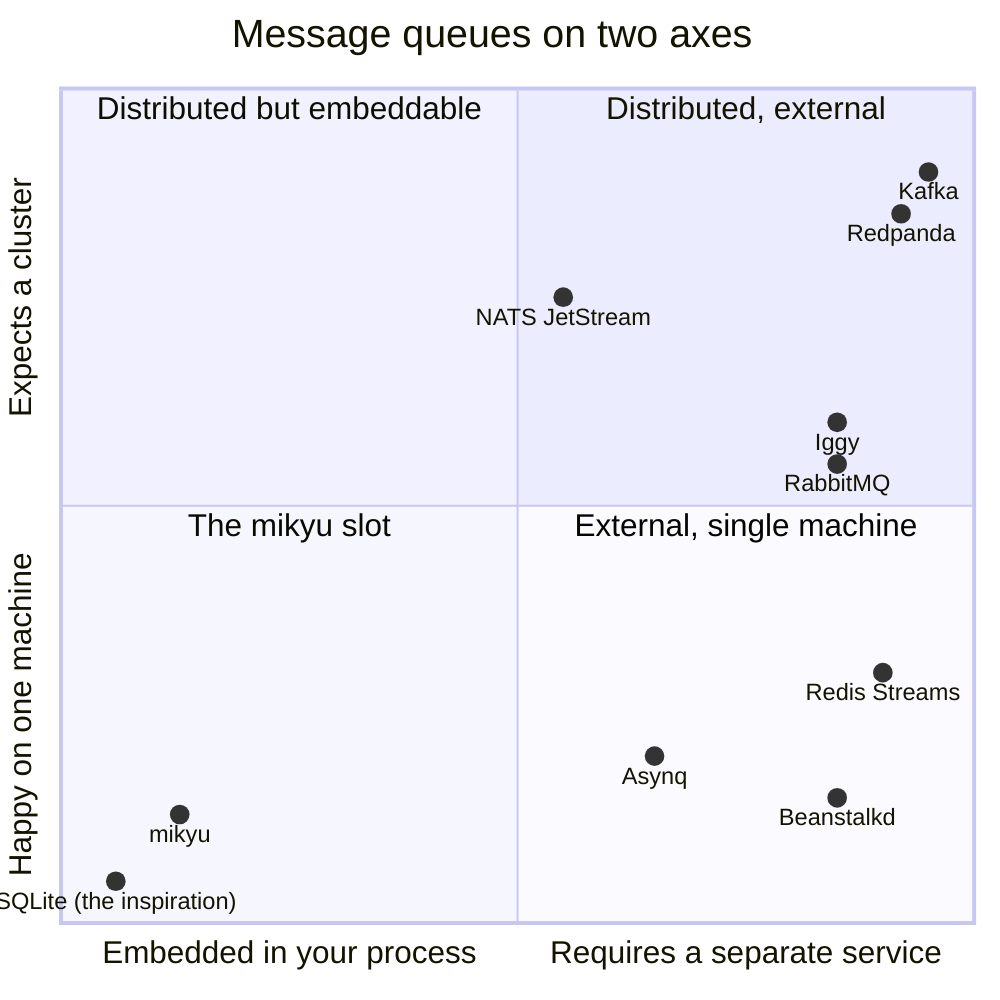

On this map, the interesting neighbor is SQLite: a complete database that lives inside your process. Mikyu aims at the same slot for queues, with a daemon mode available the day you outgrow embedding.

### 1.2 One engine, two kinds

The central move in the design is that a queue's kind is not a setting. It is the name of the directory the queue lives under. `log/events` and `task/events` are two different queues that share nothing but a filesystem tree, and nothing can confuse them, because the filesystem is the source of truth for what a queue is.

Both kinds sit on the same engine. The drivers are thin: a log queue adds consumer groups, streaming, and compaction; a task queue adds leases, scheduling, and checkpoints. Everything below them is shared.

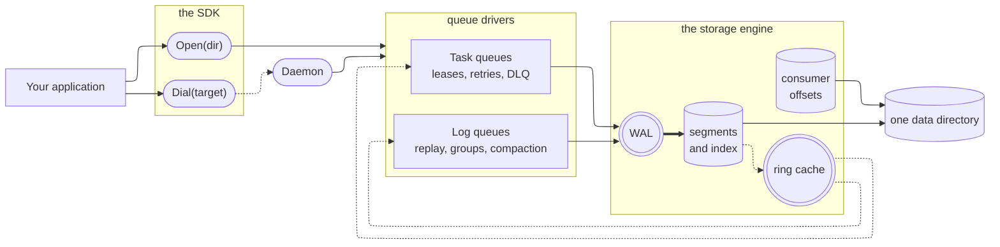

> **Why the kind lives on disk.** A spec field can drift out of sync with reality: someone moves a directory, restores from backup, or edits a config by hand. A directory cannot lie. When the node opens, it adopts orphan directories under the kind their path declares, so recovery is a filesystem walk, not a repair script.

### 1.3 The surface you call

Every operation goes through one interface, whether the queue is in your process or across a network. `mikyu.Open(dir)` embeds the engine in-process; `mikyu.Dial(target)` talks to a daemon. Both return the same `Client`, so the rest of your code does not change when your deployment does.

Queue access comes in three verbs per kind. `Log` and `Task` resolve an existing queue and never create one. `OpenLog` and `OpenTask` get or create, with options applying only at creation. `CreateLog` and `CreateTask` are strict creates that refuse duplicates. Three verbs instead of a create flag, because booleans are unreadable at the call site, and because each contract deserves its own name. The same reasoning keeps other semantics honest: `Dequeue` blocks until a task is due or your context is done (with `TryDequeue` as the explicit non-blocking form), and a task reference is a sealed union. Pass the full `Task` and the server checks the exact delivery identity (offset, attempt count, delivery ID) before accepting an ack; pass a bare `TaskID` for admin flows and the visibility rules still apply.

> **Offsets belong to the group, not the queue.** A consumer position is group state, so `Mark` (advance a monotonic high-water mark), `Commit` (persist it), and `Close` (idempotent, commits the final position) live on a `Group` handle and never clutter the queue interface. Two groups on one queue see independent positions; two queues in different kinds see independent offset stores.

Errors are stable sentinels with predicates over `errors.Is`: `IsNotFound`, `IsStale`, `IsFull`, `IsClosed`, `IsTooLarge`, `IsCorrupt`. They mean the same thing embedded and remote, which Part IV makes literal. A typed layer wraps both kinds with a `Codec[T]`, so you can work in your own Go types and still drop back to the raw interface through an escape hatch.

### 1.4 Life of a record

Here is the whole journey in one picture, before any of the machinery is opened up. A producer appends; the queue encodes the record, stamps a CRC, assigns an offset, and hands the bytes to the WAL; the WAL batches, and the writer makes them durable; the append returns; a consumer reads the record back from whichever tier holds it cheapest.

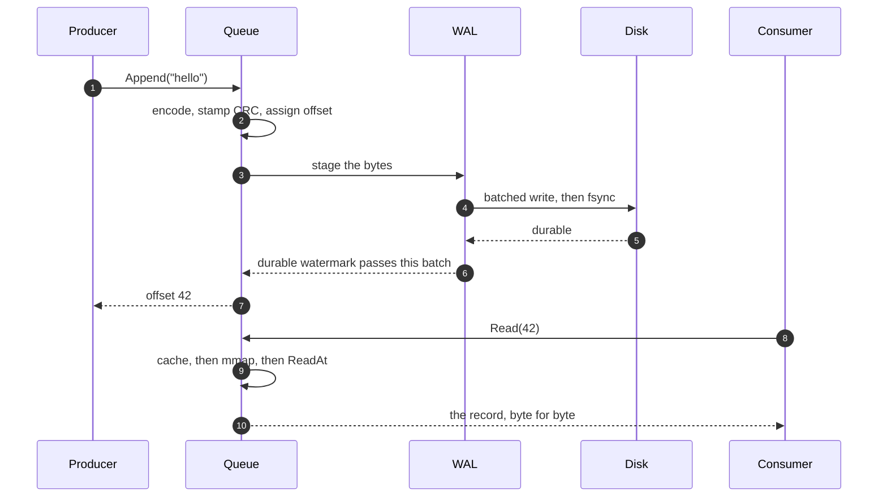

With durability set to `async`, the return happens earlier: the record becomes visible to readers immediately and is made durable in the background, which trades a small loss window on crash for much higher throughput. Part III explains both timings.

### 1.5 Life of a task

A task queue is a small state machine wearing an API. Enqueue puts a task in the log and schedules it. Dequeue hands a due task to one worker and starts a lease, which is the whole trick: while the lease holds, no other worker sees the task. Ack ends the story. A lease that lapses, or a nack, sends the task back to due after a backoff delay. A final attempt that fails sends it to the dead-letter queue instead.

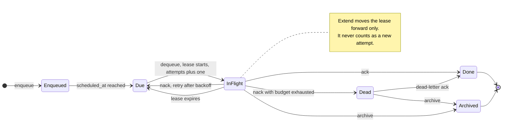

The dead-letter queue is durable, per queue, and bounded by `max_dead_letters`; when it overflows, the oldest entry is dropped and the event is counted, never silent. Archive moves a task into a companion log queue (`<queue>-archive`), where history is immutable and replayable by construction.

---

<a id="part-ii-how-it-runs"></a>

## Part II. How it runs

### 2.1 The repository at a glance

```
mikyu/
├── mikyu.go, client.go, logqueue.go, taskqueue.go   the public SDK: Open, Dial, the contract
├── types.go, errors.go, options.go, typed.go        value types, sentinels, options, the typed layer
├── adapter*.go                                      adapters implementing the contract over internal/client
├── cmd/mikyu/                                       one binary: daemon, cli, repl, bench, bench-child
└── internal/
    ├── spec/          one configuration table for every surface
    ├── iow/           bounded, ordered concurrent writes
    ├── engine/        WAL, segments, index, cache, offsets, encryption
    ├── queue/         logqueue, taskqueue, group, retention: the drivers
    ├── manager/       the kind-partitioned data directory
    ├── node/          the process-wide node: catalog, pool, lock, registry
    ├── client/        embedded and remote clients behind one type
    ├── server/        the wire server
    ├── transport/     protocol frames, opcodes, unix and pipe listeners
    ├── daemon/        daemon lifecycle, metrics HTTP
    ├── config/        the mikyu.yaml loader
    ├── metrics/       the telemetry model
    ├── errs/          the sentinel-to-wire-code taxonomy
    ├── bench/         the benchmark harness and its result envelope
    └── ui/            CLI, REPL, styled views, human formatters
```

The layering is not aspirational; it is enforced. `.go-arch-lint.yml` pins the allowed import edges, and a handful of packages (`spec`, `protocol`, `group`, `iow`, the UI primitives) sit at the bottom, importing nothing but the standard library. A dependency cycle cannot compile, so it also cannot merge.

### 2.2 Five roles, one binary

| Role | Entry point | Notes |
|---|---|---|
| Embedded engine | `mikyu.Open(dir, opts...)` | In-process node, no network, refcounted per data directory |
| Remote client | `mikyu.Dial(target, opts...)` | Pooled TCP, Unix socket, or Windows named pipe |
| Daemon | `mikyu daemon` | Long-lived server, optionally behind TLS and auth |
| CLI / REPL | `mikyu <cmd>`, `mikyu shell` | Stateless one-shot commands and a styled interactive shell |
| Bench harness | `mikyu bench run` | Spawns its own client, writes a run directory, renders the summary |

The five roles are not five builds. They are five entry points into the same code, which is why a queue created by the CLI is byte-identical to one created by the SDK, and why the bench harness can measure exactly what a user would experience.

### 2.3 Inside the data directory

Everything mikyu knows lives in one directory tree. There is no metadata server to consult and no state held anywhere else.

```
data/
├── mikyu.lock                 the process lock; a second node here fails fast
├── queues.json                the registry: names, kinds, per-queue specs
├── log/
│   ├── manager-offsets.dat    consumer-group offsets for every log queue
│   ├── events/
│   │   ├── 0000000000000000.log   append-only records
│   │   ├── 0000000000000000.idx   16-byte offset index entries
│   │   └── keys.dat               wrapped data key (encryption: aes only)
│   └── jobs-archive/          the archive log for task/jobs, created lazily
└── task/
    ├── manager-offsets.dat    independent offsets for task queues
    └── jobs/
        ├── *.log, *.idx       tasks, checkpoints, and DLQ records in one stream
        └── keys.dat
```

`mikyu.lock` is held exclusively for the life of the node, so two processes on the same directory fail immediately with a clear error instead of corrupting each other. `queues.json` is a config artifact rather than the truth: on open, the node reconciles it against the filesystem, purging entries whose directories vanished and adopting orphan directories with the kind their path declares. Notice that the offset store is per kind root, which is why a consumer group on `log/events` and one on `task/events` never see each other.

### 2.4 One table to configure them all

Every parameter mikyu has lives in one table: `spec.Table`. Each row carries the key, its type, its layer (call, spec, session), its scope (client, server, both), its mutability, its derived names in every syntax (`MIKYU_MAX_SEGMENT`, `--max-segment`, `WithMaxSegment`), and a doc string. The SDK options, the CLI flags, the environment variables, the YAML file, and the wire schema are all projections of that one table, so a new parameter is one row plus one setter, and every surface updates at once.

Values resolve through a strict precedence:

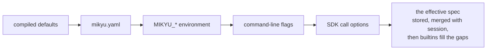

A later layer overrides an earlier one, and every value is validated where it is declared: byte sizes must be positive, retention bounds non-negative, `max_payload` must fit inside a segment minus record overhead, and cross-checks that span layers (a queue wants `encryption: aes` but the node holds no master keys, or `mtls` auth without TLS enabled) fail closed at the boundary that knows both sides. Some fields are create-only, `encryption` being the important one: flipping it after creation would silently mix plaintext and ciphertext records with no way to tell them apart, so it cannot be done.

---

<a id="part-iii-inside-the-engine"></a>

## Part III. Inside the engine

### 3.1 The record format

Every record is a fixed 36-byte header followed by the group and the payload. The layout is deliberately boring: fixed offsets, one CRC, no version field to grow into trouble.

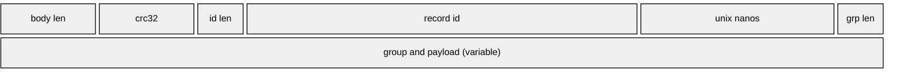

The CRC covers everything from byte 8 onward, so a torn tail or a flipped bit is detected at read time rather than trusted. The 16-byte ID is not a UUID: it is an 8-byte random prefix minted once per process and an 8-byte counter that increments per record. Unique across restarts, sortable, and free of per-record entropy costs.

When encryption is set to `aes`, the payload region holds a 12-byte nonce, the ciphertext, and a 16-byte GCM tag. The ciphertext *is* the payload: the CRC covers the sealed bytes, so the WAL, the index, memory-mapped reads, and compaction all treat it as opaque. Twenty-eight bytes per record buy a queue that no on-disk inspector can read without the keys. Section 4.4 shows where those keys live.

### 3.2 Segments and the index

A queue directory holds a sequence of segments. The active segment is preallocated on disk and appended to; when it crosses `max_segment` or `max_segment_age`, it is sealed, truncated to the length actually written, and mapped read-only with `mmap`, at which point reads of its records stop being syscalls and become memory accesses.

The preallocation size adapts to the workload. A segment that filled in under ten seconds doubles the next allocation, capped at 256 MiB; one that took more than five minutes halves it, floored at 8 MiB. The queue learns its producer's appetite instead of asking you to tune it.

Each index entry is 16 bytes: a byte position and a record length. Reading offset N is a binary search over segment base offsets, then an index lookup, then a read. On crash the index is rebuilt from the log, because the log is the truth and the index is a projection of it. That is also why the WAL's sync set names the log file and never the index: a valid log with a stale index recovers itself; the reverse would not.

### 3.3 The WAL and group commit

The WAL tracks two byte counts. `pushedBytes` counts what producers have staged; `publishedBytes` counts what the writer has made durable. An append returns when `publishedBytes` passes the sequence number its batch was handed at staging time. That is the entire durability contract, expressed in two integers.

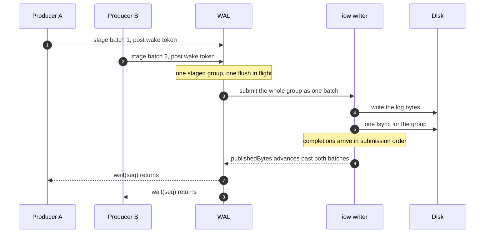

While one flush is in flight, producers keep staging. The next flush picks up everything that accumulated behind the previous completion, so under load a single fsync carries many producers' batches: that is group commit, and it is why write latency stays flat while concurrency grows. A flusher that ran ahead would flush each producer's batch alone and quietly trade group commits for fsyncs, so the design pins it to one flush at a time on purpose. When a staged batch is smaller than `max_flush_bytes`, the flusher first sleeps a short linger (an eighth of `max_flush_wait`) to let stragglers join the group.

The flusher's own loop is a small state machine, and reading it as one explains the subtler choices. It parks between batches, so a wake token is never spent on a batch it cannot write yet. It recycles staging buffers through a free list and drops the oversized ones, so steady-state flushing allocates nothing. And when a group's records tile their segment positions exactly, the whole group goes to the writer as one contiguous write instead of one write per record.

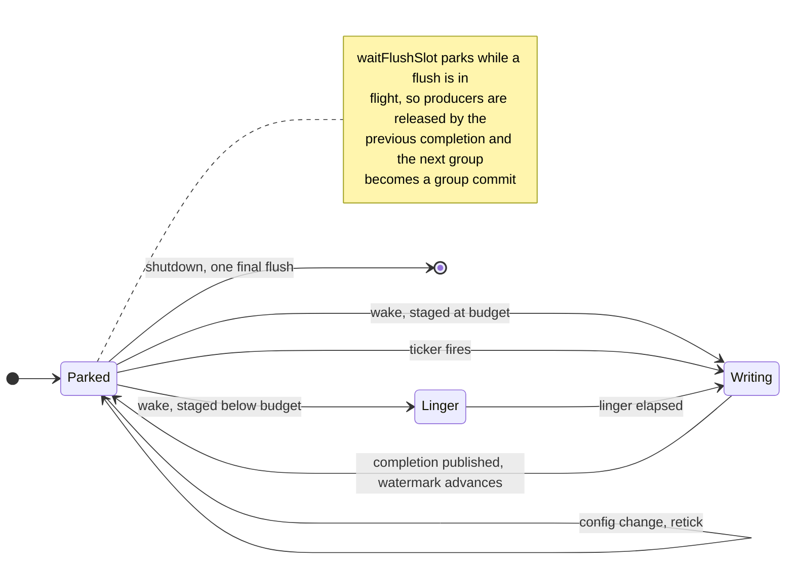

> **One writer per batch.** A batch is written by exactly one writer, and its completion callback fires exactly once, in submission order. That invariant lives in `iow` (Section 3.6) and it is what lets the byte watermark above exist without a reorder buffer anywhere in the engine.

### 3.4 The async reservation frontier

Under `async` durability, the append path changes shape. Producers reserve segment space and offsets under the queue lock, release the lock, and hand the batch to the flusher as one unit; the bytes land in the ring cache immediately, so readers see them before any fsync happens. The frontier is what keeps this honest.

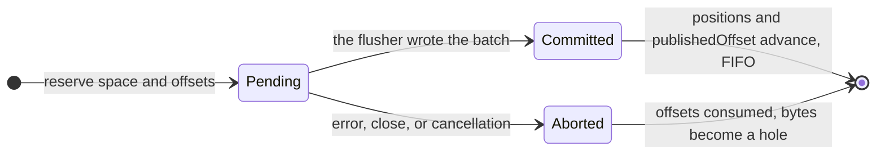

Segment positions and `publishedOffset` advance only over the committed prefix, in reservation order, so a segment is never sealed while an in-flight reservation could still land in it. A reservation that fails aborts: the offsets it took were already handed out, so they are consumed, but they contribute no bytes, leaving a small hole in the segment. A hole is cheaper than lying about offsets.

### 3.5 The read path

The cache is the first stop. It is a fixed budget of slots (sized from `max_cache`), each holding an atomic pointer to an immutable record. A lookup is a lock-free load with two checks: the slot must carry the requested offset and a non-zero timestamp. Readers never take the cache mutex and never observe a torn record, because a slot is cleared by pointer swap, never by mutation.

A cache miss locates the segment by binary search and reads from the memory map when the segment is sealed, or one positional read when it is not. Decoding validates the CRC and length; on sealed queues the payload is decrypted after decode, and a decryption failure reports as corruption, because that is what it is from the reader's chair.

Batch reads coalesce. Up to 4096 records or 4 MiB of dense span per run: one index read for the chunk's 16-byte entries, then a single dense read of the whole span, then per-record decoding out of that slice. Cache hits are drained first, so the run touches the disk only for genuine misses, and compacted offsets are skipped in place rather than served as errors.

When there is nothing to read yet, `Fetch` parks instead of polling:

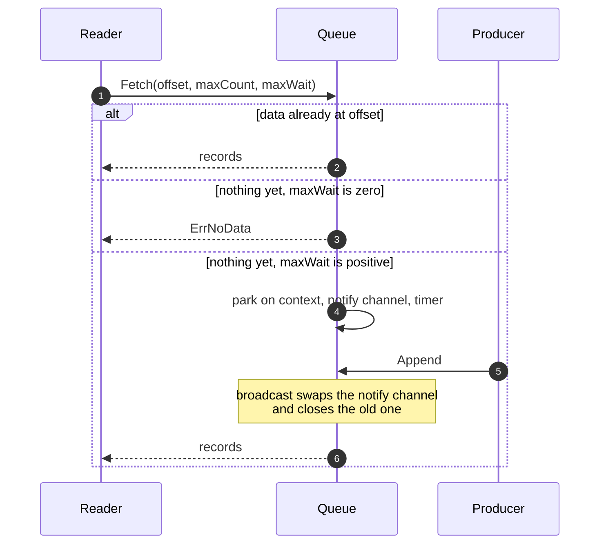

The broadcast is a channel swap: producers close the channel every parked reader is waiting on and hand out a fresh one. Nobody re-checks a flag in a loop, and no parked reader is ever missed or leaked.

Large payloads skip userland entirely on their way out. When a read range can be served entirely from sealed segments, the engine returns spans that carry a file handle and offset instead of bytes, and the server streams them with `sendfile` or `TransmitFile`. The path declines politely when it cannot hold: keyed compaction, sealed payloads, unflushed tails, anything below 16 KiB.

### 3.6 iow, the write primitive

Below the WAL sits `iow`, a package with one contract: a batch is written by exactly one writer, completions arrive in submission order, and a caller can therefore advance a monotonic durable watermark without a reorder buffer of its own. `New` picks the best writer the host offers:

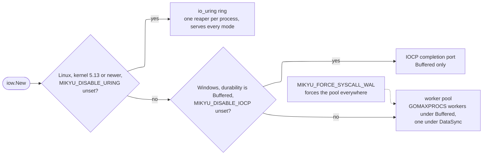

The portable pool runs everywhere: several worker goroutines under `Buffered` durability, exactly one under `DataSync`, because the kernel serializes fsyncs per file anyway and extra workers would only queue behind each other. The io_uring ring and the IOCP port are process-wide, single-reaper designs shared by every queue in the process, and both fall back to the pool the moment the host refuses them.

Ordering is restored by a tiny layer under both kernel paths. Every accepted batch takes a sequence number before submission. Completions land in whatever order the kernel hands them back; the order layer holds them and releases callbacks only along the frontier, invoking each callback *before* advancing it. Batch N's completion can never start before batch N-1's. Per-OS flush primitives differ where they must: `fdatasync` on Linux, `F_FULLFSYNC` on Darwin, `File.Sync()` elsewhere.

### 3.7 Compaction and retention

With compaction set to `keys`, each closed segment is rewritten in place after it rolls: records whose group has a newer version elsewhere are dropped, and their index slots are zeroed. Corrupt records are kept during the rewrite, because dropping one could delete the newest surviving version of a key. Every read re-checks the key index, so a superseded record still sitting inside a live memory map answers with `ErrRecordCompacted` instead of stale data.

Retention is coordinated rather than scattered. Each driver reports the oldest offset it can afford to lose: a log queue reports its minimum consumer-group position, and a task queue reports its checkpoint, lowered further by every in-flight task and every uncheckpointed dead letter that still anchors its record. The coordinator computes the policy floor from age and size, takes the stricter of the driver floors, and truncates only below that. Data a consumer has not finished with is safe from the retention clock by construction.

### 3.8 How the task queue remembers

A task queue keeps no side files. Its directory holds one log, and that log *is* the state: task records, dead-letter records, dead-letter acks, and the queue's own checkpoints all live in the same append-only stream, each with a one-byte kind tag. Recovery is therefore a replay: walk the log forward from the last checkpoint, rebuild the active map and the schedule heap, and refuse anything that is not a task record, because a non-task record in a task directory means this queue is not what it claims to be, and reinterpreting it would be worse than failing.

Since replay from the log's start would get slower forever, the queue periodically folds its entire in-memory state (every active task with its lease and attempt count, plus the whole dead-letter queue) into one self-describing checkpoint written through the same append path: a start record, the snapshot split into chunks sized to fit the append limit, and a commit record that states where the checkpoint began and how many chunks to expect. The writer even verifies its own arithmetic before declaring success: the commit must land exactly `totalChunks + 1` offsets after the start.

Recovery trusts nothing it was not forced to trust. The queue scans backward from the last offset looking for a commit record, and accepts one only when everything it implies checks out: the start record exists and agrees, every chunk is present, in order, and decodes, and the snapshot fits the size bound. The newest commit that survives the gauntlet wins; a torn or corrupt commit is not an error but a reason to try the one before it.

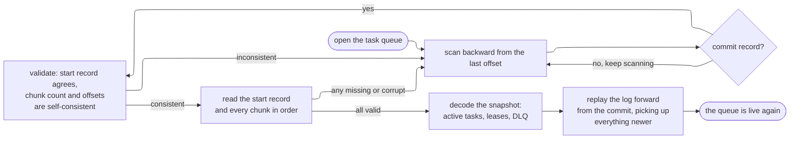

The design note is that checkpoints are data, not metadata. Because they ride the same WAL as everything else, they inherit the same durability, the same CRC checks, and the same truncation rules, and there is exactly one format to recover. A queue with a hundred million dead letters checkpoints in bounded chunks; a queue killed mid-checkpoint reopens from the previous one and loses nothing but the fold itself.

---

<a id="part-iv-across-the-wire"></a>

## Part IV. Across the wire

### 4.1 The node and the manager

A node is the process-wide owner of a data directory. It takes the lock first, then builds two engine managers, one per kind root, then fills a catalog with one driver entry per queue. Entries install their driver outside the node lock and close a `ready` channel when done, so a slow queue to open never blocks the others, and a queue that fails to open records a fault and bumps a metric rather than taking the node down. One bad queue is a warning; it is never an outage. A lookup that misses diagnoses itself: a name that exists under the other kind answers `ErrWrongKind` rather than a misleading not-found.

Embedded clients are refcounted per absolute directory. Five components calling `Open` on the same path share one node, agree on session defaults and the encryption key file, and the last `Close` tears everything down. A second `Open` that disagrees fails with a specific error rather than silently running a split-brain configuration inside one process.

### 4.2 The wire protocol

The wire is length-prefixed frames, big-endian, with a 256 MiB cap. The first byte after the length is the opcode, which also encodes the subsystem in its high nibble:

```
0x0X  admin   create, delete, list, update, describe, truncate, metrics, schema, shutdown
0x1X  log     append, append batch, read, read batch, last offset, min offset, commit, fetch
0x2X  task    enqueue, dequeue, ack, nack, extend, archive
0x3X  dlq     dead letters, dead-letter ack
0x7E  auth    the one handshake
0xFF  error   typed failures
```

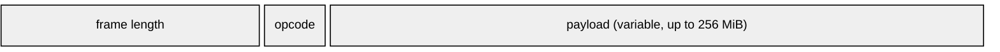

Authentication is one handshake per connection. The first frame must be `OpAuth`; the server verifies once, replies with an empty `OpAuth` frame, and everything after is plain operations. Token comparison is constant-time, and credentials read from a token file rather than argv, because a token on the command line leaks through the process table.

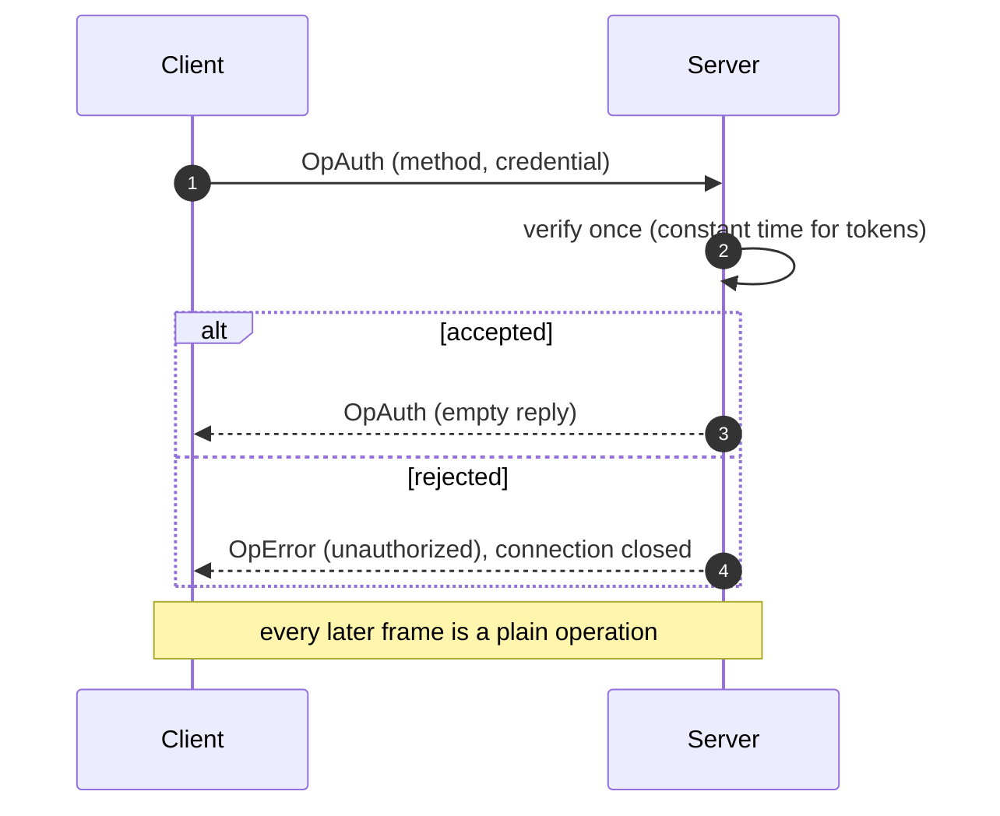

On the server side, one reader goroutine per connection feeds a dispatcher, which gives one frame of lookahead and natural backpressure: a fast client cannot outrun a slow handler, and a dead connection cancels its own long polls. Long polls are capped server-side (five minutes for fetches, thirty seconds for dequeues) so a client cannot park a handler forever.

### 4.3 Errors travel intact

A sentinel raised anywhere in the engine or the drivers crosses the wire and arrives as the same sentinel on the other side. The taxonomy maps each Go sentinel to a wire code, one to one, and the mapping is total: a test walks every source file, extracts every sentinel declared with `errors.New`, and fails the build if one is neither mapped nor explicitly declared off-wire.

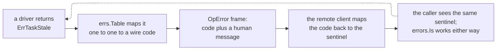

The server's detail text survives the trip too: the client appends it after the sentinel's own message, so `errors.Is(err, ErrImmutableField)` matches while the specific reason ("`max_segment` is immutable") is still there to read. Messages are human text and never contracts; the codes are the contract.

### 4.4 Sealed payloads

Payload sealing is envelope encryption. Master keys live outside the data directory, one hex key per line, with the last line wrapping any new data keys. Each queue owns a data key: 32 random bytes wrapped under a master key, with the queue's name bound as additional authenticated data. A `keys.dat` copied between queues fails authentication rather than silently decrypting the wrong data, and a queue that finds sealed data without its `keys.dat` fails closed, because that state is unrecoverable by design and pretending otherwise would be worse.

Rotation appends a master-key line. New data keys wrap under the new master, old generations still unwrap, and nothing is ever re-encrypted. Group, ID, and timestamp stay plaintext on purpose: keyed compaction, ID formatting, and metrics depend on them, and only the payload is confidential.

---

<a id="part-v-operating-and-building"></a>

## Part V. Operating and building

### 5.1 The bench harness

The bench harness is a client, not a driver. It opens embedded nodes, spawns daemons, or dials remotes through the public SDK and measures only what the SDK exposes; the engine carries no bench-specific code paths. Four modes cover the questions you actually ask: `produce` measures sustained write, `consume` measures read throughput against a preloaded queue, `mix` runs both at once, and `recovery` kills a writing child process mid-flight and measures the time to reopen, to first successful read, and to full recovery.

Payloads are a function of `(seed, offset)`, so a consumer can verify every record byte for byte without a side channel. A run records its ownership in `.bench-runs`, and a subsequent run reconciles stale state deterministically instead of leaking queues. Results are written incrementally: `series.csv` gets one unbuffered row per observation tick, and `result.json` is replaced by rename, so a killed run still leaves a readable, honestly incomplete envelope behind.

### 5.2 One observation surface

Everything measurable flows through one model. Instruments record into scopes named for their queue; a collector folds the scopes into a snapshot on a fixed interval, keeps a bounded history, and pushes to subscribers. The CLI's queue cards, the health states (healthy, degraded, critical), and the Prometheus exposition are all projections of that one snapshot, never parallel paths to the same numbers. Lock contention is telemetry too: the node's catalog lock and the engine's offset store are instrumented rwmutexes whose fast path is a `TryLock` and whose slow path contributes a timed sample, so contention shows up in the data without taxing the uncontended case.

### 5.3 Testing as specification

The tests do not only check behavior; they hold the design's vocabulary in place.

| Gate | What it holds the line on |
|---|---|
| Parity tests | Embedded and remote surfaces agree field for field, every operation and every error |
| Error taxonomy test | Every sentinel mapped to a wire code, or explicitly declared off-wire |
| Naming law | Retired vocabulary never returns on any verb path |
| Documentation gates | Every export documented; every spec row carries its doc string |
| synctest bubbles | Time-dependent behavior (wake tokens, leases, tickers) tested deterministically |
| goleak | Every goroutine-owning package verified clean at exit |
| iow parity | Every test runs against every writer the host can run: pool, ring, completion port |

### 5.4 Design decisions worth stealing

**Kind is a directory, not a field.** A config value can drift from reality; a directory cannot. Making the filesystem the source of truth for what a queue is bought crash recovery, orphan adoption, and honest error messages for the price of one `stat`.

**Three verbs instead of a create flag.** Resolve, get-or-create, and strict create are three different contracts. Giving each a name (`Log`, `OpenLog`, `CreateLog`) makes call sites read like intent instead of riddles, following the `os.Open` / `os.Create` precedent.

**Offsets belong to the group.** Consumer positions are group state. Keeping them off the queue interface kept the queue surface minimal and made multi-group replay free.

**One writer per batch, ordered completion.** The hardest problem in a concurrent WAL is turning out-of-order kernel completions back into a durable prefix. Solving it once, in `iow`, under all three backends, let the byte watermark everywhere above stay two integers.

**One flush in flight.** A flusher that runs ahead turns group commits into per-producer fsyncs. Pinning the flusher to one outstanding flush is what makes a busy WAL cheap.

**Random nonces over derived nonces.** Offset-derived nonces would collide across queues sharing a master key and would force encryption into the lock-holding staging loop. Random-nonce sealing runs in the lock-free encode path, and 28 bytes per record buy the simplicity.

**A sealed reference union.** Workers hold the full task and get the strict identity check; admin tools hold a bare ID and still respect visibility. One type, two trust levels, no boolean.

**Compaction is a log-only setting.** Task records are keyed by ID and interleaved with checkpoints; compacting them would corrupt recovery. Rejecting the combination at the boundary, in both the SDK and the node, turns a silent corruption into a startup error.

**The public surface is designed, not re-exported.** The root package declares its own interfaces and value types, with adapters bridging to the internals. Only the versioned data contracts (spec, telemetry) are aliases, because the wire format already owns them.

**The bench is a client.** If the harness cannot measure it through the SDK, users cannot feel it either. That rule has kept the engine honest about what its performance claims actually mean.

### 5.5 Glossary

| Term | Meaning |
|---|---|
| Kind | The structural type of a queue: `log` or `task`, named by its parent directory |
| Segment | One append-only `.log` file plus its 16-byte-per-record `.idx` |
| WAL | The write-ahead path: staging, batching, ordered writes, the fsync boundary |
| Durable watermark | `publishedBytes`: the byte count known to be on stable storage |
| Reservation | An async append's claimed space and offsets, resolved in FIFO order |
| Ring cache | A byte-budgeted slot array of atomic record pointers, read lock-free |
| Visibility lease | The window a dequeued task is hidden from other workers |
| Delivery identity | `(offset, attempts, delivery ID)`: what a strict ack must match |
| DLQ | The durable per-queue dead-letter queue for exhausted tasks |
| Checkpoint | The task queue's chunked, self-describing snapshot of active and dead-lettered state |
| Span | A zero-copy description of a payload: file handle, offset, length |
| Spec | A queue's configuration, resolved from the one parameter table |
