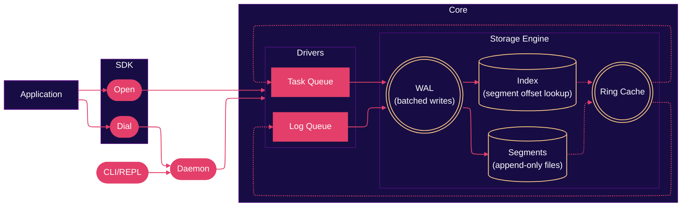

<p align="center">
  
</p>

<p align="center">
  <b>The complexity of building a message broker should not be the complexity of using one.</b>
</p>

<div align="center">

  
  
  

</div>

<br>

## &nbsp; The Problem
Durable messaging is powerful, but using it often means operating a cluster, configuring brokers, and learning a pile of distributed-systems concepts. That complexity is fine when you need it. It is a lot when you just want a queue. Tools like Kafka and NATS solve big problems. They also ask you to run infrastructure before you can write your first message.

mikyu asks a different question:

> Can an application get the useful parts of a durable log or task queue, while feeling as simple as a local database?

<br>

## &nbsp; The Solution
mikyu is a local-first, single-node messaging system. It is not a Kafka replacement and not a NATS clone. It is a durable storage engine with log and task semantics on top.

You start with a directory. You get a log queue, a task queue, or both.

### How it works



The same engine runs in two modes:

- **Embedded**: the engine lives in your process, like SQLite.
- **Daemon**: the engine runs in a separate process, reachable over TCP, Unix sockets, or named pipes. The daemon can be local or on another machine. The URL is the only thing that changes.

The application code stays the same. You point it at a directory or a daemon target.

Internally, mikyu uses a write-ahead log, memory-mapped reads, a ring cache, adaptive flushing, and careful batching. The goal is not to beat Kafka on distributed throughput. The goal is excellent performance from one process, with far less to operate.

<br>

## &nbsp; What mikyu Provides

**Log queues**

- Append-only streams
- Replay from any offset
- Tailing and streaming
- Consumer groups with persistent offsets
- Retention by age and size

**Task queues**

- At-least-once delivery
- Visibility leases
- Acknowledgements and negative acknowledgements
- Retries with backoff
- Scheduling
- Stale-lease protection
- Dead-letter queues
- Crash-recoverable task state

**Storage and deployment**

- WAL-backed durability
- Synchronous and asynchronous write modes
- mmap-backed reads
- In-memory caching
- Crash recovery
- Embedded, daemon, TCP, Unix sockets, Windows named pipes
- CLI, REPL, and a simple operator interface

<br>

## &nbsp; Getting Started

### Install

```bash
go get github.com/dmunish/mikyu
```

Or build the binary:

```bash
git clone https://github.com/dmunish/mikyu
cd mikyu
go build ./cmd/mikyu
```

### Embedded usage

```go
package main

import (
    "context"
    "fmt"
    "log"

    "github.com/dmunish/mikyu"
)

func main() {
    ctx := context.Background()

    db, err := mikyu.Open("./data")
    if err != nil {
        log.Fatal(err)
    }
    defer db.Close()

    // Log queue
    logQ, _ := db.CreateLogQueue(ctx, "events")
    offset, _ := logQ.Append(ctx, []byte("hello"))
    fmt.Println("appended at", offset)

    record, _ := logQ.Read(ctx, offset)
    fmt.Println("read:", string(record.Payload))

    // Task queue
    taskQ, _ := db.CreateTaskQueue(ctx, "jobs")
    task, _ := taskQ.Enqueue(ctx, []byte("send email"))
    delivered, _ := taskQ.Dequeue(ctx)
    fmt.Println("got task:", delivered.ID)

    if err := taskQ.Ack(ctx, delivered); err != nil {
        log.Fatal(err)
    }
}
```

### Daemon usage

Start a daemon:

```bash
mikyu daemon --target tcp://127.0.0.1:7420 --data-dir ./data
```

Then connect from another process:

```go
db, err := mikyu.Dial("tcp://127.0.0.1:7420")
```

The rest of the code remains the same.

### CLI

```bash
mikyu create --type log events
mikyu append events "hello world"
mikyu read events 0

mikyu create --type task jobs
mikyu enqueue jobs "send email"
mikyu dequeue jobs
```

<br>

## &nbsp; How It Compares

| | **mikyu** | **Kafka** | **NATS** | **SQLite** |
|---|---|---|---|---|
| Primary goal | Durable local messaging | Distributed log | Lightweight messaging | Embedded database |
| Deployment | One binary, one directory | Cluster | Server or cluster | One library |
| Operational complexity | Very low | High | Medium | Very low |
| Distributed | No | Yes | Yes | No |
| Replay and offsets | Yes | Yes | Limited | N/A |
| Task queues | Yes | No (needs extra tooling) | No (needs extra tooling) | N/A |
| Embedded mode | Yes | No | No | Yes |
| Daemon mode | Yes | Yes | Yes | No |

mikyu is not trying to replace Kafka or NATS. It is trying to make durable messaging feel like something you have, not something you operate.

<br>

## &nbsp; Roadmap

- [x] In-memory prototype with push/pull commands
- [x] Append-only log file writer, startup replay
- [x] Segments, indexes, retention
- [x] Fsync policy
- [x] Consumer groups
- [x] TCP, Unix sockets, Windows named pipes, TLS
- [x] CLI and REPL
- [x] Unified, extensive configuration
- [x] Help commands
- [x] Metrics collection
- [x] Benchmark utility
- [x] Performance improvements, platform-specific optimizations
- [ ] Encryption of data on-disk
- [ ] Block-striping experiment
- [ ] Btop-like TUI dashboard for observability/maintainence
- [ ] SDKs for Python, JS/TS, Rust and others
- [ ] More performance optimizations
- [ ] Automatic and dynamic configuration experiment
- [ ] Web dashboard

<br>

## &nbsp; Disclaimer

**MIKYU IS NOT READY FOR PRODUCTION YET!**

That's why I am not offering pre-built binaries for now. Bear with me while I am actively expanding test coverage, refining the API, and improving the on-disk format. Performance, stability and footprint are still being worked on. I would still welcome you to try it out, stress-test it, and report any bugs or issues.

<br>

## &nbsp; Acknowledgements
- [憂鬱](https://yu-utsu.bandcamp.com/), whose work directly influenced the aesthetics of mikyu
- Universtock for the banner background on [Unsplash](https://unsplash.com/photos/abstract-background-with-vertical-lines-and-glowing-circle-k-UAid_8pMY)
- The Go community for the tools and libraries that make this possible

mikyu is released under the [Apache License 2.0](LICENSE).

<br>

<p align="center">
  <sub>Made with &nbsp;<sub></sub>&nbsp; by dmunish</sub>
</p>