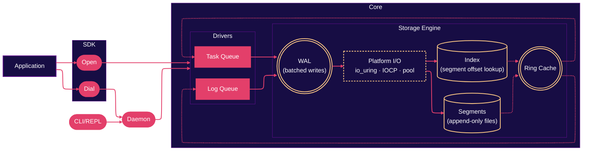
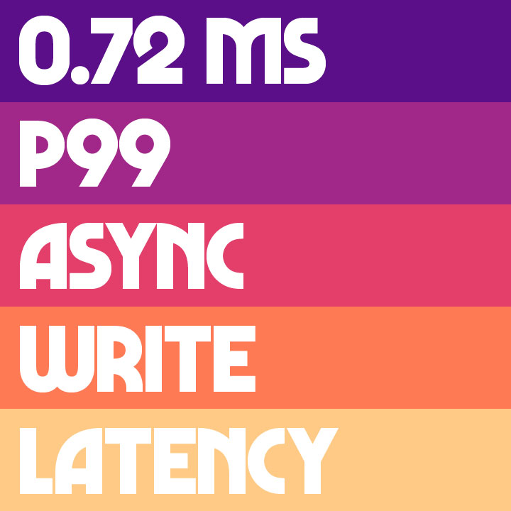
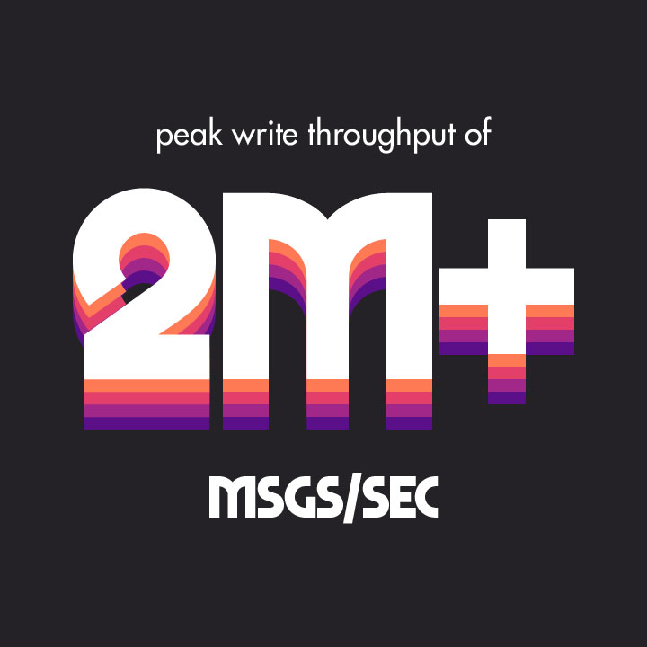

<p align="center">
  
</p>

<p align="center">
  <b>The complexity of building a message broker should not be the complexity of using one.</b>
</p>

<div align="center">

  
  
  

</div>

<br>

mikyu is an embedded-first durable message queue. You point it at a directory, open a log queue or a task queue, and start using it. It can run inside your own process the way SQLite does, or as a separate daemon that other processes talk to over TCP, Unix sockets, or Windows named pipes.

Underneath sits a log-structured storage engine: a write-ahead log for appends, memory-mapped segments for reads, a small ring cache for recent records, and consumer offsets in a side file. The goal is to give you replay, durability, and consumer groups without asking you to run a cluster.

## &nbsp; Architecture



Log queues and task queues sit on the same engine. A queue's kind comes from where it lives on disk, so `log/events` and `task/events` are two different queues that happen to share a filesystem. You pick the semantics you want per queue without running two systems.

**Log queues** are append-only streams. You append, you read from any offset, you can tail. Consumer groups track their own progress. Old segments get compacted by key or dropped by a retention rule.

**Task queues** are at-least-once work queues. Dequeue hands you a task with a visibility lease. Ack it and it's done. Let the lease expire and it comes back, with backoff, until it hits the attempt limit and lands in a per-queue dead-letter queue.

## &nbsp; Quickstart

### Install

As a library:

```bash
go get github.com/dmunish/mikyu
```

For the CLI/daemon, install from source:

```bash
go install github.com/dmunish/mikyu/cmd/mikyu@latest
```

### Usage

#### Embedded
```go
package main

import (
    "context"
    "fmt"
    "log"

    "github.com/dmunish/mikyu"
)

func main() {
    ctx := context.Background()

    mq, err := mikyu.Open("./data")
    if err != nil {
        log.Fatal(err)
    }
    defer mq.Close()

    // Log queue
    logQ, _ := mq.CreateLogQueue(ctx, "events")
    offset, _ := logQ.Append(ctx, []byte("hello"))
    fmt.Println("appended at", offset)

    record, _ := logQ.Read(ctx, offset)
    fmt.Println("read:", string(record.Payload))

    // Task queue
    taskQ, _ := mq.CreateTaskQueue(ctx, "jobs")
    task, _ := taskQ.Enqueue(ctx, []byte("send email"))
    delivered, _ := taskQ.Dequeue(ctx)
    fmt.Println("got task:", delivered.ID)

    if err := taskQ.Ack(ctx, delivered); err != nil {
        log.Fatal(err)
    }
}
```

#### Daemon

Start one:

```bash
mikyu daemon --target tcp://127.0.0.1:7420 --data-dir ./data
```

Connect to it from another process:

```go
mq, err := mikyu.Dial("tcp://127.0.0.1:7420")
```

`Open` and `Dial` return the same interface, so the rest of your code doesn't change. Where the daemon actually runs is up to you. Same machine, another machine, a container, the client doesn't care.

#### CLI

```bash
mikyu create --type log events
mikyu append events "hello world"
mikyu read events 0

mikyu create --type task jobs
mikyu enqueue jobs "send email"
mikyu dequeue jobs
```

## &nbsp; Performance

mikyu's core is optimized so that you don't have to choose between performance and simplicity.
<table>
  <tr>
    <td width="33%"></td>
    <td width="33%"></td>
    <td width="33%"></td>
  </tr>
</table>

<details>
<summary>Details</summary>

These numbers are from the built-in benchmark harness at its default settings (except total data size). They can be reproduced with running `./mikyu bench run --bytes 10GiB` on the binary.

### Device
- OS    : macOS 26.6.2 (25G83)
- CPU   : Apple M2 Pro (10 cores / 10 threads)
- RAM   : 16.0 GB Unified Memory
- Disk  : 512GB SSD

### Test configuration
- Workers     : 8
- Access      : embedded
- Durability  : async
- Message size: 1 KiB
- Total bytes : 10 GiB
- Batch size  : 64
- Queues      : 1

</details>

## &nbsp; Features

**Log queues**
- Append-only streams, replay from any offset
- Tailing and streaming
- Consumer groups with persistent offsets
- Keyed compaction, retention by age or size

**Task queues**
- At-least-once delivery with visibility leases
- Ack, nack, and delayed retries with backoff
- Scheduling and stale-lease protection
- A durable dead-letter queue per queue

**Across both**
- WAL-backed durability, sync or async
- mmap reads and an in-memory cache
- Embedded, daemon, TCP, Unix, pipe, TLS
- Rich metrics available across HTTP, SDK and CLI
- One configuration surface for every mode

## &nbsp; Comparison

The closest peers are log brokers on one side and task queue systems on the other. mikyu overlaps with both without fully replacing either.

### Log and event streaming

| | mikyu | Kafka | NATS JetStream | Iggy | Redpanda |
|---|---|---|---|---|---|
| Embeddable in your process | yes | no | yes | no | no |
| Runs on Linux, macOS, Windows | yes | Linux and macOS (Windows community) | yes | Linux (Docker or WSL elsewhere) | Linux (Docker or WSL elsewhere) |
| Standalone binary | yes | no | yes | yes | yes |
| Distributed consensus | no | yes | yes | yes | yes |
| Replay with offsets | yes | yes | yes | yes | yes |
| Task queue semantics | built in | no | no | no | no |
| Operates well on one machine | yes | possible, not the goal | yes | yes | possible, not the goal |

### Task and work queues

| | mikyu | RabbitMQ | Asynq | Beanstalkd | Redis Streams |
|---|---|---|---|---|---|
| Embeddable in your process | yes | no | Go library only | no | client library only |
| Runs on Linux, macOS, Windows | yes | yes | yes | Unix only | yes |
| Standalone binary | yes | no | no | yes | no |
| Distributed consensus | no | yes | no | no | no |
| Dead letter queue | built in | via DLX | built in | no | no |
| Delayed retries with backoff | built in | via plugin | built in | built in | no |
| Long-poll dequeue | built in | no | no | no | XREAD BLOCK only |

None of this is a claim that mikyu beats any of them. Most of those systems solve problems mikyu doesn't touch at all, like replication, consensus, and multi-node failover. If you need those, use them. mikyu is for the case where you don't, and you'd rather not run a cluster just to get a queue.

## &nbsp; Roadmap

- [x] In-memory prototype with push/pull commands
- [x] Append-only log file writer, startup replay
- [x] Segments, indexes, retention
- [x] Fsync policy
- [x] Consumer groups
- [x] TCP, Unix sockets, Windows named pipes, TLS
- [x] CLI and REPL
- [x] Unified, extensive configuration
- [x] Help commands
- [x] Metrics collection
- [x] Benchmark utility
- [x] Performance improvements, platform-specific optimizations
- [x] Encryption of data on-disk
- [ ] Comprehensive documentation
- [ ] Block-striping experiment
- [ ] Btop-like TUI dashboard for observability and maintenance
- [ ] SDKs for Python, JS/TS, Rust and others
- [ ] More performance optimizations
- [ ] Automatic and dynamic system configuration experiment
- [ ] Web dashboard

## &nbsp; Disclaimer

**MIKYU IS NOT READY FOR PRODUCTION YET!**

That's why I am not offering pre-built binaries for now. Bear with me while I am actively expanding test coverage, refining the API, and improving the on-disk format. Performance, stability and footprint are still being worked on. I would still welcome you to try it out, stress-test it, and report any bugs or issues.

## &nbsp; Acknowledgements

- [憂鬱](https://yu-utsu.bandcamp.com/), whose work directly influenced the aesthetics of mikyu
- [Universtock](https://unsplash.com/photos/abstract-background-with-vertical-lines-and-glowing-circle-k-UAid_8pMY) for the image used in the banner
- The Go community for the tools and libraries that make this possible

mikyu is released under the [Apache License 2.0](LICENSE).

<p align="center">
  <sub>Made with &nbsp;<sub></sub>&nbsp; by dmunish</sub>
</p>